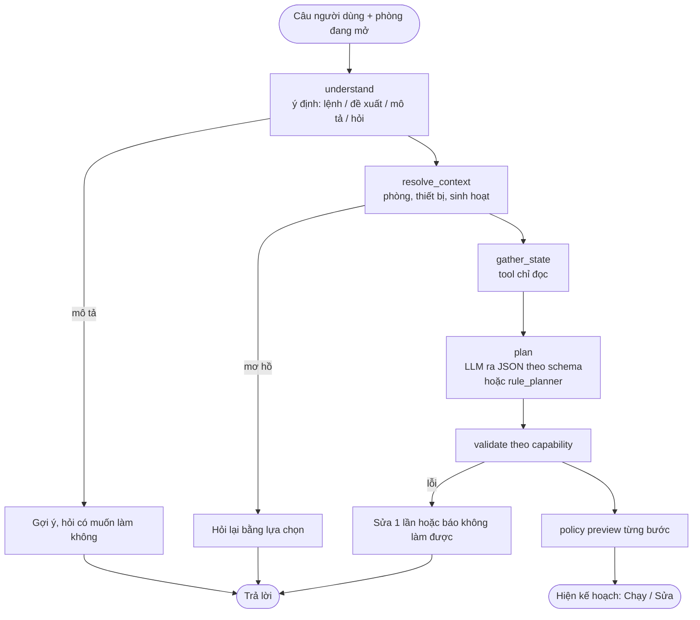

# AI Agent Design

> **Tóm tắt.** Agent hiện chỉ là mẫu. Thiết kế: AI chỉ **đề xuất** kế hoạch, policy **quyết định**, người dùng **bấm Chạy**.

**Trạng thái:** agent hiện có (`src/smarthome/agent/`) chỉ là mẫu LangGraph nhận diện chào hỏi bằng từ khóa. Thiết kế dưới đây là
**Kế hoạch P0-15** (planner) và **P1-04** (memory). Đường điều khiển mà agent sẽ dùng (`ControlService` với
`Origin.AGENT`) **đã có**.

## 1. Phân tách trách nhiệm

| Lớp | Làm | Không làm |
|---|---|---|
| **AI Agent** (`smarthome.agent`) | Hiểu câu nói, xác định ngữ cảnh, đọc trạng thái, lập kế hoạch, giải thích | Gọi gateway; quyết định cho phép |
| **Policy** (`smarthome.control.policy`) | Quyền, capability, giá trị, offline, xác nhận | Gọi LLM |
| **Execution** (`smarthome.control.execution`, scene ở P0-14) | Gửi lệnh, xác minh, timeout, audit | Suy luận |

Đầu ra của LLM luôn bị coi là dữ liệu chưa kiểm chứng cho tới khi qua validate và policy.

## 2. Graph mục tiêu



Thực thi **không** nằm trong graph. Người dùng bấm "Chạy" → API `POST /homes/{id}/plans/{plan_id}/run` (P0-14/15) → scene
executor → `ControlService.submit(..., origin=agent)` từng bước → kết quả theo bằng chứng.

## 3. Schema kế hoạch

```json
{
  "intent": "prepare_room",
  "room_id": "room-living",
  "summary": "Chuẩn bị phòng khách đón khách",
  "steps": [
    {"device_id": "dev-living-light", "capability": "brightness", "value": 80, "why": "Đủ sáng để tiếp khách"},
    {"device_id": "dev-living-ac", "capability": "target_temperature", "value": 26, "why": "Phòng đang 30.5°C"}
  ],
  "questions": []
}
```

Mỗi `step` chính là một `CommandRequest`. Validate: `device_id` tồn tại trong nhà, capability có và ghi được, giá trị hợp lệ.

## 4. Tools

| Tool | Loại | Nội dung |
|---|---|---|
| `list_rooms` | đọc | Phòng của nhà người dùng |
| `get_device_states(room_id?)` | đọc | `DeviceView` rút gọn (tên, capability, giá trị, status) |
| `get_preferences(room_id, activity)` | đọc | P1-04 |
| `propose_plan(plan)` | ghi vào bộ nhớ hội thoại | Không đổi thiết bị nào |

Không có tool `execute`, `unlock`, `call_service`. Tool chỉ thấy dữ liệu của nhà người gọi.

## 5. Fallback khi không có LLM

`rule_planner`: từ khóa + từ điển phòng/thiết bị cho lệnh đơn giản ("bật/tắt đèn phòng khách", "đặt điều hòa 26 độ",
"đóng rèm"). Đủ cho US-A5. Câu phức tạp → trả lời "cần kết nối Trợ lý AI" và gợi ý điều khiển trực tiếp.

## 6. Chống prompt injection

- Tên thiết bị, tên phòng, thuộc tính HA, nội dung memory là **dữ liệu không đáng tin**: đưa vào prompt trong khối dữ liệu
  có đánh dấu, không ghép vào chỉ dẫn hệ thống.
- Kế hoạch luôn qua validate + policy, nên văn bản bị chèn không thể tạo quyền mới.
- Hành động nhạy cảm vẫn cần chủ nhà xác nhận dù agent "được bảo" là đã có phép.
- Eval có ca tên thiết bị chứa chỉ dẫn giả (P0-15).

## 7. AI Memory (P1-04)

| Thuộc tính | Thiết kế |
|---|---|
| Phạm vi | `personal` (một người) hoặc `household` (cả nhà) |
| Khóa | `(scope, owner_user_id?, room_id, activity)`, ví dụ (personal, user-a, phòng khách, xem phim) |
| Nội dung | Danh sách `{device_id, capability, value}` + nguồn ("người dùng nói ngày…") |
| Ghi | Chỉ khi người dùng chọn "Lưu" rõ ràng; không tự suy luận và lưu |
| Đọc, sửa, xóa | Màn Sở thích; personal chỉ chủ của nó thấy; household thì thành viên thấy, owner sửa |
| Nhạy cảm | Không lưu thông tin sức khỏe, lịch vắng nhà chi tiết, vị trí; không đưa memory người khác vào prompt |

## 8. Hiệu năng

LLM gọi async có timeout (đề xuất 8 s); không chặn điều khiển trực tiếp vì chạy trong task riêng và điều khiển trực
tiếp không đi qua agent. Tiến trình dài hiện qua WebSocket (P0-08).
