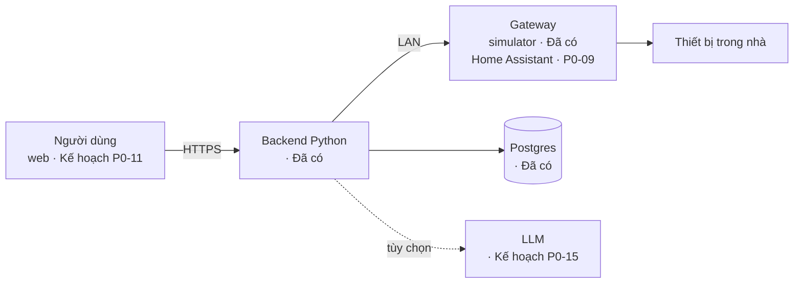
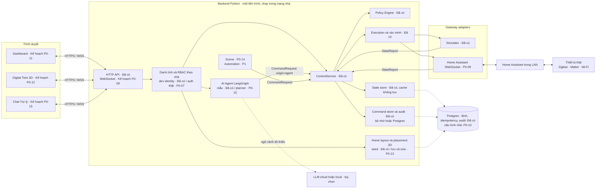
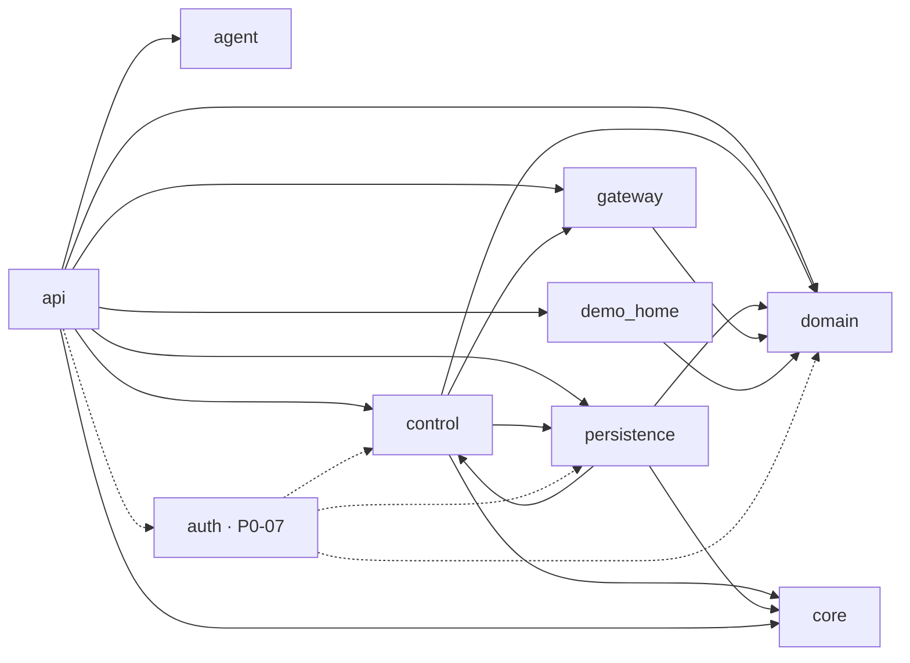
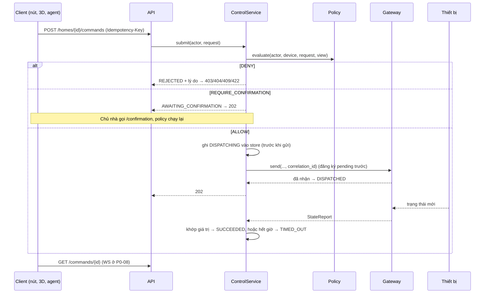
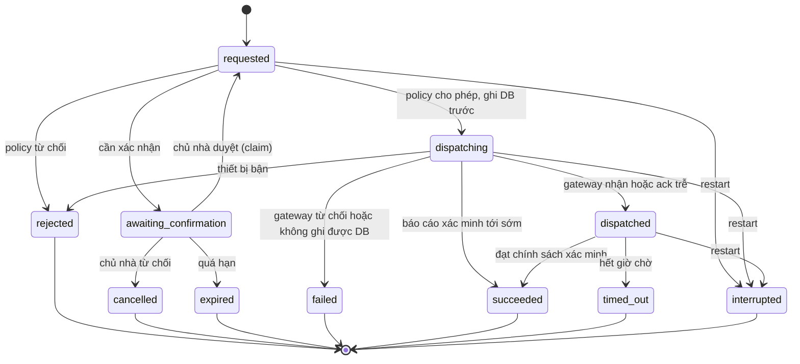
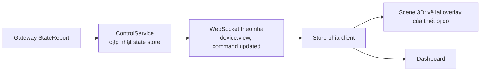

# Kiến trúc tổng thể

> **Tóm tắt.** Một backend Python chạy trong mạng nhà. Mọi nguồn lệnh (nút, 3D, AI, automation) đi qua cùng `ControlService` →
> Policy → Gateway, và chỉ thành công khi thiết bị báo lại. **Đã có:** domain, policy, execution, simulator, Postgres
> store, REST API. **Kế hoạch:** đăng nhập, WebSocket, Home Assistant, web, 3D, agent.

**Trạng thái:** kiến trúc mục tiêu. Mỗi thành phần ghi rõ **Đã có** (có code và test) hoặc **Kế hoạch** (mã task trong
[ROADMAP.md](ROADMAP.md)). Cập nhật 2026-11-23.

## 1. Nguyên tắc

1. **Một đường điều khiển duy nhất.** Nút bấm trên dashboard, điểm bấm trên mô hình 3D, AI Agent và automation đều tạo
   `CommandRequest` và đi qua cùng `ControlService` → Policy → Gateway. Không có đường tắt.
2. **Chỉ báo thành công khi có bằng chứng.** `202 Accepted` nghĩa là đã nhận lệnh. `SUCCEEDED` chỉ có khi thiết bị báo lại
   giá trị khớp lệnh. Hết thời gian chờ là `TIMED_OUT` (chưa xác minh), không phải thành công.
3. **AI đề xuất, policy quyết định.** LLM không bao giờ gọi gateway. Policy là hàm thuần, xác định, có test.
4. **Local-first.** Backend chạy trong mạng nhà, nói chuyện trực tiếp với Home Assistant trong LAN. LLM cloud là tùy chọn;
   mất Internet thì điều khiển trực tiếp và automation vẫn chạy.
5. **3D là một view.** Digital Twin đọc trạng thái và gửi lệnh qua API như mọi client khác. Nó không biết gateway là gì.
6. **Monolith có module rõ ràng.** Một tiến trình Python (API và agent chung tiến trình), tách module theo trách nhiệm. Chỉ tách service khi có
   số đo cho thấy cần.

## 1b. Tổng quan một hình

*Hình 1. Ngữ cảnh hệ thống. Chi tiết từng module ở §2.*

## 2. Thành phần

*Hình 2. Thành phần chi tiết và trạng thái triển khai.*

## 3. Ranh giới module (mã nguồn)

| Module | Trách nhiệm | Được import | Không được import |
|---|---|---|---|
| `smarthome.domain` | Home, Floor, Room, Device, Capability, Placement, trạng thái quan sát, `DeviceView` | pydantic | mọi module khác |
| `smarthome.gateway` | Hợp đồng `DeviceGateway`, `StateReport`; adapter simulator, HA | `domain` | `control`, `api`, `agent` |
| `smarthome.control` | Policy, vòng đời lệnh, xác minh, xác nhận; định nghĩa `CommandRecord`, `AuditEvent` | `domain`, `gateway.base`, `persistence.base/memory`, `core.logging` | `api`, `agent`, FastAPI |
| `smarthome.persistence` | `CommandStore` (bộ nhớ, Postgres), migration, CLI | `control.commands`, `control.audit`, `domain`, `core` | `api`, `agent`, `gateway`, FastAPI |
| `smarthome.agent` | Hiện: mẫu chào hỏi. Mục tiêu: hiểu câu nói, lập kế hoạch, tool đọc trạng thái | hiện: chỉ `agent`; mục tiêu: `domain`, `control` (qua facade) | `gateway`, FastAPI |
| `smarthome.api` | HTTP/WS, danh tính, ánh xạ lỗi sang mã HTTP | tất cả ở trên | — |
| `web/` (P0-11) | Dashboard, 3D, chat | chỉ HTTP/WS API | — |

*Hình 2b. Phụ thuộc giữa các package. Nét liền: đã kiểm bằng cách đọc import của mã nguồn (commit `0461606`). Nét đứt:
**kế hoạch**, chưa có code. `domain` và `core` không import package nào khác của `smarthome`; `agent` chỉ import chính nó.*

`control` và `persistence` phụ thuộc hai chiều ở mức package: `persistence` lưu các model do `control` định nghĩa
(`control.commands`, `control.audit`), `control` dùng giao diện `CommandStore`. **Không tạo vòng import ở mức file** (đã kiểm
bằng đồ thị import 39 module); chấp nhận cho P0, xem DR-L06 trong [Design Review](DESIGN_REVIEW_2026-11.md). Vòng duy nhất
tìm thấy là `agent/__init__` ↔ `agent/graph` (DR-L09): chạy được vì `nodes` là submodule, mã scaffold có sẵn, ghi nhận không sửa.

Sprint 1 thêm: `MembershipSource` (giao diện do `control` định nghĩa, `persistence`/`auth` cài đặt) thay dict thành viên tĩnh
trong `ControlService`; `persistence.home_config` và model `GatewayConnection` + `validate_home_config` trong `domain`
(P0-06b). Chi tiết: [LLD P0-06](lld/P0-06_PERSISTENCE.md), [LLD P0-07](lld/P0-07_AUTH_RBAC.md).

## 4. Luồng điều khiển thiết bị (Đã có)

*Hình 3. Luồng một lệnh qua API, policy, gateway.*

*Hình 4. Vòng đời `CommandStatus` (khớp `src/smarthome/control/commands.py` và `execution.py`). `timed_out` và
`interrupted` nghĩa là **chưa xác minh**, không phải thất bại.*

Ba mốc được phân biệt rõ: **API đã nhận** (`REQUESTED`/202), **gateway đã nhận** (`DISPATCHED`), **thiết bị đã xác nhận**
(`SUCCEEDED`). Trong lúc chờ, `DeviceView` giữ giá trị đã báo gần nhất và hiện `pending_value` bên cạnh.

## 5. Luồng AI Agent (Kế hoạch P0-15)

```mermaid
flowchart LR
    msg["Câu tiếng Việt"] --> intent["Hiểu ý định<br/>LLM hoặc luật"]
    intent --> ctx["Xác định phòng, ngữ cảnh"]
    ctx --> read["Tool đọc trạng thái<br/>chỉ đọc"]
    read --> plan["Kế hoạch có cấu trúc<br/>danh sách CommandRequest"]
    plan --> validate["Validate theo capability"]
    validate --> preview["Policy xem trước từng bước"]
    preview --> show["Hiện kế hoạch · người dùng bấm Chạy"]
    show --> run["Scene executor → ControlService<br/>origin=agent"]
    run --> report["Báo kết quả theo bằng chứng"]
```

LLM chỉ có tool đọc và tool `propose_plan`. Không có tool nào thực thi. Thực thi bắt đầu từ một request riêng của người dùng
("Chạy"), đi qua policy với `origin=agent`. Chi tiết: [AI_AGENT_DESIGN.md](AI_AGENT_DESIGN.md).

## 6. Luồng cập nhật 3D (Kế hoạch P0-08, P0-12)

Mô hình 3D không suy ra trạng thái từ lệnh đã gửi. Nó chỉ vẽ `DeviceView.capabilities[].status/value/pending_value`.

## 7. Luồng kiểm soát an toàn

| Lớp | Cơ chế | Trạng thái |
|---|---|---|
| Danh tính | Thành viên của đúng nhà; người ngoài nhận 404 | ✅ Đăng nhập thật (phiên phía server, CSRF) và danh tính dev chỉ ở `local`/`test` ([LLD P0-07](lld/P0-07_AUTH_RBAC.md)) |
| Thành viên động | Vai trò tra DB mỗi request và mỗi lần duyệt lệnh (`MembershipSource`); người duyệt được đọc lại lúc bấm (DR-H08 đã đóng) | ✅ `control/membership.py`, `auth/store.py`, `test_membership_source.py`, `test_auth_api.py` |
| Cổng môi trường | Chỉ `local`/`test` được dễ dãi (bộ nhớ, danh tính dev, seed-demo, `/docs`, route simulator); `Literal` từ chối giá trị lạ (DR-H03 đã đóng) | ✅ `core/config.py`, `test_environment_gate.py` |
| Default-deny | Mọi route trừ `/health`, `login`, `logout` cần phiên, gồm `/api/v1/agent/invoke` | ✅ `api/security.py`, `test_every_route_is_denied_without_a_session` |
| Capability | Thiết bị có hỗ trợ không, có ghi được không, giá trị có hợp lệ không | Đã có |
| Vai trò | `min_role` theo capability (khách không điều khiển được) | Đã có |
| Kết nối | Thiết bị offline → từ chối, không gửi mù | Đã có |
| Xác nhận | Fail-closed: capability `HIGH_POWER`/`SECURITY` cần xác nhận cho mọi giá trị trừ `safe_values`; chủ nhà xác nhận phía server, có hạn, dùng một lần (claim nguyên tử), chạy lại policy | Đã có |
| Automation | Không được thực hiện thao tác cần xác nhận | Đã có |
| Chống trùng | `Idempotency-Key` + fingerprint (khác nội dung → 409); một lệnh đang gửi mỗi thiết bị + capability (bộ nhớ và unique index DB) | Đã có |
| Xác minh | Báo cáo phải được state store chấp nhận (không sai thứ tự), khớp giá trị, và có correlation đúng hoặc không cũ hơn lúc gửi | Đã có |
| Khôi phục | Lệnh dở dang khi restart → `interrupted`, không gửi lại; đối soát sau snapshot. Chỉ một backend được dùng một DB (advisory lock), để recovery không đóng nhầm lệnh của tiến trình khác | Đã có |
| Lỗi lưu trữ | Ghi trước khi gửi phải thành công, nếu không thì không gửi (`503 STORE_UNAVAILABLE`); ghi sau khi gửi là best effort, có log, không làm kẹt thiết bị; store tự kết nối lại ở lần gọi sau | Đã có |
| Chống bật/tắt liên tục | Cooldown, hysteresis, giới hạn tần suất | P1 (AUTOMATION_ENGINE.md) |
| Audit | Mọi chuyển trạng thái của lệnh; Postgres chặn UPDATE/DELETE bằng trigger | Đã có |

## 8. Triển khai mục tiêu (local-first)

Chi tiết, sơ đồ và hiện trạng đã kiểm: [DEPLOYMENT.md](DEPLOYMENT.md), [ADR 0008](adr/0008-local-deployment-topology.md).

| Thành phần | Chạy ở đâu |
|---|---|
| Home Assistant | Thiết bị riêng trong nhà (HA OS/mini PC), do chủ nhà quản lý |
| Backend + Postgres + web tĩnh | Docker Compose trên cùng mini PC hoặc máy khác trong LAN |
| Truy cập từ xa | Tùy chọn qua VPN/tunnel; không mở cổng trực tiếp |
| LLM | Cloud qua API key (tùy chọn) hoặc model local; khi không có, agent dùng bộ lập kế hoạch theo luật |

## 9. API contracts

Hợp đồng HTTP hiện có: [api/control-api.md](api/control-api.md). Thiết kế API đăng nhập: [LLD P0-07](lld/P0-07_AUTH_RBAC.md#6-api).
Realtime: [ADR 0007](adr/0007-realtime-websocket-per-home.md) (Proposed). Schema dữ liệu: [DATABASE_DESIGN.md](DATABASE_DESIGN.md).

## 10. Tài liệu liên quan

[DIGITAL_TWIN_3D.md](DIGITAL_TWIN_3D.md) · [IOT_INTEGRATION.md](IOT_INTEGRATION.md) ·
[AI_AGENT_DESIGN.md](AI_AGENT_DESIGN.md) · [AUTOMATION_ENGINE.md](AUTOMATION_ENGINE.md) ·
[SECURITY_AND_SAFETY.md](SECURITY_AND_SAFETY.md) · [ADR](adr/README.md) · [Design Review](DESIGN_REVIEW_2026-11.md) ·
[Traceability](TRACEABILITY.md)
