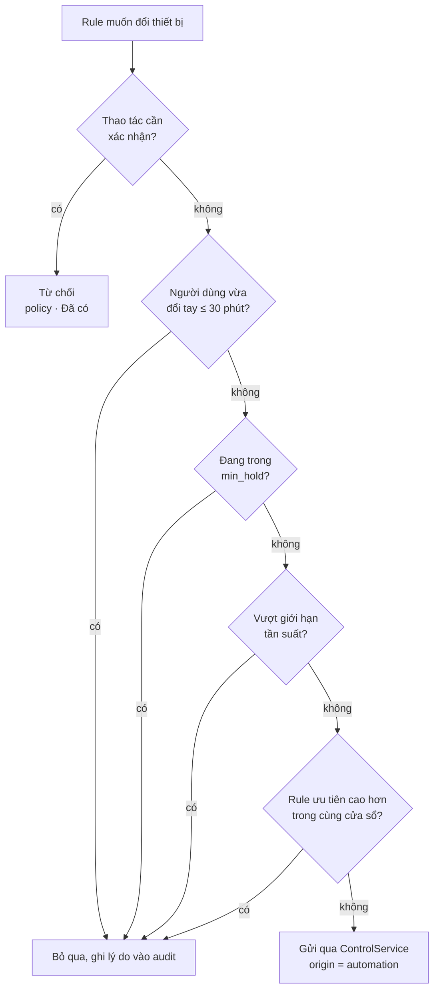

# Automation Engine

> **Tóm tắt.** **Chưa triển khai.** Phần đã có: automation không thể thực hiện thao tác cần xác nhận. Thiết kế phân xử xung đột
> dành cho P1.

**Trạng thái:** thiết kế. Scene là **P0-14**; rule, conflict engine và tối ưu là **P1-01, P1-02**. Phần nền đã có: mọi lệnh
của automation đi qua `ControlService` với `Origin.AUTOMATION`, và policy đã **cấm automation thực hiện thao tác cần xác
nhận** (`test_agent_unlock_requires_confirmation_and_automation_is_denied`).

## 1. Scene (P0-14)

- Scene = danh sách bước `CommandRequest` có thứ tự.
- Chạy tuần tự. Mỗi bước đợi trạng thái cuối của lệnh.
- Bước kết thúc không phải `succeeded` → dừng; các bước sau `not_run`; báo rõ bước nào dừng và vì sao.
- Không tự thử lại; người dùng chọn "Thử lại bước lỗi".
- Kết quả: `{steps: [{index, command_id, status}], verified: n, total: m}`.

## 2. Rule (P1-01)

```yaml
id: ac-off-when-empty
trigger: {type: state, device: dev-living-motion, capability: occupancy, to: false, for: 10m}
conditions: [{device: dev-living-ac, capability: on_off, equals: true}]
actions: [{device: dev-living-ac, capability: on_off, value: false}]
priority: 50            # cao hơn thắng khi xung đột
cooldown: 15m           # không chạy lại rule này trong khoảng này
mode: single            # bỏ qua trigger mới khi đang chạy
```

Loại trigger: thời gian (cron, bình minh/hoàng hôn), trạng thái cảm biến (có `for`), hiện diện, sự kiện thủ công, câu nói
(qua agent, luôn cần xác nhận trước khi lưu). Điều kiện chỉ dùng giá trị không `stale`/`offline`; nếu dữ liệu cũ → rule
không chạy và ghi lý do.

## 3. Xung đột

### 3.1 Phát hiện tĩnh khi lưu rule

Hai rule xung đột tiềm năng khi cùng tác động một `(device, capability)` với giá trị khác nhau và điều kiện của chúng có
thể đồng thời đúng. Ví dụ:

- **A:** không có người 10 phút → tắt điều hòa.
- **B:** nhiệt độ > 30°C → bật điều hòa.

Phòng trống và nóng → A tắt, B bật, lặp lại. Khi lưu B, hệ thống cảnh báo: "Xung đột với A khi phòng trống và trên 30°C",
và đề xuất: thêm điều kiện "có người" vào B, hoặc đặt ưu tiên.

### 3.2 Phân xử khi chạy

| Cơ chế | Quy tắc |
|---|---|
| Ưu tiên | Trong một cửa sổ phân xử, chỉ hành động của rule ưu tiên cao nhất cho mỗi `(device, capability)` được gửi |
| Giữ tối thiểu | Sau khi một rule đổi thiết bị, rule khác đổi ngược lại phải đợi `min_hold` (mặc định 10 phút cho điều hòa) |
| Người dùng thắng | Lệnh thủ công gần đây (≤ 30 phút) chặn automation đổi ngược lại, trừ rule an toàn |
| Giới hạn tần suất | Tối đa N lệnh mỗi thiết bị mỗi giờ từ automation (bảo vệ máy nén, rơ-le) |
| Hysteresis | Ngưỡng bật/tắt khác nhau (bật > 30°C, tắt < 28°C) |

Mỗi quyết định ghi vào audit với lý do: "B bị bỏ qua: A ưu tiên cao hơn, giữ tối thiểu còn 6 phút".


*Hình 1. Phân xử khi chạy (thiết kế P1-02). Chỉ bước "cần xác nhận → từ chối" đã có trong code.*

## 4. Tối ưu đa mục tiêu

| Tầng | Loại | Ví dụ |
|---|---|---|
| 1. An toàn | **Ràng buộc cứng** (policy, không tối ưu) | Không bật bình nóng lạnh tự động; giới hạn nhiệt độ |
| 2. An ninh, quyền | **Ràng buộc cứng** | Automation không mở khóa |
| 3. Tiện nghi | Mục tiêu mềm | Nhiệt độ theo sở thích khi có người |
| 4. Năng lượng | Mục tiêu mềm | Tăng nhiệt độ đặt khi không có người |
| 5. Tuổi thọ thiết bị | Ràng buộc mềm có giới hạn cứng | `min_hold`, giới hạn tần suất |

Mục tiêu mềm chỉ được chọn trong không gian mà ràng buộc cứng cho phép. LLM không bao giờ là cơ chế bảo vệ an toàn duy nhất.

## 5. Local-first

Engine chạy trong backend tại nhà. Rule an toàn quan trọng (ví dụ cảnh báo rò nước) nên được cấu hình thẳng trong HA để vẫn
chạy khi backend dừng; hệ thống chỉ hiển thị chúng (P1).
