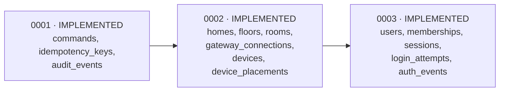
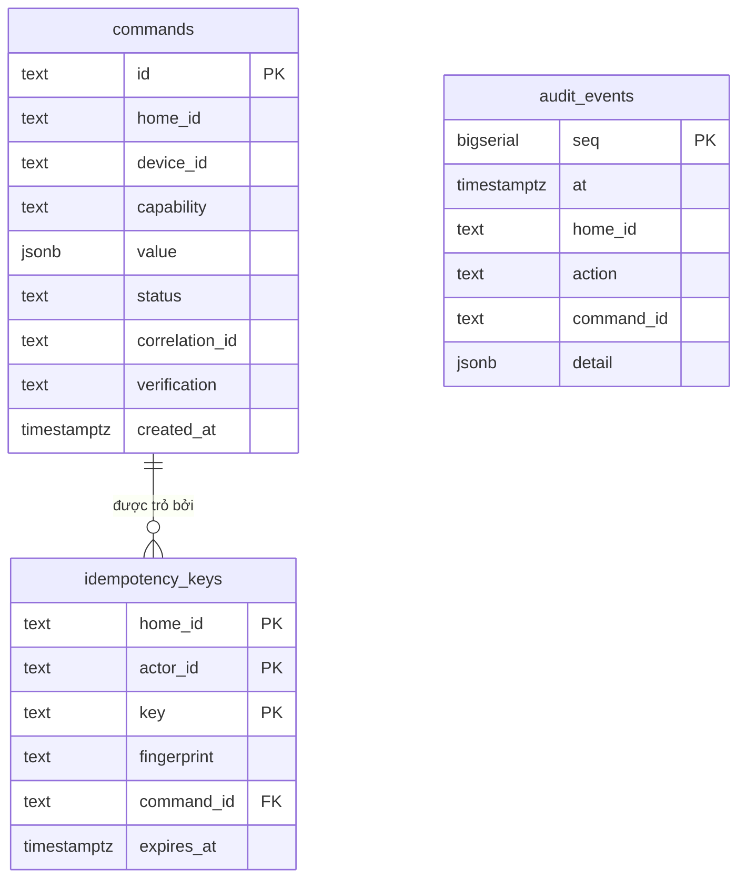
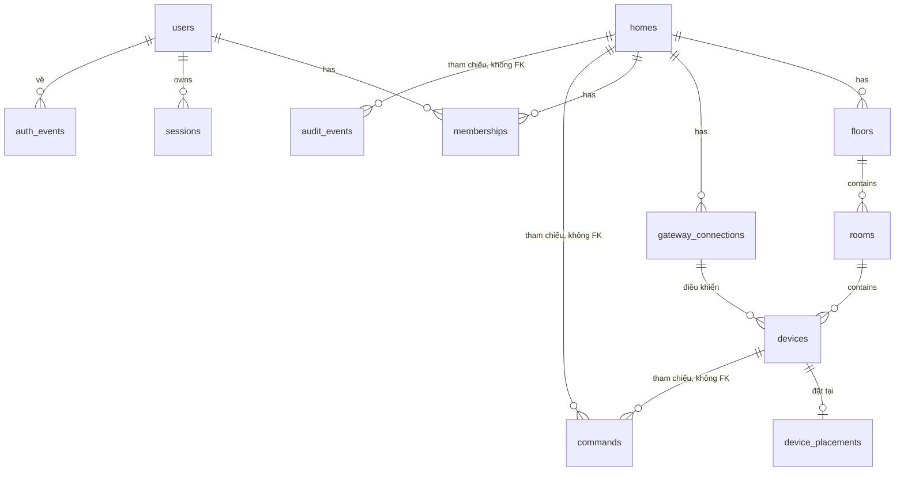

# Database Design

> **Tóm tắt.** Mười bốn bảng chạy thật trên Postgres qua ba migration: `0001` (lệnh, idempotency, audit), `0002` (cấu hình nhà),
> `0003` (đăng nhập). Trạng thái thiết bị cố ý không lưu (cache).

**Trạng thái (2026-11-24):** **IMPLEMENTED** cho cả ba migration (`src/smarthome/persistence/migrations/`, runner
`python -m smarthome.persistence`), có test trên PostgreSQL thật: xem [SPRINT1_ACCEPTANCE](SPRINT1_ACCEPTANCE.md). Thiết kế ở
[LLD P0-06](lld/P0-06_PERSISTENCE.md), [LLD P0-07](lld/P0-07_AUTH_RBAC.md), [ADR 0006](adr/0006-home-configuration-source-of-truth.md)
và [ADR 0005](adr/0005-session-auth-csrf.md). Có `SMARTHOME_DATABASE_URL` thì **cấu hình nhà lấy từ DB**; không có (chỉ `local`/`test`)
thì nhà mẫu `src/smarthome/demo_home.py` nằm trong bộ nhớ. Migration là file SQL có phiên bản chạy bằng runner riêng, **không dùng
Alembic** ([ADR 0002](adr/0002-postgresql-versioned-sql-migrations.md)). Trạng thái thiết bị là cache, nguồn đúng là gateway.

*Hình 1. Thứ tự migration. Mỗi migration chỉ thêm bảng; `down` của migration sau không đụng migration trước.*

## 1. Quy ước

- Mọi ID là `text`. Người dùng và thiết bị thật dùng ID tự sinh; ID cố định (`dev-living-light`, `user-owner`) chỉ có ở seed demo.
  `audit_events.seq` và `auth_events.seq` là `bigserial`.
- **Mọi bảng thuộc về một nhà có `home_id`**; mọi truy vấn của API lọc theo `home_id` của danh tính.
- Thời gian `timestamptz` UTC.
- Khóa ngoại **tổng hợp theo `home_id`** để một dòng không trỏ sang nhà khác; `ON DELETE RESTRICT` (ngoại lệ: placement `CASCADE`).
- Lịch sử (`commands`, `audit_events`) **không** có khóa ngoại tới thiết bị, người dùng: sống lâu hơn đối tượng được tham chiếu.
- Cột JSON (`capabilities`, `footprint`, `value`) được validate bằng model pydantic khi ghi và khi đọc.

### Phạm vi của ID

| Thực thể | Khóa | Duy nhất ở phạm vi | Lý do |
|---|---|---|---|
| `homes` | `id` | toàn cục | |
| `floors`, `rooms` | `(home_id, id)` | trong một nhà | Code không tra tầng/phòng toàn cục; seed của hai nhà không đụng nhau |
| `gateway_connections` | `id` | **toàn cục**, thuộc đúng một nhà | `Device.gateway` mang ID này; `ControlService.gateways` khóa theo nó |
| `devices` | `id` | **toàn cục** | `ControlService.devices` và `commands_one_in_flight_idx` khóa theo `device_id` không kèm nhà |
| `(gateway_id, external_ref)` | unique một phần | thiết bị đang hoạt động | Hai nhà không va chạm vì `gateway_id` khác nhau |
| `users` | `id`; `lower(email)` | toàn cục | Một người có thể thuộc nhiều nhà |
| `memberships` | `(home_id, user_id)` | | |

## 2. ERD

### 2.1 Bảng đã có (migration `0001_commands_audit`)

*Hình 2. Ba bảng đang chạy (rút gọn cột). `audit_events.command_id` cố ý **không** có khóa ngoại để audit sống lâu hơn
lệnh đã purge. Đầy đủ cột: `src/smarthome/persistence/migrations/0001_commands_audit.up.sql`.*

### 2.2 Cấu hình nhà và đăng nhập (`0002`, `0003`, IMPLEMENTED)

*Hình 3. Chi tiết cột và ràng buộc: [LLD P0-06 §3](lld/P0-06_PERSISTENCE.md#3-erd) và [LLD P0-07 §4](lld/P0-07_AUTH_RBAC.md#4-schema-0003_auth).
`login_attempts` không có quan hệ (email có thể không tồn tại).*

### 2.3 Sau Sprint 1 (ý tưởng, chưa thiết kế)

`scenes`, `scene_runs` (P0-14), `automations` (P1-01), `memories` (P1-04), `energy_samples` (P1-05). Chỉ ghi nhận hướng,
không coi là thiết kế.

## 3. Bảng

Bảng dưới là mục lục, không lặp chi tiết cột.

| Bảng | Trạng thái | Migration / task | Ghi chú |
|---|---|---|---|
| `commands` | ✅ IMPLEMENTED | `0001` | `id text`; `correlation_id`, `verification`; unique một phần: một lệnh đang gửi mỗi `(device_id, capability)` |
| `idempotency_keys` | ✅ IMPLEMENTED | `0001` | PK `(home_id, actor_id, key)`, `fingerprint`, `expires_at` |
| `audit_events` | ✅ IMPLEMENTED | `0001` | `seq bigserial`; trigger chặn UPDATE/DELETE trừ `purge`; `home_id NOT NULL` |
| `homes`, `floors`, `rooms`, `gateway_connections`, `devices`, `device_placements` | ✅ IMPLEMENTED | `0002` · P0-06b | Khóa ngoại tổng hợp; số thực là `double precision` (không phải `real`, để đọc lại đúng giá trị đã ghi); `homes.config_version`; `devices.removed_at` (xóa mềm); `gateway_connections` **chuyển từ P0-09 vào `0002`** vì `Device.gateway` cần ID instance |
| `users`, `memberships`, `sessions`, `login_attempts`, `auth_events` | ✅ IMPLEMENTED | `0003` · P0-07 | `users.id text`; unique `lower(email)`; `sessions` chỉ lưu SHA-256 token, có `csrf_token`; `auth_events` chỉ ghi thêm |
| `scenes`, `scene_runs` | ❌ Chưa thiết kế chi tiết | P0-14 | |
| `automations`, `memories`, `energy_samples` | Mức ý tưởng | P1 | |
| ~~`device_observations`, `device_connectivity`~~ | **Không làm** | — | Trạng thái thiết bị là cache, nguồn đúng là gateway ([HARDENING §2.3](HARDENING_2026-11.md#23-persistence-và-recovery-issue-04)) |

## 4. Ánh xạ từ mã hiện tại

| Mã hiện tại | Lưu ở | Trạng thái |
|---|---|---|
| `CommandRecord` | `commands` | ✅ |
| `AuditEvent` (qua `CommandStore`) | `audit_events` | ✅ |
| `Home`, `Floor`, `Room` | `homes`, `floors`, `rooms` | ✅ |
| `Device`, `Capability` | `devices` (`capabilities jsonb`, validate bằng chính model pydantic) | ✅ |
| `Device.gateway` | `gateway_connections.id` (ID **instance**, không phải tên adapter) | ✅ |
| `Placement` | `device_placements` | ✅ |
| `Member` | `memberships`, đọc qua `MembershipSource` (thay dict tĩnh trong `ControlService`) | ✅ |
| `StateStore` | **Không lưu** (cache trong bộ nhớ) | ✅ quyết định |

## 5. Migration và khởi động lại

| Mục | Quy tắc |
|---|---|
| Công cụ | Runner SQL riêng `persistence/migrate.py`; file `NNNN_name.up.sql` và `.down.sql`; mỗi migration một transaction. Không dùng Alembic |
| Kiểm tra khi khởi động | App từ chối chạy nếu phiên bản schema khác phiên bản mã |
| Nhà mẫu | Chỉ `seed-demo` ở `local`/`test`, `homes.simulated = true`; không có DB thì nhà mẫu trong bộ nhớ |
| Có DB mà chưa có nhà | Từ chối khởi động, không rơi về nhà mẫu |
| Recovery (**đã có**) | Lệnh `requested/dispatching/dispatched` từ lần chạy trước → `interrupted` (`SERVER_RESTARTED`), không gửi lại, rồi đối soát với snapshot gateway; lệnh `awaiting_confirmation` quá hạn → `expired` |
| Backup | `pg_dump` theo lịch, thử khôi phục trong P0-17 |
| Rollback | Code cũ chạy được với bảng thừa; `downgrade --to N --confirm-data-loss` xóa dữ liệu các migration trên N |
