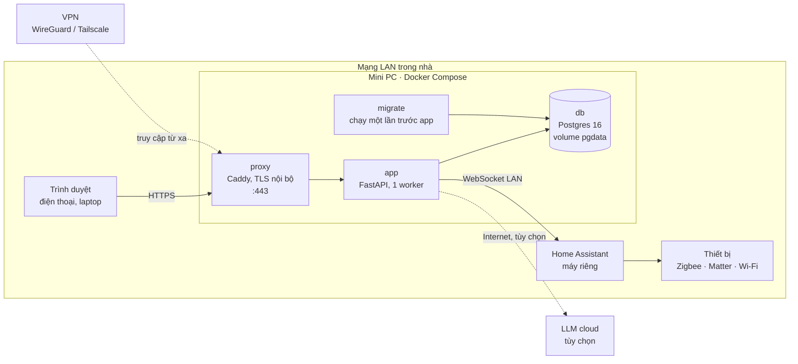
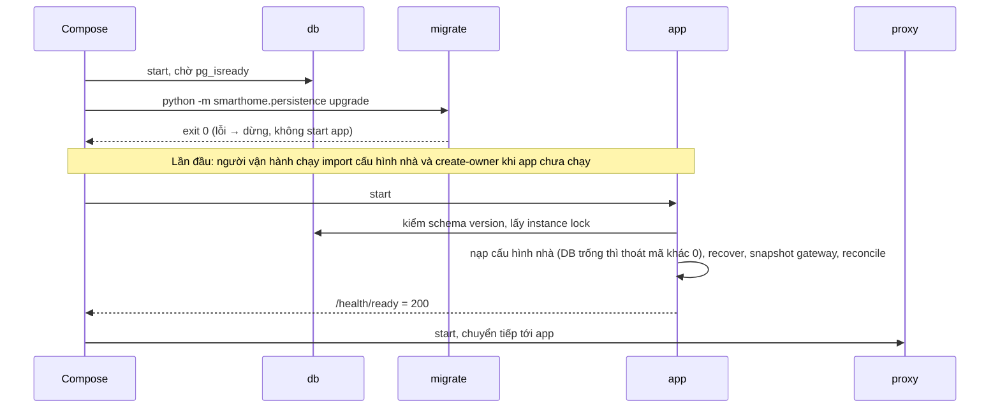

# Deployment

> **Tóm tắt.** Hiện có Dockerfile (non-root, 1 worker, healthcheck) và `docker-compose.yml` **chỉ có app**: chạy bằng
> Compose thì lệnh và audit nằm trong bộ nhớ. Thiết kế mục tiêu ([ADR 0008](adr/0008-local-deployment-topology.md),
> Proposed): một máy trong LAN, Compose gồm proxy TLS + app + Postgres + bước migrate, truy cập từ xa qua VPN, NTP bật.
> Image đặt `SMARTHOME_ENVIRONMENT=production` nên **không chạy được nếu thiếu Postgres và `SMARTHOME_ALLOWED_ORIGINS`** (fail-closed); Compose dev đặt `local` và chỉ bind `127.0.0.1`. **Chưa có môi trường triển khai nào; build Docker chưa kiểm** (daemon không chạy lúc triển khai Sprint 1; `docker compose config` hợp lệ).

## 1. Hiện trạng đã xác minh

| Thành phần | Trạng thái | Dẫn chứng |
|---|---|---|
| Image | Python 3.12-slim, user `app` (uid 10001), `pip install .`, 1 worker Uvicorn | `Dockerfile` |
| Healthcheck | Gọi `/health`, luôn trả `ok` (không kiểm DB, gateway) | `Dockerfile`, `api/routes/health.py` |
| Compose | Chỉ service `api`, `SMARTHOME_ENVIRONMENT=docker`, `.env` tùy chọn; **không** có Postgres, migrate, proxy | `docker-compose.yml` |
| Bảo vệ cấu hình | Production thiếu DB → từ chối khởi động; danh tính dev bị chặn **chỉ** khi `environment == "production"`. `environment` là chuỗi tự do, mặc định `local`: giá trị `docker` của Compose nằm ngoài cổng (fail-open, DR-H03) | `api/main.py` `create_app`, `core/config.py` |
| CI | Ruff, pytest với Postgres 16 bắt buộc, eval, render Mermaid | `.github/workflows/ci.yml` |
| Build Docker | ⚠️ **Chưa kiểm** trong các đợt gần đây (Docker daemon không chạy trên máy dev) | — |

## 2. Topology mục tiêu

*Hình 1. Không mở cổng ra Internet. Mất Internet: mọi thứ trong khung LAN vẫn chạy, chỉ LLM mất.*

## 3. Thứ tự khởi động

*Hình 2. App từ chối khởi động nếu schema lệch phiên bản, đã có instance khác, hoặc DB chưa có cấu hình nhà (ADR 0001, 0002, 0006).
Bước nạp cấu hình nhà và `create-owner` là thiết kế ([LLD P0-06](lld/P0-06_PERSISTENCE.md#7-khởi-động-và-cli), [LLD P0-07](lld/P0-07_AUTH_RBAC.md)), chưa có code.*

## 4. Cấu hình

| Biến | Bắt buộc ở production | Ghi chú |
|---|---|---|
| `SMARTHOME_ENVIRONMENT` | ✅ `production` hoặc `staging` | Sau S1-01: chỉ nhận `local`, `test`, `staging`, `production`; ngoài `local`/`test` bắt buộc DB, cấm danh tính dev, tắt `/docs` và route simulator. `Dockerfile` sẽ đặt `production` mặc định; giá trị `docker` hiện tại của Compose sẽ bị từ chối |
| `SMARTHOME_DATABASE_URL` | ✅ | Secret; không commit |
| `SMARTHOME_HA_TOKEN` | ✅ khi có P0-09 | Secret; không lưu DB (ADR 0004) |
| `SMARTHOME_ALLOWED_ORIGINS` | ✅ khi có P0-07 | Origin của proxy; dùng cho kiểm `Origin` của request ghi, login và WebSocket |
| `SMARTHOME_TRUSTED_PROXY_IPS` | ✅ khi có P0-07 | IP/CIDR của proxy trong mạng Compose. Rỗng = không tin header chuyển tiếp; sai = giới hạn đăng nhập theo IP khóa cả nhà (mọi request cùng IP proxy) hoặc vô hiệu. Uvicorn chạy với `--proxy-headers` và danh sách này |
| `SMARTHOME_COOKIE_SECURE` | Mặc định `true` | Chỉ đặt `false` được ở `local`/`test` |
| `SMARTHOME_LLM_API_KEY` | Không | Thiếu → agent dùng luật |
| `SMARTHOME_DEV_IDENTITY_ENABLED` | ❌ phải `false` | |

## 5. Vận hành

| Việc | Cách | Trạng thái |
|---|---|---|
| Nâng cấp | `pg_dump` → kéo image mới → `migrate` → `app` | Lệnh migrate: ✅ có; quy trình Compose: 📐 |
| Rollback | Image cũ chạy được nếu migration mới chỉ thêm bảng; downgrade cần `--confirm-data-loss` | 📐 |
| Backup | `pg_dump` hằng ngày, giữ 14 bản, thử khôi phục trước pilot | 📐 P0-17 |
| Dọn dữ liệu | `python -m smarthome.persistence purge` theo lịch | Lệnh: ✅ có |
| Đồng hồ | NTP trên host; lệch > 1 s làm `state_match` từ chối báo cáo đúng (ADR 0003) | 📐 |
| Health | Tách `/health/live` và `/health/ready` (DB, gateway, instance lock) | 📐 P0-16 |
| Log | stdout JSON, chỉ metadata (không nội dung, không secret) | Một phần: hiện là log văn bản |

## 6. Giới hạn chưa kiểm chứng

Chưa build và chạy image trong đợt này; chưa có máy đích; chưa đo tài nguyên (RAM/CPU) của app + Postgres trên mini PC;
chưa thử VPN; chưa thử khôi phục backup.
