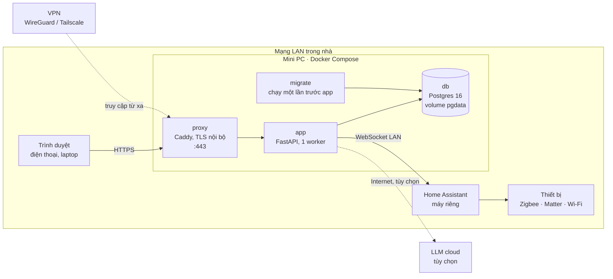
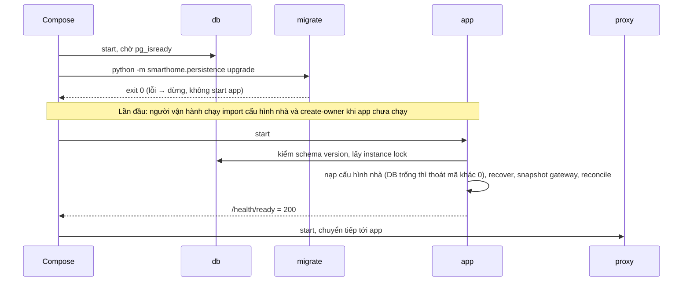

# Deployment

> **Tóm tắt.** **Hiện tại:** Dockerfile (Python 3.12, non-root, 1 worker, healthcheck) mặc định
> `SMARTHOME_ENVIRONMENT=production` nên fail-closed: thiếu PostgreSQL hoặc `SMARTHOME_ALLOWED_ORIGINS` là không khởi động.
> `docker-compose.yml` chỉ dành cho **phát triển**: một service `api`, môi trường `local`, nhà mẫu trong bộ nhớ, chỉ publish
> `127.0.0.1:8000`. Image được build và chạy với PostgreSQL 16 trong CI. **Mục tiêu (P0-17, chưa làm):** Compose production gồm
> proxy TLS + app + Postgres + job migrate + backup ([ADR 0008](adr/0008-local-deployment-topology.md), Proposed). **Chưa có môi
> trường triển khai nào.**

## 1. Hiện trạng đã xác minh (2026-11-24)

| Thành phần | Trạng thái | Dẫn chứng |
|---|---|---|
| Image | Python 3.12-slim, user `app` (uid 10001), `pip install .`, 1 worker Uvicorn, `SMARTHOME_ENVIRONMENT=production`, không chứa `.env` hay secret | `Dockerfile`, `tests/unit/test_dockerfile.py`, `scripts/docker_smoke.sh` |
| Healthcheck | Gọi `/health`, luôn trả `ok` (không kiểm DB, gateway; tách live/ready ở P0-16) | `Dockerfile`, `api/routes/health.py` |
| Compose (phát triển) | Chỉ service `api`, `SMARTHOME_ENVIRONMENT=local`, `.env` tùy chọn, publish `127.0.0.1:8000`; **không** có Postgres, migrate, proxy, backup. Không dùng để triển khai | `docker-compose.yml` |
| Cổng môi trường | `environment` chỉ nhận `local`, `test`, `staging`, `production` (giá trị khác, gồm `docker`, bị từ chối). `staging` và `production` cùng fail-closed: bắt buộc DB và `SMARTHOME_ALLOWED_ORIGINS`, cấm danh tính dev và cookie không `Secure`, tắt `/docs`, `/openapi.json`, `/redoc` và route simulator | `core/config.py`, `api/main.py`, `tests/unit/test_environment_gate.py` |
| Khởi động có DB | Kiểm schema version, lấy instance lock, nạp cấu hình nhà từ DB (DB trống hoặc dữ liệu sai → thoát), recover, reconcile | `api/main.py`, `bootstrap.py`, `tests/integration/test_startup.py` |
| CLI vận hành | `python -m smarthome.persistence upgrade / status / downgrade / purge / seed-demo` (seed chỉ `local`/`test`, cần app dừng); `python -m smarthome.auth create-owner / set-password / unlock / disable-user` (mật khẩu qua prompt hoặc stdin) | `persistence/__main__.py`, `auth/__main__.py` |
| CI | Job `checks`: ruff, pytest với Postgres 16 bắt buộc, eval, render Mermaid. Job `docker`: hadolint, build, chạy image với PostgreSQL 16 (migration, đăng nhập thật, CSRF, restart, healthcheck), Compose dev, kiểm dọn dẹp khi smoke test lỗi giữa chừng | `.github/workflows/ci.yml`, [CI run 45352819175](https://github.com/nguyenquangtiep/smart-home-future/actions/runs/45352819175) |
| Docker trên máy dev | ✅ `scripts/docker_smoke.sh` đạt 30/30 trên Docker Desktop 29.6.1 (Windows, 2026-11-24), sau một lần Docker Desktop crash khi khởi động rồi tự chạy lại | [SPRINT1_ACCEPTANCE](SPRINT1_ACCEPTANCE.md#nghiệm-thu-bổ-sung-2026-11-24-f1-f2-f3) |

## 2. Topology mục tiêu

*Hình 1. **Thiết kế mục tiêu (P0-17, chưa triển khai).** Không mở cổng ra Internet. Mất Internet: mọi thứ trong khung LAN vẫn
chạy, chỉ LLM mất.*

## 3. Thứ tự khởi động

*Hình 2. Thứ tự trong Compose production mục tiêu (P0-17). Phần của app **đã có code**: từ chối khởi động nếu schema lệch phiên
bản, đã có instance khác, hoặc DB chưa có cấu hình nhà (ADR 0001, 0002, 0006); `create-owner` đã có. Chưa có: job `migrate`
trong Compose, `/health/ready` (P0-16), lệnh `import` cấu hình nhà (P0-10; hiện chỉ có `seed-demo` cho local/test).*

## 4. Cấu hình

| Biến | Ngoài `local`/`test` | Ghi chú |
|---|---|---|
| `SMARTHOME_ENVIRONMENT` | ✅ `staging` hoặc `production` | Chỉ nhận `local`, `test`, `staging`, `production`; giá trị khác bị từ chối khi khởi động. Image mặc định `production`; Compose dev đặt `local` |
| `SMARTHOME_DATABASE_URL` | ✅ bắt buộc | Secret; không commit, không đưa vào image |
| `SMARTHOME_ALLOWED_ORIGINS` | ✅ bắt buộc | Origin của proxy (ví dụ `https://home.lan`), phân cách bằng dấu phẩy; kiểm `Origin` của login và mọi request ghi |
| `SMARTHOME_TRUSTED_PROXY_IPS` | Nên đặt khi có proxy | IP/CIDR của proxy. Rỗng = không tin `X-Forwarded-For`; đặt sai = giới hạn đăng nhập theo IP tính mọi người là IP proxy. Chỉ middleware của app đọc header này (không cần cờ `--proxy-headers`) |
| `SMARTHOME_COOKIE_SECURE` | Phải `true` (mặc định) | `false` bị từ chối ngoài `local`/`test` |
| `SMARTHOME_DEV_IDENTITY_ENABLED` | Phải `false` (mặc định) | `true` bị từ chối ngoài `local`/`test` |
| `SMARTHOME_ARGON2_MAX_CONCURRENT`, `SMARTHOME_ARGON2_MAX_PENDING`, `SMARTHOME_ARGON2_WAIT_S` | Tùy chọn (2, 16, 5) | Giới hạn số phép Argon2id chạy cùng lúc (mỗi phép ~64 MiB) và hàng đợi; vượt ngưỡng trả `503 AUTH_BUSY` + `Retry-After` |
| `SMARTHOME_HA_TOKEN` | ✅ khi có P0-09 | Secret; không lưu DB (ADR 0004) |
| `SMARTHOME_LLM_API_KEY` | Không | Thiếu → agent dùng luật |

## 5. Vận hành

| Việc | Cách | Trạng thái |
|---|---|---|
| Nâng cấp | `pg_dump` → kéo image mới → `migrate` → `app` | Lệnh migrate: ✅ có; quy trình Compose: 📐 |
| Rollback | Image cũ chạy được nếu migration mới chỉ thêm bảng; downgrade cần `--confirm-data-loss` | 📐 |
| Backup | `pg_dump` hằng ngày, giữ 14 bản, thử khôi phục trước pilot | 📐 P0-17 |
| Dọn dữ liệu | `python -m smarthome.persistence purge` theo lịch | Lệnh: ✅ có |
| Đồng hồ | NTP trên host; lệch > 1 s làm `state_match` từ chối báo cáo đúng (ADR 0003) | 📐 |
| Health | Tách `/health/live` và `/health/ready` (DB, gateway, instance lock) | 📐 P0-16 |
| Log | stdout JSON, chỉ metadata (không nội dung, không secret) | Một phần: hiện là log văn bản |

## 6. Giới hạn chưa kiểm chứng

| Mục | Trạng thái |
|---|---|
| Image và Compose dev | ✅ trong CI và trên máy dev |
| Compose production (proxy TLS, Postgres, migrate, backup) | Chưa có, P0-17 |
| Tài nguyên app + Postgres trên mini PC; Argon2id trên máy đích | Chưa đo (M-07-1: PENDING TARGET HARDWARE) |
| VPN, khôi phục backup, NTP | Chưa thử |
