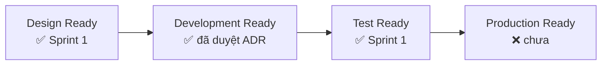
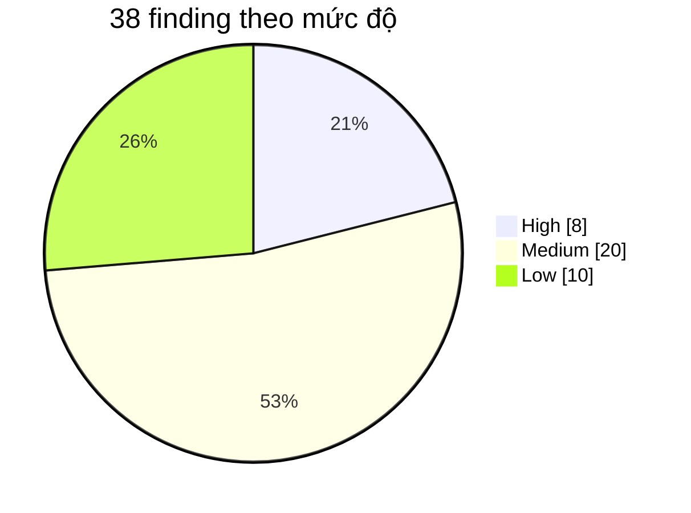
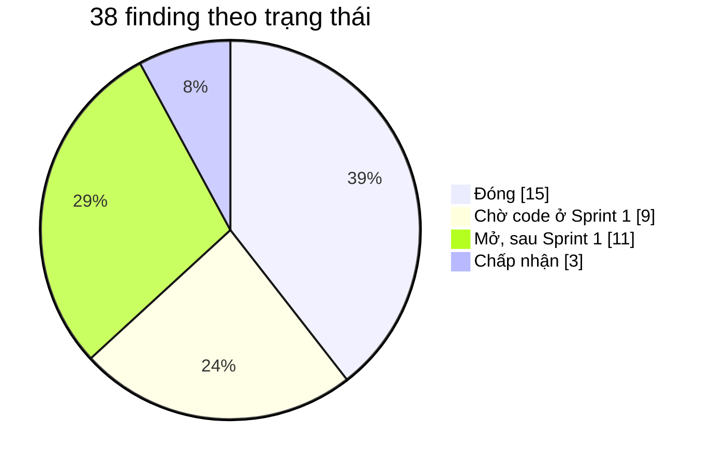
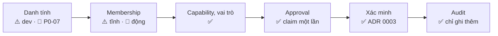

# Design Review 2026-11

> **Kết luận (v2, chốt thiết kế Sprint 1): ✅ PASS cho thiết kế Sprint 1 (P0-06b, P0-07).** Chủ dự án đã duyệt
> [ADR 0005](adr/0005-session-auth-csrf.md) và [ADR 0006](adr/0006-home-configuration-source-of-truth.md) theo khuyến nghị kỹ thuật
> (2026-11-23), nên Sprint 1 **được phép bắt đầu code**. Đây là sign-off thiết kế, **không** phải sản phẩm đã xong: Production Ready
> vẫn ❌. DDL đã thử trên Postgres 18 (79 phép thử đúng thiết kế). 38 finding: 8 High · 20 Medium · 10 Low, **không có Critical**
> (thiết kế). Rủi ro sản phẩm "chưa có đăng nhập thật" vẫn là Critical ở [SECURITY §7](SECURITY_AND_SAFETY.md#7-rủi-ro-còn-mở)
> cho tới khi P0-07 xong.

| Mức sẵn sàng | Kết quả | Căn cứ |
|---|---|---|
| **Design Ready** (Sprint 1) | ✅ | LLD v2, ADR có mô hình mối đe dọa, DDL đã thử, không còn mâu thuẫn thiết kế đã biết |
| **Development Ready** | ✅ | Chủ dự án đã duyệt ADR 0005 và ADR 0006 (2026-11-23); C1, C2 hoàn thành |
| **Test Ready** (Sprint 1) | ✅ | 33 tiêu chí nghiệm thu (13 + 20) đều có loại test; CI chạy Postgres bắt buộc. Còn phải tạo fixture đăng nhập qua `https://` (S1-09) và đo Argon2id thủ công (M-07-1) |
| **Production Ready** | ❌ | Chưa có đăng nhập, Home Assistant, web, môi trường triển khai; Docker chưa kiểm; chưa thử thiết bị thật |


*Hình 1. Bốn mức sẵn sàng. Thiết kế chốt xong không có nghĩa sản phẩm xong.*

**Baseline:** `main` = `0461606` (sau Design Review v1; v1 dựa trên `a797bac`), working tree sạch, nhánh
`docs/design-finalization-sprint1`. Phê duyệt ADR (2026-11-23) được ghi sau baseline, trên cùng nhánh. Lượt này **không đổi code production hay schema**; chỉ sửa tài liệu và
`tests/unit/test_docs.py` (bộ kiểm tra anchor).

## 1. Phạm vi và phương pháp

| Mục | Nội dung |
|---|---|
| Tài liệu đã đọc | PRD, ARCHITECTURE, DATABASE_DESIGN, SECURITY_AND_SAFETY, TRACEABILITY, ROADMAP, DEPLOYMENT, `adr/`, `lld/P0-06`, `lld/P0-07` |
| Code đối chiếu | `src/smarthome/{domain,control,persistence,api,core}`, migration `0001`, `demo_home.py`, Dockerfile, Compose, test |
| Kiểm chứng bằng chạy | (a) CHECK của `0001` so với enum; (b) nhà mẫu so với các bất biến của LLD; (c) đồ thị import 39 module; (d) DDL `0002` và `0003` lấy **nguyên văn từ hai LLD** áp lên Postgres 18 tạm; (e) pytest, ruff, eval, mermaid-cli |
| Giới hạn | Các phép thử (a)–(d) là script tạm **ngoài repo**; chúng kiểm ràng buộc DB và code hiện có, **không** kiểm logic ứng dụng chưa viết (đếm owner, throttle, CSRF). Phần đó nằm ở AC để tự động hóa khi code. Không kiểm: Docker, Home Assistant, thiết bị thật, hiệu năng |

## 2. Trạng thái 10 nhóm thiết kế

| Nhóm | Trạng thái | Dẫn chứng chính |
|---|---|---|
| Requirements | ⚠️ PARTIAL | [TRACEABILITY](TRACEABILITY.md): 6 IMPLEMENTED, 4 PARTIAL, 10 DESIGNED, 3 MISSING (FR-12, FR-13, FR-16) |
| Architecture | ✅ IMPLEMENTED (lõi) | Monolith một instance ([ADR 0001](adr/0001-modular-monolith-single-instance.md)); ranh giới module khớp import; không vòng import ở mức file giữa `control` và `persistence` |
| Database | ⚠️ PARTIAL | `0001` ✅; `0002`, `0003` 📐 **DESIGNED** với DDL đã thử ([LLD P0-06](lld/P0-06_PERSISTENCE.md), [LLD P0-07](lld/P0-07_AUTH_RBAC.md)) |
| API / realtime | ⚠️ PARTIAL | REST điều khiển ✅; API auth 📐 ([LLD P0-07 §6](lld/P0-07_AUTH_RBAC.md#6-api)); realtime 📐 ADR 0007 chưa có LLD; plan/scene API ❌ |
| Security | ⚠️ PARTIAL | Policy, approval, cô lập nhà ✅; đăng nhập 📐; cổng môi trường fail-open (DR-H03); thành viên tĩnh (DR-H08) |
| IoT | 📐 DESIGNED | Hợp đồng gateway ✅, simulator ✅; HA 📐 [ADR 0004](adr/0004-home-assistant-integration-layer.md) |
| AI | ❌ MISSING (mức code) | `agent/` là mẫu, không nối `control`; thiếu hợp đồng tool và plan API (DR-M03, M04) |
| 3D | 📐 DESIGNED | `Placement`, `Room.footprint` ✅; UI chưa có |
| Automation | 📐 DESIGNED (P1) | Chỉ có quy tắc "automation không làm thao tác cần xác nhận" ✅ |
| Deployment | 📐 DESIGNED | [DEPLOYMENT](DEPLOYMENT.md) + [ADR 0008](adr/0008-local-deployment-topology.md) (Proposed); Compose chưa có DB |

## 3. Findings

Ký hiệu trạng thái: ✅ đóng (đã sửa tài liệu hoặc quyết định, có bằng chứng) · 📐 thiết kế đã chốt, chờ code ở task Sprint 1 ·
⏳ mở, xử lý ở task sau Sprint 1 · ➖ chấp nhận, ghi nhận.

### 3.1 Findings của v1 và trạng thái mới

| ID | Mức | Vấn đề | Trạng thái | Xử lý / bằng chứng |
|---|---|---|---|---|
| DR-H01 | High | Cấu hình nhà luôn là seed trong code | 📐 | `api/main.py` `build_control` gọi `build_demo_home()`. LLD P0-06 v2 + ADR 0006; code S1-03, S1-04 |
| DR-H02 | High | Thiết kế đăng nhập thiếu | 📐 | Hạ từ ✅ ở v1: LLD v1 còn 6 lỗi (LLD P0-07 §1, E1–E6). v2 sửa; code S1-06…08 |
| DR-H03 | High | Danh tính dev chỉ bị chặn khi `environment == "production"` đúng chữ; phạm vi mở rộng: thiếu DB, `/docs`, Compose đặt `docker` | 📐 | `api/main.py`, `core/config.py`. D-07-9 allowlist, AC-07-14; code S1-01 |
| DR-H04 | High | Compose không có Postgres/migrate; build Docker chưa kiểm | ⏳ | `docker-compose.yml`. DEPLOYMENT đã đồng bộ; code P0-17, ngoài Sprint 1 |
| DR-H05 | High | DATABASE_DESIGN mâu thuẫn schema thật | ✅ | v1 đóng chưa đủ, còn 2 mô tả lỗi thời (DR-M20); đã sửa hết và đối chiếu lại |
| DR-M01 | Medium | Không ghi được sự kiện cấp người dùng (`audit_events.home_id NOT NULL`) | ✅ | `auth_events`, `login_attempts` ở `0003`; DDL đã thử |
| DR-M02 | Medium | Realtime chưa có hợp đồng sự kiện | ⏳ | Cần LLD P0-08 (Sprint 2); ràng buộc xác thực WebSocket đã chốt ở ADR 0005 §5 |
| DR-M03 | Medium | Plan/scene API và bảng `scenes` chưa có | ⏳ | Cần LLD P0-14 |
| DR-M04 | Medium | Hợp đồng tool của agent mới ở mức bảng | ⏳ | Cần LLD P0-15 |
| DR-M05 | Medium | Nơi lưu token HA mâu thuẫn | ✅ | ADR 0004; `gateway_connections.secret_ref` là **tên** secret, nhất quán với `0002` |
| DR-M06 | Medium | `/health` tĩnh | ⏳ | `/health/live` và `/ready` ở P0-16 |
| DR-M07 | Medium | NFR-01, NFR-02 chưa có phép đo | ⏳ | P0-16 |
| DR-M08 | Medium | `state_match` cần đồng hồ chính xác | ✅ | NTP trong ADR 0008 và DEPLOYMENT §5 |
| DR-M09 | Medium | Test cô lập nhà chỉ phủ `/devices` | 📐 | AC-07-10 tham số hóa trên **mọi** route; S1-07 |
| DR-M10 | Medium | Chưa có chính sách Origin/CORS | 📐 | Cùng origin qua proxy + `SMARTHOME_ALLOWED_ORIGINS` (ADR 0005, DEPLOYMENT §4); S1-07 |
| DR-M11 | Medium | Đổi cấu hình lúc chạy chưa làm mới bộ nhớ `ControlService` | ⏳ | LLD P0-13; ở P0 ghi cấu hình chỉ khi app dừng (D-06-8) |
| DR-L01 | Low | Tên kỹ thuật `smarthome`, `SMARTHOME_` | ⏳ | `product/repo-migration.md` §5 |
| DR-L02 | Low | Log văn bản, chưa JSON, chưa có command id | ⏳ | P0-16 |
| DR-L03 | Low | Tài liệu v1 mang tính lịch sử | ✅ | Đã gắn nhãn |
| DR-L04 | Low | Lệnh chờ xác nhận hết hạn nằm trong bộ nhớ tới khi được truy cập | ⏳ | P0-16 |
| DR-L05 | Low | Một kết nối DB có khóa | ➖ | Đủ cho một nhà (ADR 0001, 0002) |
| DR-L06 | Low | `control` ↔ `persistence` phụ thuộc hai chiều ở mức package | ➖ | Đã kiểm bằng đồ thị import: **không** có vòng ở mức file |

### 3.2 Findings bổ sung của vòng này

| ID | Mức | Phát hiện | Bằng chứng | Xử lý | Trạng thái |
|---|---|---|---|---|---|
| DR-H06 | High | `UNIQUE(gateway, external_ref)` với `gateway` là **tên adapter**: hai nhà cùng dùng HA va chạm entity `light.x`, và không thể có hai gateway cùng loại trong một nhà | LLD v1; `Device.gateway` | D-06-3: gateway là instance có ID riêng, `gateway_connections` vào `0002`. Thử: cùng ref ở hai gateway OK, trùng trong một gateway bị chặn | ✅ |
| DR-H07 | High | `device_placements.room_id` độc lập với `devices.room_id`, khóa ngoại đơn: placement trỏ phòng khác phòng của thiết bị | LLD v1 | D-06-4: khóa ngoại tổng hợp `(device_id, room_id)`. Thử 5 ca (lệch phòng, thiết bị lạ, đổi phòng khi còn placement…) | ✅ |
| DR-H08 | High | Thành viên là dict tĩnh nạp lúc khởi động; `confirm()` kiểm lại người yêu cầu bằng dict đó: người bị hạ quyền hoặc gỡ vẫn giữ vai trò cũ khi duyệt | `control/execution.py` `self.members`, `confirm()` | `MembershipSource` tra DB mỗi lần (D-07-6), AC-07-11; S1-05, S1-08 | 📐 |
| DR-M12 | Medium | LLD v1 chỉ lưu **hash** CSRF nhưng `GET /auth/session` phải trả token | LLD P0-07 v1 | Lưu `csrf_token` trong `sessions` (D-07-3) | ✅ |
| DR-M13 | Medium | Giới hạn thử sai theo IP vô nghĩa sau reverse proxy: mọi request cùng IP proxy, một người sai khóa cả nhà | DEPLOYMENT topology | D-07-8, `SMARTHOME_TRUSTED_PROXY_IPS`, AC-07-5 | ✅ |
| DR-M14 | Medium | Argon2 trong coroutine (~100 ms CPU) chặn event loop của worker duy nhất, tức chặn cả điều khiển | ADR 0001, LLD v1 | Thread pool (D-07-5), AC-07-17, M-07-1 | ✅ |
| DR-M15 | Medium | `/api/v1/agent/invoke` không có xác thực | `api/routes/agent.py` (chỉ `Depends(get_graph)`) | Default-deny (D-07-10), AC-07-9; S1-07 | 📐 |
| DR-M16 | Medium | `users.id uuid` lệch `commands.actor_id`, `confirmed_by` (text) và ID seed `user-owner` | `0001`, `demo_home.py` | `users.id text` (D-07-4) | ✅ |
| DR-M17 | Medium | `Device.id` và `commands_one_in_flight_idx` là toàn cục nhưng LLD v1 coi ID thiết bị theo nhà | `execution.py` `self.devices`, `0001` | D-06-1: ID thiết bị duy nhất toàn cục, tự sinh; tầng/phòng theo `(home_id, id)` | ✅ |
| DR-M18 | Medium | Hai owner hạ quyền nhau đồng thời làm nhà mất owner | LLD v1 không có cơ chế | D-07-12 khóa dòng `homes`. Thử cơ chế khóa trên Postgres; AC-07-12 kiểm đồng thời | ✅ |
| DR-M19 | Medium | ADR 0005 thiếu mô hình mối đe dọa và ràng buộc WebSocket | ADR 0005 v1 | 15 mối đe dọa (T1–T15), §5 WebSocket | ✅ |
| DR-M20 | Medium | DATABASE_DESIGN còn "`StateStore` → `device_observations`" và "Alembic" dù DR-H05 đã đóng | `DATABASE_DESIGN.md` §4, §5 (v1) | Viết lại; "Alembic" chỉ còn trong câu phủ định | ✅ |
| DR-L07 | Low | Route điều khiển simulator đăng ký ở mọi môi trường | `api/routes/homes.py` | Chỉ đăng ký ở `local`/`test` (D-07-9); S1-01 | 📐 |
| DR-L08 | Low | OpenAPI `/docs`, `/openapi.json` luôn mở | `api/main.py` `FastAPI(...)` | Tắt ngoài `local`/`test`; S1-01 | 📐 |
| DR-L09 | Low | Vòng import `agent/__init__` ↔ `agent/graph` | Đồ thị import 39 module, 79 cạnh | Chạy được vì `nodes` là submodule; mã scaffold, ghi nhận | ➖ |
| DR-L10 | Low | `on_report` lưu trạng thái cả cho thiết bị không có trong cấu hình | `execution.py` `on_report` gọi `state.apply` trước kiểm `device is None` | Adapter chỉ chuyển báo cáo của entity đã ánh xạ (P0-09) | ⏳ |

### 3.3 Tổng hợp


*Hình 2. Nguồn: hai bảng §3.1 và §3.2.*


*Hình 3. 9 finding chờ code đều đã gắn task [S1-01…S1-09](ROADMAP.md#sprint-1-p0-06b-và-p0-07-chốt-thiết-kế-2026-11-23).
Trong 8 High: 3 đóng (H05, H06, H07), 4 chờ code Sprint 1 (H01, H02, H03, H08), 1 ở P0-17 (H04).*

## 4. Gap Analysis

| Khu vực | Hiện trạng | Mục tiêu Sprint 1 | Khoảng cách | Task |
|---|---|---|---|---|
| Cấu hình nhà | Seed trong code | Postgres là nguồn chuẩn | `0002`, `HomeConfigStore`, validator, `seed-demo` | S1-02…04 |
| Danh tính | Header dev | Đăng nhập, phiên, CSRF, throttle | `0003`, API auth, CLI, default-deny | S1-06, S1-07 |
| Thành viên | Dict tĩnh | Tra DB mỗi lần | `MembershipSource`, API thành viên, last-owner | S1-05, S1-08 |
| Môi trường | Fail-open theo một chuỗi | Allowlist `{local, test}` | `Literal`, DB bắt buộc, tắt `/docs`, Dockerfile | S1-01 |
| Test | Danh tính dev | Fixture đăng nhập `https://` | Chuyển test cũ, hồi quy | S1-09 |
| Sau Sprint 1 | Poll, simulator, chưa web | WebSocket, HA, import, web | LLD P0-08, P0-14, P0-15; ADR 0004, 0007, 0008 | Sprint 2+ |

## 5. Đối chiếu HLD, LLD và code

| # | Đối chiếu | Cách kiểm | Kết quả |
|---|---|---|---|
| 1 | Ranh giới module trong ARCHITECTURE §3 với import thật | Đọc import theo package + đồ thị import 39 module, 79 cạnh | ✅ khớp. Duy nhất một vòng: `agent` (DR-L09); `control` ↔ `persistence` không vòng ở mức file |
| 2 | CHECK của `0001` với enum | So `status`, `verification` với `CommandStatus`, `Verification` | ✅ đồng bộ |
| 3 | Nhà mẫu với bất biến LLD P0-06 | Script: 10 thiết bị, vị trí trong footprint, `placement.room_id == device.room_id`, 1 gateway `simulator`, `simulated=true` | ✅ không vi phạm |
| 4 | Khóa của `ControlService` với LLD | Đọc `execution.py` | Thiết bị khóa toàn cục ✔ (D-06-1); gateway khóa theo tên ✔ (D-06-3); thành viên tĩnh ✖ → DR-H08 |
| 5 | DDL `0002` trong LLD P0-06 | Áp nguyên văn lên Postgres 18 tạm, 40 phép thử (khóa ngoại tổng hợp, placement, gateway, xóa, CHECK, down) | ✅ 40/40 sau khi sửa kỳ vọng SQLSTATE: `ON DELETE RESTRICT` báo `RestrictViolation` (23001), không phải `ForeignKeyViolation` (23503); đã ghi vào AC-06-6 |
| 6 | DDL `0003` trong LLD P0-07 trên nền `0001` thật + `0002` | 39 phép thử (email không phân biệt hoa thường, FK, CHECK, trigger chỉ ghi thêm, khóa dòng `homes` serialize hai transaction, down) | ✅ 39/39 |
| 7 | DATABASE_DESIGN với migration, ADR, LLD | Đọc đối chiếu từng bảng; sửa §2.2, §3, §4, §5 | ✅ khớp; 2 mô tả lỗi thời đã sửa (DR-M20) |
| 8 | TRACEABILITY với PRD và ROADMAP | 23 yêu cầu; AC trỏ về LLD v2 (AC-06-1…13, AC-07-1…20) | ✅ số đếm không đổi; liên kết cập nhật |
| 9 | DEPLOYMENT với ràng buộc bảo mật | Thêm `SMARTHOME_TRUSTED_PROXY_IPS`, `SMARTHOME_COOKIE_SECURE`, cổng môi trường, bước nạp cấu hình/create-owner | ✅ đồng bộ với ADR 0005 và LLD P0-07 |
| 10 | Liên kết, anchor, Mermaid | `test_docs`, mermaid-cli | Xem §8 |

## 6. Security và Reliability


*Hình 4. Chuỗi kiểm soát của một lệnh. Hai mắt xích yếu: danh tính (DR-H02, DR-H03) và membership (DR-H08).*

| Kiểm tra | Kết quả |
|---|---|
| Fail-closed cho thiết bị nguy hiểm | ✅ `safe_values`, `test_issue02_*` |
| Không gửi lại lệnh sau restart | ✅ `test_restart_keeps_history_interrupts_in_flight_and_never_resends` |
| Ghi trước khi gửi (at-most-once) | ✅ `test_store_failure_before_dispatch_sends_nothing_and_does_not_wedge` |
| Một instance mỗi DB | ✅ `test_gap_d_second_instance_on_same_database_is_refused` |
| Thiết bị đã xóa mềm khi restart | ✅ code: `reconcile_interrupted` xử lý `device is None`; test: AC-06-11 |
| Secrets không vào DB/log | 📐 thiết kế (LLD P0-07 §8, AC-07-3, AC-07-16); chưa có code |
| Fail-closed theo tên môi trường | ❌ DR-H03, code S1-01 |
| Quyền theo thành viên hiện tại | ❌ DR-H08, code S1-05, S1-08 |
| Dữ liệu cache và authoritative | ✅ trạng thái thiết bị không lưu |

## 7. Checklist

| # | Mục | Đạt |
|---|---|---|
| 1 | Mọi yêu cầu P0 có ID và nằm trong RTM | ✅ |
| 2 | Mọi yêu cầu P0 có kiến trúc tương ứng | ⚠️ FR-12, FR-13 thiếu thiết kế API (DR-M03, M04) |
| 3 | Ranh giới module được tuân thủ trong code | ✅ |
| 4 | Schema trong tài liệu khớp migration, ADR, LLD | ✅ |
| 5 | Mọi quyết định kiến trúc trọng yếu có ADR | ✅ (8; 0005 và 0006 Accepted 2026-11-23, chưa triển khai; 0007, 0008 Proposed) |
| 6 | LLD sprint tới có schema, API, luồng, lỗi, AC | ✅ |
| 7 | Mọi AC có loại test | ✅ (33 AC) |
| 8 | Mô hình mối đe dọa cho đăng nhập | ✅ (T1–T15) |
| 9 | Recovery và at-most-once có test | ✅ |
| 10 | DDL đã thử trên DB thật | ✅ chỉ phần ràng buộc DB |
| 11 | Thiết kế triển khai tồn tại và khớp ràng buộc bảo mật | ✅ |
| 12 | Sơ đồ render bằng renderer thật | ✅ |
| 13 | Link và anchor hợp lệ | ✅ |
| 14 | Không còn mâu thuẫn tài liệu đã biết | ✅ |
| 15 | Phê duyệt bắt buộc của chủ dự án | ✅ ADR 0005 và 0006 (2026-11-23) |
| 16 | Không còn Critical; mọi High có biện pháp và task | ✅ |

## 8. Validation

| Kiểm tra | Kết quả |
|---|---|
| Ruff lint, format | đạt: `ruff check` và `ruff format --check` (93 file; lưu ý ruff cũng định dạng khối ```python trong Markdown, khối của LLD P0-06 đã được định dạng lại) |
| pytest, Postgres bắt buộc (`SMARTHOME_REQUIRE_POSTGRES=1`) | **217 passed, 0 failed, 0 skipped** |
| Trong đó `test_docs` (link, anchor, SVG, Mermaid tĩnh) | 81 passed |
| Eval | 7/7 ca đạt |
| Render Mermaid bằng mermaid-cli 11.17.1 (`scripts/render_mermaid.py`) | **48/48** khối render được |
| DDL `0002` / `0003` trên Postgres 18 tạm | 40/40 · 39/39 (script ngoài repo) |
| Đồ thị import | 39 module, 79 cạnh, 1 vòng (`agent`, DR-L09) |
| Chưa chạy được | Build Docker (không có daemon), Home Assistant, thiết bị thật, hiệu năng; CI GitHub chạy sau khi push |

## 9. Sign-off

**✅ PASS** cho thiết kế Sprint 1: không còn blocker thiết kế, phê duyệt bắt buộc đã có. C3–C7 là tiêu chí hoàn thành và
ràng buộc cho bước sau, **không chặn** việc bắt đầu code. Bản trước của báo cáo, khi chưa có phê duyệt (PASS WITH CONDITIONS), là commit `31ff680`.

| # | Điều kiện | Trước khi | Trạng thái |
|---|---|---|---|
| C1 | Chủ dự án quyết định D1–D6 của [ADR 0006](adr/0006-home-configuration-source-of-truth.md#5-quyết-định-cần-chủ-dự-án) | Code S1-02, S1-03, S1-04 | ✅ Đã duyệt 2026-11-23 |
| C2 | Chủ dự án quyết định D1–D6 của [ADR 0005](adr/0005-session-auth-csrf.md#6-quyết-định-cần-chủ-dự-án), gồm dependency `argon2-cffi` | Code S1-01, S1-05…S1-09 | ✅ Đã duyệt 2026-11-23, gồm `argon2-cffi` |
| C3 | DR-H03 và DR-H08 đóng bằng test (AC-07-14, AC-07-11) | Đóng P0-07 | ⏳ khi code (S1-01, S1-05) |
| C4 | Đo Argon2id trên máy đích, ghi kết quả (M-07-1) | Đóng P0-07 | ⏳ khi code (S1-07) |
| C5 | Đạt đủ [tiêu chí thoát Sprint 1](ROADMAP.md#sprint-1-p0-06b-và-p0-07-chốt-thiết-kế-2026-11-23) | Ghi P0-06 hoặc P0-07 là "Đạt" | ⏳ cuối Sprint 1 |
| C6 | Không triển khai ra ngoài máy dev cho tới khi xong P0-07 và P0-17 (DR-H03, DR-H04) | Mọi triển khai | ⏳ ràng buộc liên tục |
| C7 | Viết LLD P0-08 và LLD P0-14 trước khi code các task đó | Sprint 2 và sau | ⏳ trước Sprint 2 |

### Trạng thái phê duyệt ADR

| ADR | Trạng thái | Khuyến nghị kỹ thuật | Người duyệt |
|---|---|---|---|
| [0005](adr/0005-session-auth-csrf.md) Đăng nhập | ✅ Accepted (chưa triển khai) | Accept | ☑ Chủ dự án, 2026-11-23 |
| [0006](adr/0006-home-configuration-source-of-truth.md) Cấu hình nhà | ✅ Accepted (chưa triển khai) | Accept | ☑ Chủ dự án, 2026-11-23 |
| [0001](adr/0001-modular-monolith-single-instance.md), [0002](adr/0002-postgresql-versioned-sql-migrations.md), [0003](adr/0003-evidence-based-command-verification.md) | ✅ Accepted | Ghi lại quyết định đã có code | — |
| [0004](adr/0004-home-assistant-integration-layer.md) | 📐 Accepted (thiết kế) | Cần HA thật để kiểm | — |
| [0007](adr/0007-realtime-websocket-per-home.md), [0008](adr/0008-local-deployment-topology.md) | 📝 Proposed | Không chặn Sprint 1 | ☐ Chưa duyệt |

### Rủi ro còn lại

| Mức | Rủi ro |
|---|---|
| ⛔ **Critical** | Chưa có đăng nhập thật: **không** nối thiết bị thật, không triển khai ngoài máy dev |
| 🔴 **High** | Cấu hình nhà là seed (H01); cổng môi trường fail-open (H03); thành viên tĩnh (H08); không có môi trường triển khai, Compose không có DB, Docker chưa kiểm (H04); chưa có Home Assistant, chưa kiểm thiết bị thật |
| 🟠 **Medium** | Thông số Argon2id chưa đo trên máy đích; khóa tài khoản do nhập sai cố ý; IP là dữ liệu cá nhân; `state_match` phụ thuộc đồng hồ gateway; `TRUSTED_PROXY_IPS` cấu hình sai; chưa có LLD P0-08, P0-14, P0-15 |
| 🟡 **Low** | Route simulator và `/docs` mở (sửa ở S1-01); vòng import `agent`; trạng thái cho thiết bị lạ trong `StateStore` |

Không xét sign-off cho P0-09 trở đi trong review này: cần Home Assistant thật của chủ nhà và các LLD tương ứng.
