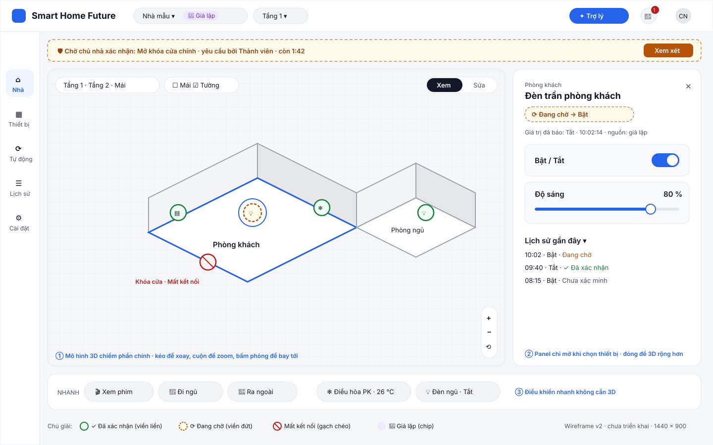
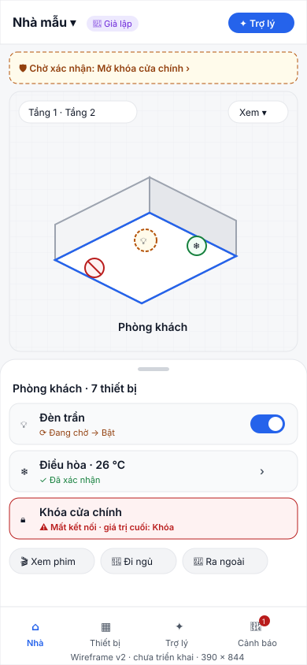

# Digital Twin 3D

> **Tóm tắt.** Mô hình 3D là trung tâm trang Nhà nhưng **chưa triển khai**. Backend đã có dữ liệu tầng, phòng, vị trí thiết bị và
> trạng thái. Bố cục mục tiêu: wireframe v2 ở dưới và [VISUAL_DESIGN_STANDARD.md §4](VISUAL_DESIGN_STANDARD.md#4-digital-twin-3d).

**Trạng thái:** thiết kế. Phía backend đã có dữ liệu nền: `Floor`, `Room.footprint`, `Device.placement`
(`src/smarthome/domain/models.py`) và `DeviceView` qua API. Chưa có frontend (P0-11, P0-12, P0-13, P1-08).

## 0. Bố cục mục tiêu (wireframe v2)

| Desktop | Mobile |
|---|---|
|  |  |

*Hình 1. Wireframe, **chưa phải giao diện đã code**. Quy tắc bố cục, trạng thái và a11y:
[VISUAL_DESIGN_STANDARD.md §3–4](VISUAL_DESIGN_STANDARD.md#3-web-uiux).*

## 1. Stack đề xuất

React + TypeScript + Vite, **React Three Fiber** (three.js), `@react-three/drei` cho camera controls và helper, Zustand cho
store phía client. GLB/glTF cho mô hình đồ đạc và (về sau) mô hình nhà. Không cần game engine.

Lý do: repo chưa có frontend nên không có stack cũ để giữ; R3F cho phép viết 3D như component React, dùng chung store với
dashboard.

## 2. Dữ liệu

| Dữ liệu | Nguồn | Ghi chú |
|---|---|---|
| Tầng | `Floor{level, elevation_m, height_m}` | Đã có |
| Phòng | `Room{floor_id, footprint=(x, z, rộng, sâu)}` | Đã có. P1-08 mở rộng thành polygon |
| Vị trí thiết bị | `Placement{room_id, position, rotation_y_deg}` | Đã có, đọc từ seed; lưu/sửa ở P0-13 |
| Trạng thái | `DeviceView.capabilities[]` | Đã có qua REST; realtime ở P0-08 |
| Mô hình chi tiết | GLB tùy chọn theo nhà/phòng/loại thiết bị | P1-08 |

**Quy tắc tách biệt:** placement chỉ phục vụ hiển thị. Backend không bao giờ dùng tọa độ 3D để quyết định điều khiển.
Đổi vị trí trên mô hình không làm đổi thiết bị nào.

## 3. Dựng cảnh (P0-12)

1. Mỗi tầng là một `group` ở độ cao `elevation_m`.
2. Mỗi phòng dựng sàn và bốn tường thấp từ `footprint` (procedural, không cần GLB). Tường có thể ẩn hoặc làm trong suốt.
3. Mỗi thiết bị là một marker theo loại (hình khối đơn giản ở P0, GLB ở P1) tại `placement.position`.
4. Overlay trạng thái gắn trên marker (`Html` của drei hoặc sprite).

## 4. Ánh xạ trạng thái → hiển thị

| `status` | Hiển thị | Ví dụ |
|---|---|---|
| `confirmed` | Hiệu ứng theo giá trị: đèn phát sáng theo `brightness`, rèm co theo `position`, TV màn hình sáng | Đèn bật 80% → point light 0.8 |
| `simulated` | Như trên + nhãn "Giả lập" | Nhà mẫu |
| `pending` | Giữ hiệu ứng của `value` cũ + vòng chờ, chú thích `pending_value` | "→ 26°C đang chờ" |
| `stale` | Hiệu ứng mờ + nhãn thời điểm | "Cập nhật 20 phút trước" |
| `unknown` | Marker xám, "?" | Chưa từng có báo cáo |
| `offline` | Marker đỏ, biểu tượng mất kết nối, giá trị cuối gạch mờ | "Mất kết nối" |

Không bao giờ vẽ trạng thái mới từ lệnh vừa gửi. Mọi nhãn có chữ, không chỉ màu.

## 5. Tương tác

| Cấp | Thao tác |
|---|---|
| Toàn nhà | Orbit/zoom/pan; chọn tầng (các tầng trên ẩn); bật/tắt mái, tường |
| Phòng | Bấm phòng → camera bay tới khung bao phòng; nút "← Cả nhà" |
| Thiết bị | Bấm marker → panel điều khiển sinh từ capability (switch, slider, enum); gửi qua `POST /commands`; panel hiện trạng thái lệnh |

## 6. Chế độ VIEW và EDIT

- **VIEW** (mặc định): chỉ quan sát và điều khiển. Kéo chuột chỉ xoay camera, không di chuyển được đối tượng.
- **EDIT** (P0-13, chỉ owner): bật bằng nút riêng, viền màn hình đổi màu, tắt điều khiển thiết bị. Kéo marker trên mặt
  sàn của phòng; snap vào tường/trần cho đèn và điều hòa; lưu một lần qua API (`PUT /homes/{id}/layout/placements`,
  có `version` để chống ghi đè); hủy để hoàn tác.
- **P1-08:** thêm/xóa tầng, phòng, vẽ polygon, nhập GLB, liên kết đối tượng GLB với `device_id`.

## 7. Hiệu năng

Ngân sách P0: ≤ 50 draw calls cho nhà pilot, instancing cho marker cùng loại, chỉ render lại khi store đổi
(`frameloop="demand"`), không đổ bóng thời gian thực mặc định. Đo fps thủ công trên laptop mục tiêu và ghi vào
IMPLEMENTATION_LOG.

## 8. Khả năng độc lập

Mô hình 3D chạy được khi agent lỗi hoặc gateway mất kết nối: nó vẫn hiển thị cấu trúc nhà và đánh dấu thiết bị offline.
