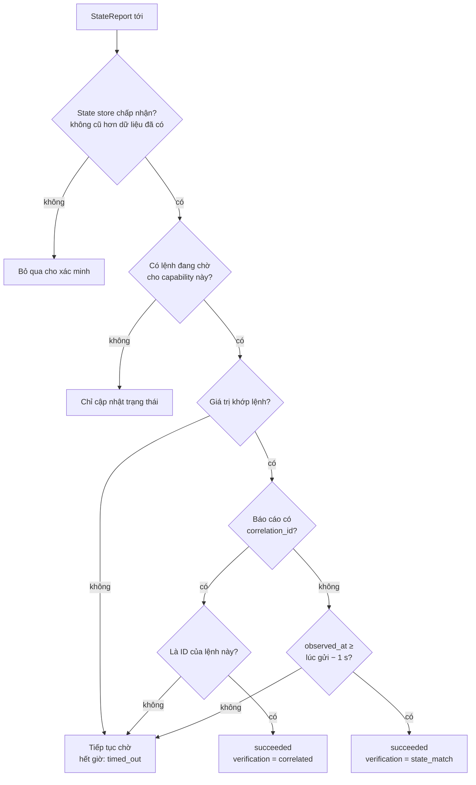
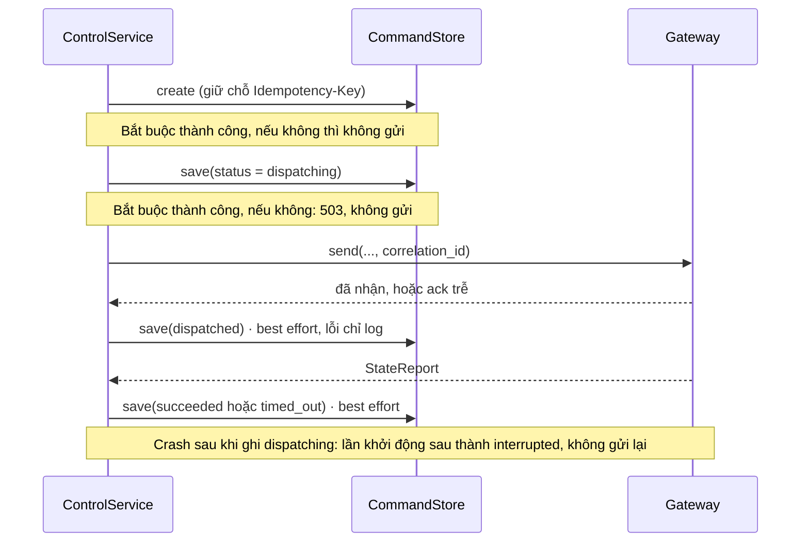

# Hardening 2026-11: phân tích và thiết kế sửa lỗi

> **Tóm tắt.** Hai vòng hardening ngày 2026-11-23: sửa 4 issue gốc và 5 lỗi phát hiện thêm. ISSUE-04 còn **một phần** (cấu hình nhà
> chưa lưu DB). Kết quả: 136 test đạt trên Postgres; CI đạt cho `27d13f0` và `a0e09e4`.

Đợt hardening đường điều khiển trước khi nối Home Assistant. Baseline: commit `d9b67ff`, 79 test đạt, ruff sạch, eval 7/7,
chưa có type-checker được cấu hình. Kết quả sau sửa ở [IMPLEMENTATION_LOG.md](IMPLEMENTATION_LOG.md).

## 1. Issue Analysis

### ISSUE-02 · Safety Policy Enforcement · Mức: **Critical**

| Mục | Nội dung |
|---|---|
| File | `domain/capabilities.py` (`Capability.requires_confirmation`), `control/policy.py` (`evaluate`) |
| Nguyên nhân gốc (đã xác minh) | Xác nhận chỉ dựa vào danh sách `confirm_values` (danh sách "cấm"). `SafetyClass` không được dùng trong quyết định. Capability `HIGH_POWER`/`SECURITY` thiếu `confirm_values` → `ALLOW` |
| Tái hiện | `test_issue02_high_power_without_confirm_values_is_not_silently_allowed`, `test_issue02_security_without_confirm_values_is_not_silently_allowed`: cả hai **FAIL** trên baseline (`Outcome.ALLOW`) |
| Ảnh hưởng | Bật thiết bị công suất lớn, tắt camera an ninh không cần người xác nhận; automation làm được |
| Hướng sửa | **Fail-closed**: với `safety != NORMAL`, mọi giá trị cần xác nhận **trừ** giá trị nằm trong `safe_values` (danh sách "cho phép"). `confirm_values` chỉ còn dùng cho capability `NORMAL` |
| Approval | Approval chính là bản ghi lệnh (gắn sẵn user, nhà, thiết bị, capability, giá trị, `command_id`). Chuyển `awaiting_confirmation → requested` bằng **claim có điều kiện** (trạng thái + hạn), dùng một lần. Approval không nâng quyền: policy chạy lại với vai trò của người yêu cầu |
| Rủi ro | Cấu hình cũ có `confirm_values` cho capability nguy hiểm vẫn an toàn hơn trước; capability nguy hiểm thiếu `safe_values` sẽ hỏi xác nhận cả thao tác an toàn (ví dụ khóa cửa) cho tới khi khai báo |

### ISSUE-01 · Command Verification & Stale State · Mức: **Critical**

| Mục | Nội dung |
|---|---|
| File | `control/execution.py` (`on_report`), `domain/state.py` (`StateStore.apply`) |
| Nguyên nhân gốc (đã xác minh) | `on_report` chỉ so giá trị với lệnh đang chờ. Không kiểm độ mới của báo cáo, không biết `StateStore` đã bỏ qua báo cáo đó vì đến sai thứ tự |
| Tái hiện | `test_issue01_report_observed_before_dispatch_does_not_verify` và `test_issue01_out_of_order_report_ignored_by_store_does_not_verify`: **FAIL** (lệnh thành `succeeded`) |
| Ảnh hưởng | Báo "đã xong" khi thiết bị chưa đổi: vi phạm nguyên tắc cốt lõi của sản phẩm |
| Hướng sửa | Chính sách xác minh hai mức, xem §2.1 |

### ISSUE-03 · Idempotency · Mức: **High**

| Mục | Nội dung |
|---|---|
| File | `control/execution.py` (`submit`), `api/routes/homes.py` |
| Nguyên nhân gốc (đã xác minh) | Khóa idempotency chỉ ánh xạ tới `command_id`, không lưu nội dung. Cùng khóa + nội dung khác → âm thầm trả lệnh cũ; client tưởng lệnh mới (ví dụ mở khóa) đã được nhận |
| Tái hiện | `test_issue03_same_key_different_payload_is_not_treated_as_retry`: **FAIL** |
| Hướng sửa | Fingerprint SHA-256 trên JSON chuẩn hóa `{device_id, capability, value, value_type, origin}`; phạm vi `(home_id, actor_id, key)`; khác fingerprint → `409 IDEMPOTENCY_KEY_REUSED`; TTL mặc định 24 giờ; giữ chỗ khóa và tạo lệnh trong một bước nguyên tử (khóa asyncio + khóa chính DB) |

### ISSUE-04 · Persistence, Recovery & Audit · Mức: **Critical** cho thiết bị thật

| Mục | Nội dung |
|---|---|
| File | `control/execution.py` (`_commands`, `_idempotency`), `control/audit.py` (`AuditLog._events`) |
| Nguyên nhân gốc (đã xác minh bằng đọc code) | Lệnh, khóa idempotency và audit chỉ nằm trong dict/list của tiến trình |
| Ảnh hưởng | Restart mất lịch sử và audit; lệnh đang chờ biến mất, không ai biết kết quả |
| Hướng sửa | `CommandStore` (bộ nhớ cho dev/test, Postgres cho triển khai), migration SQL có phiên bản, khôi phục khi khởi động, đối soát, retention. Xem §2.3 |

## 2. Thiết kế

### 2.1 Chính sách xác minh (ISSUE-01)

Một báo cáo chỉ xác minh một lệnh khi **mọi** điều kiện đúng:

1. `StateStore` **chấp nhận** giá trị đó (không cũ hơn quan sát hiện có). `apply()` trả về các capability được chấp nhận;
   execution chỉ xét những capability này. Store và execution xử lý cùng một báo cáo một lần, nhất quán.
2. Giá trị khớp lệnh (`Capability.matches`).
3. **Có correlation** (`StateReport.correlation_id`): phải trùng một trong các ID của lệnh, gồm `command_id` (gửi kèm như
   gợi ý) và ID do gateway trả về từ `send()` (ví dụ `context.id` của Home Assistant). Trùng → `verification="correlated"`.
   Báo cáo mang correlation của lệnh khác → **không** xác minh.
4. **Không có correlation**: `observed_at ≥ thời điểm bắt đầu gửi − độ lệch đồng hồ cho phép`
   (`SMARTHOME_VERIFICATION_CLOCK_SKEW_S`, mặc định 1 s) → `verification="state_match"`. Timestamp ở đây chỉ là **bộ lọc báo
   cáo cũ**, không phải bằng chứng nhân quả; kết quả được gắn nhãn yếu hơn để UI và audit phân biệt.

Báo cáo trùng sau khi đã xác minh không có tác dụng. Báo cáo không khớp không kết thúc lệnh; hết thời gian chờ → `timed_out`.
Nếu báo cáo có correlation đến **trước** khi `send()` trả ID của gateway, execution kiểm lại quan sát mới nhất ngay khi
nhận ID.

*Hình 1. Chính sách xác minh. Đã có trong `ControlService.on_report` và `_verification`.*

### 2.2 Idempotency (ISSUE-03)

| Trường hợp | Kết quả |
|---|---|
| Cùng khóa, cùng fingerprint, còn hạn | Trả lại lệnh cũ, header `Idempotent-Replayed: true`, mã HTTP theo trạng thái lệnh |
| Cùng khóa, khác fingerprint, còn hạn | `409 IDEMPOTENCY_KEY_REUSED`, không tạo lệnh |
| Khóa hết hạn | Khóa được gán cho lệnh mới |
| Khóa của nhà/người khác | Phạm vi riêng, không ảnh hưởng |

### 2.3 Persistence và recovery (ISSUE-04)

| Dữ liệu | Authoritative? | Lưu |
|---|---|---|
| Lệnh (gồm approval, kết quả, verification) | Có | Postgres `commands` |
| Khóa idempotency | Có | Postgres `idempotency_keys` |
| Audit | Có | Postgres `audit_events`, chặn UPDATE và DELETE bằng trigger trừ khi purge có chủ đích |
| Trạng thái thiết bị | **Không**, là cache | Không lưu. Nguồn thật là gateway; sau restart trạng thái `unknown` tới khi gateway gửi snapshot |
| Cấu hình nhà, thiết bị | Có | Vẫn từ seed; lưu bền thuộc P0-10 |

- **At-most-once dispatch:** lệnh được ghi `dispatching` (commit) **trước** khi gọi gateway. Crash giữa chừng → khi khởi
  động lệnh là `dispatching` → `interrupted`, **không bao giờ gửi lại**.
- **Khởi động:** mọi lệnh `requested/dispatching/dispatched` → `interrupted` (lý do `SERVER_RESTARTED`). Lệnh chờ xác nhận
  giữ nguyên (policy chạy lại khi duyệt, hạn vẫn áp dụng).
- **Đối soát:** sau snapshot đầu tiên của gateway, so giá trị hiện tại với lệnh bị gián đoạn, ghi lý do
  `STATE_MATCHES_AFTER_RESTART` / `STATE_DIFFERS_AFTER_RESTART` / `STATE_UNKNOWN_AFTER_RESTART`. Trạng thái vẫn là
  `interrupted`, không bao giờ thành `succeeded`.
- **Ràng buộc DB:** một lệnh đang gửi mỗi `(device, capability)` (partial unique index), khóa chính cho idempotency,
  approval claim bằng `UPDATE … WHERE status='awaiting_confirmation' AND confirmation_expires_at > now`.
- **Production fail-closed:** `SMARTHOME_ENVIRONMENT=production` mà thiếu `SMARTHOME_DATABASE_URL` → từ chối khởi động. Schema chưa
  đúng phiên bản → từ chối khởi động, yêu cầu chạy migrate.
- **Retention:** lệnh 90 ngày, audit 365 ngày (cấu hình được); chỉ xóa bằng lệnh `purge` chạy tay.
- **Audit không chứa secrets:** chỉ ID, mã lý do, giá trị lệnh.

*Hình 2. Ghi trước side effect là cổng bắt buộc; ghi sau side effect không được chặn xác minh (vòng 2, GAP-B).*

### 2.4 Phương án đã cân nhắc

| Phương án | Vì sao không chọn |
|---|---|
| SQLAlchemy + Alembic | Thêm hai dependency lớn cho 3 bảng; runner SQL có phiên bản đủ dùng và dễ đọc. Có thể chuyển sang Alembic sau |
| psycopg async | Không chạy với event loop mặc định trên Windows (Proactor). Dùng psycopg đồng bộ trong `asyncio.to_thread`, một kết nối có khóa: đủ cho một nhà |
| SQLite cho dev/test | Hai dialect, khác hành vi ràng buộc; định hướng dự án là Postgres |
| Outbox + worker gửi lệnh | Cần khi nhiều tiến trình; hiện một tiến trình, ghi trước khi gửi đã bảo đảm at-most-once |
| Lưu trạng thái thiết bị | Sẽ hiển thị giá trị cũ như thật sau restart; gateway resync là nguồn đúng |

### 2.5 Ảnh hưởng và tương thích

- API: thêm trạng thái `interrupted`; thêm trường `verification`, `correlation_id`; thêm `409 IDEMPOTENCY_KEY_REUSED`.
  Không bỏ trường nào.
- Gateway: `send()` nhận thêm `correlation_id` và có thể trả ID của gateway. Simulator đã cập nhật; chưa có adapter nào khác.
- Không đặt `SMARTHOME_DATABASE_URL` thì hành vi như cũ (bộ nhớ), có log cảnh báo.

### 2.6 Migration và rollback

- `0001_commands_audit`: tạo bảng mới, không đụng dữ liệu có sẵn (DB mới).
- Nâng cấp: backup (`pg_dump`) → `python -m smarthome.persistence upgrade` → khởi động app.
- Rollback code: phiên bản cũ không dùng DB nên chạy được mà không cần downgrade schema.
- Rollback schema: `python -m smarthome.persistence downgrade --to 0 --confirm-data-loss`. Đây là thao tác **xóa dữ liệu** của
  0001, phải backup trước.

### 2.7 Test plan

Unit: policy fail-closed, approval, verification (cũ, sai thứ tự, correlation lạ, trùng), idempotency (replay, conflict,
TTL, đồng thời). Integration: API → policy → execution với simulator; cùng bộ contract chạy trên store bộ nhớ và Postgres;
restart/recovery; migration up/down trên DB mới. Không dùng thiết bị thật.

## 3. Kết quả (sau khi triển khai)

| Issue | Trạng thái | Ghi chú |
|---|---|---|
| ISSUE-02 | FIXED | Fail-closed theo `SafetyClass` + `safe_values`; approval là claim nguyên tử, dùng một lần, có hạn |
| ISSUE-01 | FIXED | Chính sách xác minh §2.1; `verification` ghi trên lệnh và audit |
| ISSUE-03 | FIXED | Fingerprint + 409; giữ chỗ khóa nguyên tử trong tiến trình và giữa các tiến trình (Postgres) |
| ISSUE-04 | PARTIALLY FIXED | Lệnh, idempotency, audit bền vững; recovery và đối soát có test. Vòng 2 đã thêm: tự kết nối lại DB, xử lý lỗi DB trước/sau khi gửi, khóa một instance. Còn lại: cấu hình nhà/thiết bị/thành viên lưu DB (P0-07, P0-10), tách role DB cho audit |

Số liệu test và danh sách file: [IMPLEMENTATION_LOG.md](IMPLEMENTATION_LOG.md).

## 4. Vòng 2: kiểm chứng lại và lỗi còn sót

Chạy lại brief trên `main` (`27d13f0`): 127 test đạt; 5 test tái hiện ISSUE-01/02/03 của vòng 1 đều đạt, tức các lỗi gốc
**không còn tái hiện**. Review lại phần hardening tìm được 5 lỗi thật trong phạm vi bốn issue; mỗi lỗi có test FAIL trước
khi sửa (`tests/unit/test_hardening_round2.py`, cuối `tests/integration/test_persistence.py`).

| ID | Thuộc | Mức | Lỗi đã xác minh | Sửa |
|---|---|---|---|---|
| GAP-A | ISSUE-01 | **Critical** | Gateway không ack kịp → lệnh thành `failed`; nếu báo cáo xác minh đã tới trong lúc chờ ack thì `succeeded` bị **ghi đè** thành `failed` (bản ghi có `verification=correlated` nhưng `status=failed`) | Hết hạn ack không phải bằng chứng thất bại: giữ lệnh chờ xác minh, lý do `GATEWAY_ACK_TIMEOUT`; không bao giờ ghi đè trạng thái đã xác minh; `failed` chỉ khi gateway từ chối |
| GAP-B | ISSUE-04 | High | Lỗi DB **sau** khi gateway đã nhận lệnh làm `submit` ném lỗi, lệnh treo `dispatching`, capability bị coi là "bận" tới khi restart | Ghi sau side effect là best effort (log), không chặn xác minh/timeout; ghi **trước** khi gửi lỗi → không gửi, giải phóng capability, `503 STORE_UNAVAILABLE`; lỗi ghi audit chỉ log |
| GAP-C | ISSUE-04 | High | Mất kết nối Postgres → store lỗi vĩnh viễn tới khi restart | Lần gọi kế tiếp tự mở kết nối mới; không tự chạy lại câu lệnh đã lỗi |
| GAP-D | ISSUE-04 | High | Instance thứ hai khởi động trên cùng DB chạy recovery và đánh `interrupted` các lệnh **đang sống** của instance thứ nhất | Advisory lock phiên của Postgres khi khởi động; instance thứ hai từ chối khởi động; mất lock khi kết nối lại → lỗi rõ ràng |
| GAP-E | ISSUE-04 | Low | Store bộ nhớ đánh lại `seq` audit trùng sau `purge` | Bộ đếm tăng dần |

Không có thay đổi schema trong vòng 2. API chỉ thêm: `503 STORE_UNAVAILABLE`, lý do `GATEWAY_ACK_TIMEOUT`.

