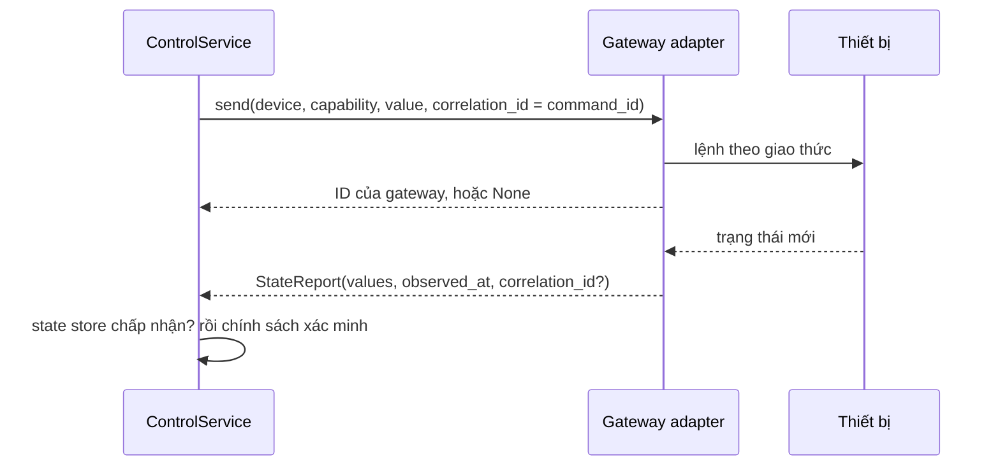

# IoT Integration

> **Tóm tắt.** Mọi thiết bị đi qua một hợp đồng gateway chung; chỉ báo cáo của thiết bị mới là bằng chứng. Hiện có simulator; Home
> Assistant là adapter thật tiếp theo (P0-09).

**Trạng thái:** lớp trừu tượng và simulator **Đã có**. Adapter Home Assistant là **Kế hoạch P0-09**.

## 1. Quyết định: Home Assistant là lớp tích hợp tại nhà

Không tự viết lại Zigbee, Matter, giao thức Wi-Fi của từng hãng. Home Assistant (HA) đã hỗ trợ hàng nghìn integration,
chạy cục bộ, có WebSocket API ổn định. Hệ thống này nói chuyện với HA, HA nói chuyện với thiết bị.

| Phương án | Dùng khi |
|---|---|
| **HA WebSocket API** | Mặc định: nhận `state_changed` realtime và gọi service trên cùng một kết nối |
| HA REST API | Chỉ để kiểm tra sức khỏe hoặc đọc snapshot khi cần |
| MQTT trực tiếp | Khi thiết bị chỉ có MQTT và không muốn đi qua HA (sau P0) |
| Connector hãng | Khi HA không hỗ trợ; viết thành một adapter `DeviceGateway` riêng |

Matter, Zigbee (qua ZHA hoặc Zigbee2MQTT) và thiết bị LAN đều đi vào HA, nên phần còn lại của hệ thống không cần biết.

## 2. Device Abstraction (Đã có)

```
Device ── capabilities: tuple[Capability] ── gateway: "simulator" | "home_assistant" ── external_ref
```

- `Device.id` là ID ổn định của hệ thống; `external_ref` là ID trong gateway (ví dụ `light.phong_khach`). Đổi entity HA
  không làm đổi ID, lịch sử hay placement.
- `Capability` mô tả thứ thiết bị **thật sự** hỗ trợ: kiểu giá trị, khoảng, bước, lựa chọn, vai trò tối thiểu, lớp an
  toàn, giá trị cần xác nhận, tuổi tối đa của báo cáo. Hai điều hòa có thể khác nhau.
- Danh sách capability hiện có: `on_off`, `brightness`, `position`, `target_temperature`, `hvac_mode`, `lock`,
  `temperature`, `humidity`, `occupancy`, `power` (`src/smarthome/domain/capabilities.py`).

## 3. Hợp đồng gateway (Đã có)

`src/smarthome/gateway/base.py`:

- `send(device, capability, value, correlation_id)`: trả về nghĩa là **gateway đã nhận**, không phải thiết bị đã đổi.
  `correlation_id` là `command_id`, adapter nào echo được thì gắn vào báo cáo; adapter có ID riêng (Home Assistant
  `context.id`) thì trả ID đó. Ném `GatewayError`
  nếu từ chối.
- `subscribe(listener)`: nhận `StateReport{device_id, values, connectivity, source, observed_at}`. Đây là **nguồn bằng
  chứng duy nhất** cho trạng thái thiết bị.


*Hình 1. Hợp đồng gateway. Simulator làm đúng luồng này (đã có); Home Assistant sẽ trả `context.id` làm ID gateway (P0-09).*

## 4. Trạng thái và bằng chứng

| Khái niệm | Ở đâu | Ý nghĩa |
|---|---|---|
| `Observation` | `StateStore` | Giá trị đã báo + nguồn + thời điểm. Báo cáo cũ hơn bị bỏ qua (chống đảo thứ tự) |
| `Connectivity` | `StateStore` | online/offline/unknown theo báo cáo của gateway |
| `pending` | `ControlService` | Lệnh đã gửi, chưa có báo cáo khớp |
| `DisplayStatus` | `DeviceView` | Kết hợp các thứ trên thành một nhãn cho UI |

Khớp lệnh: số so theo dung sai `step/2`; bool/enum so bằng nhau và cùng kiểu. Báo cáo không khớp (ví dụ rèm đang chạy)
không kết thúc lệnh; nếu tới hết thời gian chờ vẫn không khớp → `TIMED_OUT`.

## 5. Simulator (Đã có)

`SimulatorGateway`: độ trễ cấu hình được, bốn hành vi `normal`, `silent`, `error`, `offline`. Mọi báo cáo mang
`source=simulated`, nên UI luôn hiện "Giả lập". Chỉ chạy khi `SMARTHOME_DEVICE_GATEWAY=simulator` (hiện là giá trị duy nhất).

## 6. Adapter Home Assistant (Kế hoạch P0-09)

| Việc | Thiết kế |
|---|---|
| Kết nối | `ws://<ha>:8123/api/websocket`, xác thực bằng long-lived access token đọc từ `SMARTHOME_HA_TOKEN` (secret, không lưu DB, không log; chốt ở [ADR 0004](adr/0004-home-assistant-integration-layer.md)) |
| Nhận trạng thái | `subscribe_events` với `state_changed` (hoặc `subscribe_entities`), lọc theo entity đã ánh xạ |
| Snapshot khi kết nối | `get_states` → `StateReport` cho mọi entity đã ánh xạ |
| Gửi lệnh | `call_service`, ví dụ `light.turn_on {brightness_pct}`, `cover.set_cover_position`, `climate.set_temperature`, `climate.set_hvac_mode`, `lock.lock`/`lock.unlock`, `switch.turn_on` |
| Offline | State `unavailable` → `Connectivity.OFFLINE`; `unknown` → không có giá trị |
| Trạng thái lạc quan | Entity có thuộc tính `assumed_state: true` không được tính là xác minh: báo cáo cần được đánh dấu riêng để `SUCCEEDED` không dựa trên nó |
| Mất kết nối HA | Mọi thiết bị của adapter → offline; tự kết nối lại với backoff có giới hạn; lệnh đang chờ → `TIMED_OUT` |
| Ánh xạ capability | Bảng theo domain HA + `supported_features` + thuộc tính (`min_temp`, `max_temp`, `hvac_modes`) để sinh capability thật của từng entity |

**Câu hỏi mở cho pilot:** HA đã cài chưa, phiên bản, danh sách entity của 8–12 thiết bị dự kiến. Cần trước khi làm P0-09.

## 7. Local-first

- Backend và HA cùng LAN; đường điều khiển không đi qua Internet.
- LLM là thành phần duy nhất có thể cần Internet; nó không nằm trên đường điều khiển trực tiếp.
- Automation (P1) chạy trong backend hoặc giao lại cho HA với những rule an toàn quan trọng, để vẫn chạy khi backend dừng.

## 8. Compatibility Matrix (bắt đầu từ pilot)

| Loại | Domain HA | Capability | Đã kiểm với thiết bị thật |
|---|---|---|---|
| Đèn | `light` | on_off, brightness | Chưa |
| Rèm | `cover` | position | Chưa |
| Điều hòa | `climate` | on_off, target_temperature, hvac_mode | Chưa |
| TV | `media_player` | on_off | Chưa |
| Ổ cắm | `switch` + `sensor` (power) | on_off, power | Chưa |
| Cảm biến nhiệt ẩm | `sensor` | temperature, humidity | Chưa |
| Hiện diện | `binary_sensor` | occupancy | Chưa |
| Khóa | `lock` | lock | Chưa |
