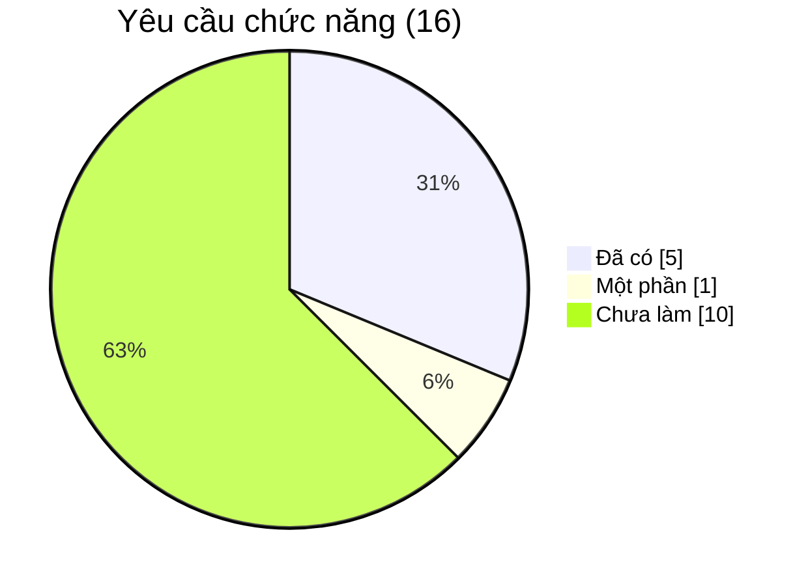

# PRD: yêu cầu sản phẩm

> **Tóm tắt.** 16 yêu cầu chức năng: 5 đã có, 1 một phần, 10 chưa làm. Ưu tiên: an toàn và thiết bị thật trước giao diện.

Cập nhật 2026-11-23. Mỗi yêu cầu có ID, mốc (P0/P1/P2) và trạng thái triển khai. Thứ tự và tiêu chí nghiệm thu kỹ thuật ở
[ROADMAP.md](ROADMAP.md).

## 1. Vai trò

| Vai trò | Quyền |
|---|---|
| Chủ nhà (owner) | Mọi thao tác; xác nhận hành động nhạy cảm; xem audit; sửa mô hình nhà; quản lý thành viên |
| Thành viên (member) | Điều khiển thiết bị thường; gửi yêu cầu nhạy cảm (chờ chủ nhà xác nhận); sở thích riêng |
| Khách (guest) | Xem trạng thái; điều khiển được giới hạn theo capability (mặc định: không) |

## 2. User stories

### Dashboard
- **US-D1 (P0)** Là thành viên, tôi thấy tổng quan nhà: thiết bị đang bật, nhiệt độ/độ ẩm, cảnh báo mất kết nối, lệnh
  đang chờ, để biết nhà đang thế nào mà không mở 3D.
- **US-D2 (P0)** Tôi điều khiển nhanh một thiết bị từ dashboard và thấy rõ "đang chờ" → "đã xác nhận" hoặc "chưa xác minh".
- **US-D3 (P1)** Tôi xem công suất điện nếu có thiết bị đo.
- **US-D4 (P0)** Chủ nhà xem lịch sử ai đã làm gì, từ đâu (nút, 3D, agent, automation).

### Digital Twin 3D
- **US-T1 (P0)** Tôi xoay, zoom, kéo camera quanh mô hình nhà; chọn tầng; ẩn/hiện mái và tường.
- **US-T2 (P0)** Tôi bấm một phòng để camera bay tới phòng đó.
- **US-T3 (P0)** Tôi bấm một thiết bị trên mô hình để mở bảng điều khiển của đúng thiết bị đó.
- **US-T4 (P0)** Mô hình hiện trạng thái thật: đèn sáng khi đã xác nhận bật, rèm theo % mở, điều hòa hiện nhiệt độ đặt và
  chế độ, thiết bị mất kết nối có cảnh báo rõ, trạng thái giả lập có nhãn.
- **US-T5 (P0)** Chủ nhà bật chế độ EDIT để kéo thiết bị về đúng vị trí thật và lưu.
- **US-T6 (P1)** Chủ nhà thêm/xóa tầng, phòng, vẽ mặt bằng hoặc nhập mô hình GLB.

### Thiết bị
- **US-I1 (P0)** Hệ thống quản lý đèn, rèm, điều hòa, TV, ổ cắm, cảm biến nhiệt ẩm, cảm biến hiện diện, khóa thông minh.
  Quạt, camera, đồng hồ năng lượng, bình nóng lạnh ở P1.
- **US-I2 (P0)** Mỗi thiết bị có ID ổn định, tên, loại, hãng, model, nhà/tầng/phòng, vị trí 3D, capability, trạng thái
  kết nối, trạng thái, thời điểm cập nhật, lịch sử lệnh.
- **US-I3 (P0)** Thiết bị offline hoặc dữ liệu cảm biến cũ được hiện đúng như vậy.

### AI Agent
- **US-A1 (P0)** Tôi nói "Phòng khách đang nóng, làm cho dễ chịu nhưng tiết kiệm điện" và nhận kế hoạch có lý do, chưa
  thiết bị nào đổi cho tới khi tôi bấm Chạy.
- **US-A2 (P0)** "Tôi chuẩn bị đi ngủ", "Tối nay có khách, chuẩn bị phòng khách" cho kế hoạch nhiều thiết bị.
- **US-A3 (P0)** Câu mơ hồ ("tắt đèn" ở trang cả nhà) → agent hỏi lại, không làm gì.
- **US-A4 (P0)** Yêu cầu nhạy cảm qua agent ("mở cửa") luôn chờ chủ nhà xác nhận phía server.
- **US-A5 (P0)** Mất Internet hoặc không có LLM, lệnh đơn giản ("tắt đèn phòng khách") vẫn chạy bằng bộ luật.
- **US-A6 (P1)** "Lần sau để 27 độ" → hỏi "Chỉ lần này" hay "Lưu sở thích"; sở thích xem/sửa/xóa được.
- **US-A7 (P1)** "Không có ai ở nhà thì tắt những thiết bị không cần thiết" → đề xuất automation, cần xác nhận trước khi lưu.

### Automation
- **US-R1 (P0)** Tôi chạy một scene nhiều thiết bị và thấy kết quả từng bước.
- **US-R2 (P1)** Tôi tạo rule theo thời gian, cảm biến, hiện diện, có ngoại lệ và ưu tiên.
- **US-R3 (P1)** Khi lưu rule mâu thuẫn với rule khác, hệ thống cảnh báo và giải thích; khi chạy, không bật/tắt liên tục.

## 3. Yêu cầu chức năng

*Hình 1. Nguồn: cột Trạng thái của bảng dưới.*

| ID | Yêu cầu | Mốc | Trạng thái |
|---|---|---|---|
| FR-01 | Mô hình capability theo thiết bị, validate giá trị | P0 | **Đã có** |
| FR-02 | Trạng thái hiển thị theo bằng chứng: confirmed/simulated/pending/stale/unknown/offline | P0 | **Đã có** (API) |
| FR-03 | Vòng đời lệnh có xác minh, timeout, idempotency | P0 | **Đã có** (lưu bền khi có Postgres) |
| FR-04 | Xác nhận phía server cho hành động nhạy cảm, chỉ chủ nhà, có hạn | P0 | **Đã có** |
| FR-05 | Audit mọi lệnh | P0 | **Đã có** (lưu bền khi có Postgres) |
| FR-06 | Lưu bền dữ liệu | P0 | **Một phần** (lệnh, idempotency, audit) |
| FR-07 | Đăng nhập, RBAC theo nhà | P0 | Chưa (chỉ dev identity) |
| FR-08 | Realtime WebSocket | P0 | Chưa |
| FR-09 | Home Assistant adapter | P0 | Chưa |
| FR-10 | Web dashboard | P0 | Chưa |
| FR-11 | 3D view + liên kết thiết bị | P0 | Chưa |
| FR-12 | Scene | P0 | Chưa |
| FR-13 | AI Agent lập kế hoạch | P0 | Chưa (chỉ agent mẫu) |
| FR-14 | Automation + conflict engine | P1 | Chưa |
| FR-15 | AI Memory | P1 | Chưa |
| FR-16 | Energy, diagnostics | P1 | Chưa |

## 4. Yêu cầu phi chức năng

| ID | Yêu cầu | Đo bằng |
|---|---|---|
| NFR-01 | p95 bấm → xác nhận < 2 s trên đường cục bộ, điều kiện: LAN, HA cục bộ, thiết bị Zigbee/Wi-Fi local | Log độ trễ P0-16 |
| NFR-02 | Suy luận LLM không chặn điều khiển trực tiếp | Test tải: lệnh trực tiếp trong lúc agent chạy |
| NFR-03 | Không báo thành công khi chưa có bằng chứng | Test execution, audit pilot |
| NFR-04 | Tách dữ liệu giữa các nhà | Test sai nhà ở mọi endpoint |
| NFR-05 | Mất Internet: điều khiển LAN vẫn chạy | Acceptance P0-18 |
| NFR-06 | 3D ≥ 50 fps với nhà pilot trên laptop mục tiêu | Đo thủ công P0-12 |
| NFR-07 | Không log nội dung tin nhắn, token, mật khẩu | Test log hiện có, mở rộng |
