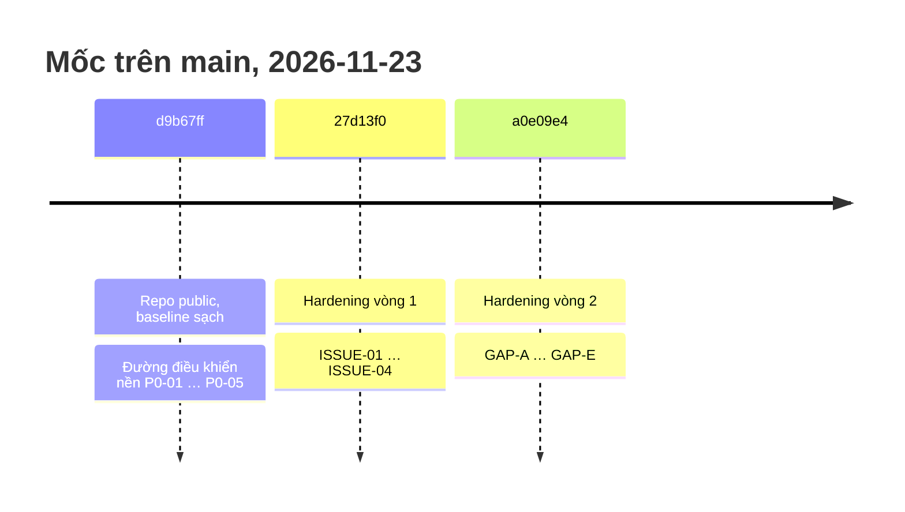

# Báo cáo tiến độ

> **Tóm tắt (2026-11-23).** Đường điều khiển thiết bị đã vững: policy fail-closed, xác minh theo bằng chứng, chống trùng,
> lưu bền Postgres, khôi phục sau restart, 217 test và CI đạt. **Chưa** có đăng nhập thật, web UI, 3D, Home Assistant hay
> thiết bị thật. Việc tiếp theo: **P0-07 đăng nhập thật**.

## 1. Executive Summary

| Câu hỏi | Trả lời |
|---|---|
| ✅ **Đã xong** | P0-01 … P0-05 (mô hình thiết bị, policy, execution, simulator, REST API); 2 vòng hardening; tiêu chuẩn Visual-first |
| 🔧 **Đang làm** | Không có task P0 nào đang mở. Tài liệu Visual-first vừa hoàn tất |
| 📋 **Còn lại** | 12 task P0 chưa làm, 1 task một phần (P0-06) |
| ⚠️ **Blocker / rủi ro** | Chưa có đăng nhập thật (Critical). [Design Review 2026-11 v2](DESIGN_REVIEW_2026-11.md): **PASS** cho thiết kế Sprint 1; chủ dự án đã duyệt ADR 0005, 0006 (2026-11-23) nên Sprint 1 được bắt đầu code (chưa có dòng code nào). Cần thông tin Home Assistant và thiết bị pilot cho P0-09 |
| ➡️ **Tiếp theo** | Sprint 1: P0-06b cấu hình nhà → P0-07 đăng nhập và RBAC → P0-08 WebSocket, P0-09 Home Assistant |

### Tiến độ P0

```
Đạt       █████░░░░░░░░░░░░░  5 / 18  (28 %)
Một phần  █░░░░░░░░░░░░░░░░░  1 / 18  (P0-06, không tính vào %)
```
*Hình 1. Phương pháp: số task P0 đạt **mọi** tiêu chí nghiệm thu có test, chia tổng 18 task trong [ROADMAP.md](ROADMAP.md).*

### Ma trận trạng thái task

| Khu vực | Task |
|---|---|
| Điều khiển | ✅ 01 Capability · ✅ 02 Policy · ✅ 03 Execution · ✅ 04 Simulator · ✅ 05 REST API · ⏳ 14 Scene |
| Dữ liệu | 🟡 06 Postgres (lệnh, audit: có · nhà, thiết bị: chưa) · ⏳ 10 Cấu hình nhà |
| Danh tính, realtime | ⏳ 07 Đăng nhập, RBAC · ⏳ 08 WebSocket |
| IoT | ⏳ 09 Home Assistant |
| Giao diện | ⏳ 11 Web app · ⏳ 12 3D view · ⏳ 13 Sửa vị trí 3D |
| AI | ⏳ 15 AI Agent |
| Vận hành | ⏳ 16 Observability · ⏳ 17 Triển khai local · ⏳ 18 Pilot |

*Hình 2. ✅ đạt · 🟡 một phần · ⏳ chưa làm. Ký hiệu luôn đi kèm chữ ở chú thích này.*

### Mốc đã đạt


*Hình 3. Chỉ ghi mốc đã có commit. Chưa có lịch cho các task tiếp theo nên không vẽ Gantt.*

### Kết quả test và CI

| Commit | Test đạt (có Postgres) | | CI GitHub |
|---|---|---|---|
| `d9b67ff` | 79 | `████████████` | ✅ success |
| `27d13f0` | 127 | `███████████████████` | ✅ success |
| `a0e09e4` | 136 | `████████████████████` | ✅ success |
| `72ee113` | 188 | `███████████████████████████` | ✅ success |

*Hình 4. 0 test lỗi, 0 bỏ qua trên CI ở mọi commit. Từ `72ee113` gồm cả 52–53 test tài liệu. Nguồn: `python -m pytest -q`
trên máy và log của `gh run view`. Số test hiện tại (217, gồm 81 test tài liệu) và kết quả render Mermaid: xem IMPLEMENTATION_LOG.*

### Rủi ro

| Mức | Rủi ro chính |
|---|---|
| ⛔ Critical | Chưa có đăng nhập thật |
| 🔴 High | Cấu hình nhà/thiết bị chưa lưu DB; danh tính dev fail-open theo tên môi trường; Compose chưa có Postgres; chưa có Home Assistant và chưa kiểm thiết bị thật |
| 🟠 Medium | Audit có thể thiếu khi DB gián đoạn; xác minh `state_match` phụ thuộc đồng hồ; chưa có rate limit |
| 🟡 Low | Lệnh chờ hết hạn nằm trong bộ nhớ |

*Hình 5. Ma trận đầy đủ theo khu vực: [SECURITY_AND_SAFETY.md §7](SECURITY_AND_SAFETY.md#7-rủi-ro-còn-mở).*

## 2. Technical Details

| Cần tra | Ở đâu |
|---|---|
| Từng thay đổi, file, lệnh kiểm chứng | [IMPLEMENTATION_LOG.md](IMPLEMENTATION_LOG.md) |
| Phân tích lỗi, thiết kế sửa, rollback | [HARDENING_2026-11.md](HARDENING_2026-11.md) |
| Tiêu chí nghiệm thu từng task | [ROADMAP.md](ROADMAP.md) |
| Phân bố test, cách chạy test Postgres | [TESTING_STRATEGY.md](TESTING_STRATEGY.md) |
| Tiêu chuẩn tài liệu và giao diện | [VISUAL_DESIGN_STANDARD.md](VISUAL_DESIGN_STANDARD.md) |

Lệnh tái tạo số liệu:

```powershell
python -m pytest -q
```

```powershell
gh run list --repo nguyenquangtiep/smart-home-future --branch main
```
