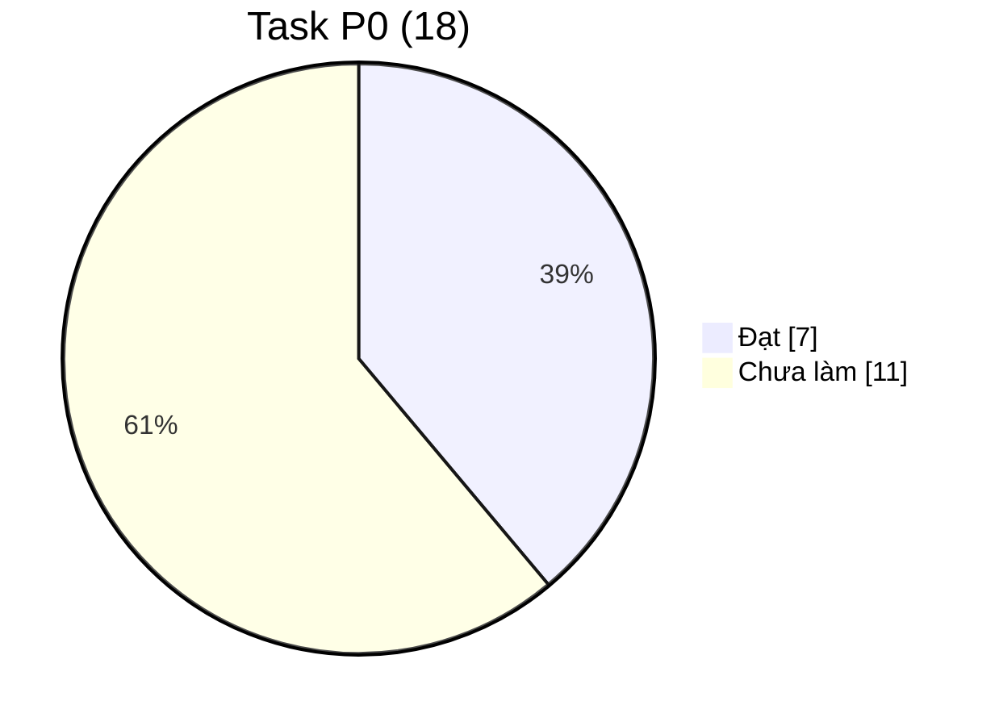
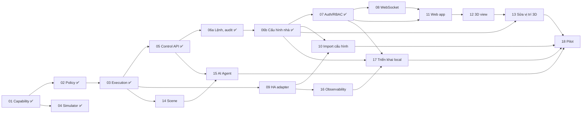
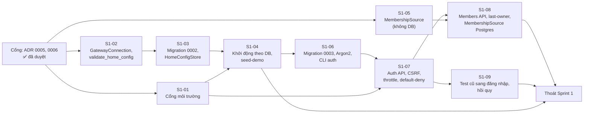
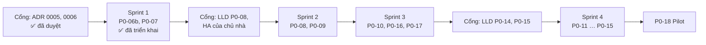

# Roadmap

> **Tóm tắt.** P0: **7/18 task đạt** (39 %), 11 chưa làm. **Sprint 1 (P0-06b, P0-07) đã có code và test** trên PostgreSQL thật
> ([kết quả nghiệm thu](SPRINT1_ACCEPTANCE.md)). Còn mở: đo Argon2id trên máy đích, kiểm Docker. Việc tiếp theo: Sprint 2 (P0-08, P0-09).

Cập nhật 2026-11-24. Task xếp theo dependency: không làm frontend trước khi có API, không làm tool AI trước khi có hợp đồng
điều khiển ổn định.

**Cách đo tiến độ:** đếm task có **mọi** tiêu chí nghiệm thu đạt và có test/bằng chứng. Không dùng phần trăm ước lượng.
**P0 hiện tại: 7/18 task đạt** (P0-01 … P0-07; Sprint 1 xong 2026-11-24). Độ phức tạp: S (≤1 ngày), M (2–4 ngày), L (1–2 tuần) cho một người.

## P0 — MVP dùng được trong nhà thật

*Hình 1. Trạng thái P0. Nguồn: cột Trạng thái trong bảng dưới; "Đạt" = mọi tiêu chí nghiệm thu có test.*

Mục tiêu pilot: một nhà, khoảng hai phòng, 8–12 thiết bị thật được chọn, chạy qua Home Assistant trong LAN.

*Hình 2. Dependency sau Design Review 2026-11: P0-06 tách 06a/06b; P0-07 cần 06b (khóa ngoại `memberships → homes`);
P0-17 cần 07 và 16. ✅ đạt · 📐 có LLD.*

| ID | Task | Module | Phụ thuộc | Ưu tiên | Độ phức tạp | Trạng thái |
|---|---|---|---|---|---|---|
| P0-01 | Device Capability Model, trạng thái có nguồn gốc | `domain` | — | Cao nhất | M | **Đạt** |
| P0-02 | Policy Engine v1 | `control/policy.py` | 01 | Cao nhất | S | **Đạt** |
| P0-03 | Execution Engine v1: vòng đời, xác minh, xác nhận, chống trùng, audit | `control/execution.py` | 01, 02 | Cao nhất | M | **Đạt** (hardening 2026-11) |
| P0-04 | Simulator gateway với hành vi lỗi | `gateway/simulator.py` | 01 | Cao | S | **Đạt** |
| P0-05 | Control API v1 (REST, dev identity) | `api/routes/homes.py` | 03 | Cao | S | **Đạt** |
| P0-06 | Lưu bền. **06a**: lệnh, idempotency, audit. **06b**: cấu hình nhà ([LLD v2](lld/P0-06_PERSISTENCE.md)) | `persistence`, `domain` | 05; 06b: ADR 0006 | Cao nhất | L | **Đạt** (06a, 06b; AC-06-1…13 có test, [bằng chứng](SPRINT1_ACCEPTANCE.md#ac-06-persistence)) |
| P0-07 | Auth thật và RBAC theo nhà ([LLD v2](lld/P0-07_AUTH_RBAC.md)) | `api/identity`, `persistence`, `auth`, `control` (MembershipSource) | 06b; ADR 0005 | Cao nhất | L | **Đạt** (AC-07-1…20 có test, [bằng chứng](SPRINT1_ACCEPTANCE.md#ac-07-authentication-and-rbac)); còn mở: M-07-1 trên máy đích |
| P0-08 | WebSocket realtime theo nhà | `api` | 07; ADR 0007; **cần LLD** | Cao | M | Chưa làm |
| P0-09 | Home Assistant gateway adapter | `gateway/home_assistant.py` | 01, 03 | Cao nhất | L | Chưa làm |
| P0-10 | Nhập/xuất cấu hình YAML + ánh xạ entity HA | `domain`, `persistence` | 06b, 09 | Cao | M | Chưa làm |
| P0-11 | Web app: đăng nhập, dashboard, điều khiển, xác nhận | `web/` (mới) | 07, 08 | Cao | L | Chưa làm |
| P0-12 | Digital Twin 3D cơ bản (VIEW) | `web/twin` | 11 | Cao | L | Chưa làm |
| P0-13 | Liên kết, kéo thả vị trí thiết bị (EDIT cơ bản) | `web/twin`, API layout | 12, 06b | Trung bình | M | Chưa làm |
| P0-14 | Scene nhiều thiết bị (chạy tuần tự, dừng khi chưa xác minh) | `control/scenes.py` | 03; **cần LLD** (API plan/scene, bảng) | Cao | M | Chưa làm |
| P0-15 | AI Agent v1: kế hoạch có cấu trúc, fallback theo luật | `agent` | 14, 05 | Cao | L | Chưa làm |
| P0-16 | Observability: log có cấu trúc, đo độ trễ p95, health gateway | `core`, `api` | 03, 09 | Trung bình | S | Chưa làm |
| P0-17 | Triển khai local-first theo [DEPLOYMENT](DEPLOYMENT.md): Compose + Postgres + migrate + proxy, backup | deploy | 06b, 07, 16; ADR 0008 | Cao | M | Chưa làm |
| P0-18 | Nghiệm thu pilot với thiết bị thật | toàn hệ | tất cả | — | M | Chưa làm |

### Tiêu chí nghiệm thu và cách kiểm thử

**P0-01 (Đạt).** Thiết bị khai báo capability riêng; hai thiết bị cùng loại có thể khác capability; giá trị được validate
theo kiểu và khoảng; `DeviceView` phân biệt `confirmed/simulated/pending/stale/unknown/offline`; giá trị hiển thị luôn là
giá trị đã báo. *Test:* `tests/unit/test_capabilities_and_state.py`.

**P0-02 (Đạt).** Từ chối sai nhà, capability không hỗ trợ/chỉ đọc, giá trị sai, vai trò thiếu, thiết bị offline; yêu cầu
xác nhận cho mở khóa và bật bình nóng lạnh; automation không được làm thao tác cần xác nhận. *Test:* `tests/unit/test_policy.py`.

**P0-03 (Đạt, bộ nhớ).** `SUCCEEDED` chỉ khi có báo cáo khớp; im lặng → `TIMED_OUT`, giữ giá trị cũ; lỗi gateway →
`FAILED`; idempotency key trả cùng lệnh; lệnh thứ hai khi đang chờ → `DEVICE_BUSY`; xác nhận chỉ chủ nhà, có hạn, chạy lại
policy; audit đủ vòng đời. Hardening 2026-11: chính sách xác minh (correlation, báo cáo cũ/sai thứ tự), fingerprint
idempotency, claim approval nguyên tử. *Test:* `tests/unit/test_execution.py`, `test_hardening.py`, `test_issue_repro.py`.

**P0-04 (Đạt).** Mọi báo cáo mang `source=simulated`; bốn hành vi `normal/silent/error/offline`. *Test:* gián tiếp qua
test execution và API.

**P0-05 (Đạt).** REST theo nhà, người ngoài 404, mặc định 401 khi chưa bật dev identity, cấm dev identity ở production,
mã HTTP theo lý do từ chối. *Test:* `tests/integration/test_homes_api.py`.

**P0-06.** Chi tiết phần 06b và AC-06-1…13: [LLD P0-06](lld/P0-06_PERSISTENCE.md#9-tiêu-chí-nghiệm-thu). Khởi động lại server không mất lệnh, audit, cấu hình nhà; lệnh đang `DISPATCHED` khi khởi động lại chuyển
`TIMED_OUT` có lý do; mọi truy vấn lọc theo `home_id`; audit chỉ ghi thêm (quyền DB). *Test:* integration với Postgres
thật trong CI (service container), test khởi động lại.

**P0-07.** Chi tiết và AC-07-1…20: [LLD P0-07](lld/P0-07_AUTH_RBAC.md#9-tiêu-chí-nghiệm-thu). Đăng nhập bằng mật khẩu băm Argon2id, cookie phiên `HttpOnly; Secure; SameSite=Strict`, CSRF cho request ghi, giới hạn
thử sai; vai trò owner/member/guest theo membership; xóa `X-Dev-User` khỏi đường production. *Test:* integration auth, test
sai nhà, test vai trò.

**P0-08.** Client nhận `device.view` và `command.updated` trong ≤ 500 ms sau khi server nhận StateReport (LAN); chỉ nhận
sự kiện của nhà mình; tự kết nối lại và tải lại snapshot. *Test:* integration WebSocket, test cô lập nhà.

**P0-09.** Kết nối HA WebSocket bằng long-lived token từ biến môi trường; ánh xạ `state_changed` → `StateReport(source=reported)`;
`unavailable` → offline; entity có `assumed_state` không được tính là xác minh; tự kết nối lại có backoff; mất HA → mọi
thiết bị của adapter hiện `offline`. *Test:* unit với tin nhắn HA ghi sẵn; integration với HA dev container (demo
integration); kiểm tra thủ công với **thiết bị an toàn** (đèn, ổ cắm không tải).

**P0-10.** Nhà, tầng, phòng, thiết bị, placement khai báo trong một file YAML có schema; validate khi nạp; báo lỗi rõ nếu
entity HA không tồn tại. *Test:* unit validate, integration nạp vào DB.

**P0-11.** React + TypeScript + Vite; trang tổng quan, danh sách phòng/thiết bị, điều khiển nhanh, hộp xác nhận cho chủ nhà,
lịch sử; nhãn trạng thái có chữ và ký hiệu; responsive. Tuân theo [VISUAL_DESIGN_STANDARD.md](VISUAL_DESIGN_STANDARD.md)
§3 (tokens, ngôn ngữ trạng thái, component; gồm VD-06, VD-07). *Test:* unit component (Vitest), E2E Playwright với
simulator ở 3 kích thước màn hình, kiểm tra a11y (axe).

**P0-12.** React Three Fiber; dựng tường/sàn từ footprint phòng; chọn tầng; ẩn/hiện mái và tường; bấm phòng → camera bay
tới; bấm thiết bị → panel điều khiển; overlay theo `DeviceView.status`; ≥ 50 fps trên laptop mục tiêu với nhà pilot.
Bố cục theo wireframe v2 và [VISUAL_DESIGN_STANDARD.md §4](VISUAL_DESIGN_STANDARD.md#4-digital-twin-3d).
*Test:* unit mapping trạng thái → hiệu ứng; E2E bấm thiết bị gửi lệnh; đo fps thủ công.

**P0-13.** Chế độ EDIT tách khỏi VIEW (phải bật rõ ràng, chỉ owner); kéo thả marker, lưu placement qua API; hoàn tác trước
khi lưu. *Test:* API placement, E2E kéo thả.

**P0-14.** Scene là danh sách bước; chạy tuần tự qua `ControlService`; bước chưa xác minh → dừng, các bước sau `not_run`;
kết quả từng bước. *Test:* unit với simulator silent ở bước giữa.

**P0-15.** Hiểu các câu mẫu trong PRD; ra kế hoạch dạng JSON đúng schema; validate theo capability trước khi hiện; không có
tool thực thi; người dùng bấm Chạy; không có LLM → bộ luật vẫn xử lý lệnh đơn giản; prompt injection từ tên thiết bị không
làm đổi kế hoạch. *Test:* eval dataset tiếng Việt mở rộng, test không có API key, test injection.

**P0-16.** Log JSON có `command_id`; đo `accepted→dispatched→succeeded` theo phân vị; `/health` báo trạng thái từng gateway.
*Test:* unit, kiểm tra thủ công. Mục tiêu p95 < 2 s cho đường điều khiển cục bộ được đo ở đây.

**P0-17.** `docker compose up` trong LAN dựng backend, Postgres, web; backup/restore Postgres có script và đã thử khôi phục.
*Test:* thủ công theo checklist, ghi vào IMPLEMENTATION_LOG.

**P0-18.** Chạy 7 ngày với thiết bị thật; không có báo thành công sai; mất Internet vẫn điều khiển được qua LAN.
*Test:* acceptance theo TESTING_STRATEGY §6.

## P1 — Nâng cao tính thông minh

| ID | Task | Phụ thuộc |
|---|---|---|
| P1-01 | Automation engine: trigger thời gian, cảm biến, hiện diện; điều kiện; ưu tiên; cooldown | P0-06, P0-09 |
| P1-02 | Conflict Engine: phát hiện tĩnh khi lưu rule, phân xử khi chạy, giải thích | P1-01 |
| P1-03 | Automation Builder UI | P1-01, P0-11 |
| P1-04 | AI Memory: sở thích cá nhân/hộ, xem/sửa/xóa, chỉ lưu khi đồng ý | P0-15, P0-07 |
| P1-05 | Energy monitoring từ ổ cắm/đồng hồ đo | P0-09 |
| P1-06 | Diagnostics: thiết bị hay mất kết nối, lệnh hay timeout | P0-16 |
| P1-07 | Kịch bản theo ngữ cảnh (tạo rule từ câu nói, luôn qua xác nhận) | P1-01, P0-15 |
| P1-08 | Trình chỉnh sửa mô hình nhà: thêm/xóa tầng, phòng, vẽ footprint, nhập GLB | P0-13 |
| P1-09 | Mở rộng loại thiết bị: quạt, camera (chỉ trạng thái), đồng hồ năng lượng | P0-09 |

## P2 — Sản phẩm thương mại

AI dự đoán thói quen có kiểm soát; nhiều hộ và quản trị B2B; giọng nói; dựng mô hình từ bản vẽ; giám sát vận hành ở quy mô
lớn; tối ưu năng lượng nâng cao; quy trình triển khai, cập nhật phần mềm và hỗ trợ khách hàng. Chi tiết hóa sau khi pilot
P0-18 có số liệu.

## Sprint 1: P0-06b và P0-07 (chốt thiết kế 2026-11-23)

**Trạng thái: S1-01…S1-09 đã triển khai**, chi tiết từng tiêu chí ở [SPRINT1_ACCEPTANCE](SPRINT1_ACCEPTANCE.md). Thiết kế: [LLD P0-06](lld/P0-06_PERSISTENCE.md), [LLD P0-07](lld/P0-07_AUTH_RBAC.md). Điều kiện bắt đầu code đã đạt (và đã dùng): chủ dự án đã duyệt
[ADR 0006](adr/0006-home-configuration-source-of-truth.md) và [ADR 0005](adr/0005-session-auth-csrf.md) (**Accepted** 2026-11-23).

*Hình 3. Dependency của Sprint 1. S1-01, S1-02, S1-05 độc lập nhau và làm được song song ngay sau cổng duyệt.*

| ID | Task | Phụ thuộc | Cỡ | AC | Đóng finding |
|---|---|---|---|---|---|
| S1-01 | `environment` thành `Literal`, allowlist `{local, test}`: ngoài đó bắt buộc DB, cấm danh tính dev và seed-demo, tắt `/docs`, route simulator; `Dockerfile` đặt `production`; sửa env của Compose | ADR 0005 | S | AC-07-14 | DR-H03 |
| S1-02 | Model `GatewayConnection` và hàm thuần `validate_home_config` + unit test | ADR 0006 | S | AC-06-7, AC-06-13 | |
| S1-03 | Migration `0002`, `HomeConfigStore` (Postgres, bộ nhớ), `ConfigVersionConflict` | S1-02 | M | AC-06-1…6, 8, 12 | DR-H01 |
| S1-04 | Khởi động theo `load_all` (từ chối DB trống/cấu hình sai), CLI `seed-demo` (cần instance lock) | S1-03, S1-01 | S | AC-06-9…11 | DR-H01 |
| S1-05 | `MembershipSource` (protocol async + `StaticMembershipSource`), `ControlService.member` thành async | ADR 0005 | S | AC-07-20 (phần tĩnh) | DR-H08 |
| S1-06 | Migration `0003`, store người dùng/phiên, Argon2id trong thread pool, CLI `create-owner`, `set-password`, `unlock`, `disable-user` | S1-04, ADR 0005 (D2) | M | AC-07-3, 15, 19 | |
| S1-07 | API đăng nhập/đăng xuất/phiên/đổi mật khẩu, cookie, CSRF + Origin, throttle, IP qua proxy tin cậy, default-deny (gồm `/agent/invoke`) | S1-06, S1-01 | M | AC-07-1, 2, 4…10, 17, 18 | DR-H02, DR-M09 |
| S1-08 | API thành viên, last-owner, `PostgresMembershipSource`, sự kiện bảo mật | S1-07, S1-05 | M | AC-07-11…13, 16, 20 | DR-H08, DR-M01 |
| S1-09 | Chuyển test hiện có sang fixture đăng nhập qua `https://`; hồi quy | S1-07 | S | AC-07-18 | |

**Tiêu chí thoát Sprint 1** (mọi mục phải đạt, kèm bằng chứng):

| # | Tiêu chí |
|---|---|
| 1 | ✅ Toàn bộ AC-06-1…13 và AC-07-1…20 có test đạt với Postgres bắt buộc (không skip) trên máy phát triển; CI chạy cùng cấu hình (xem Pull Request) |
| 2 | 🟡 M-07-1 đã đo trên máy phát triển (băm 88 ms, xác minh 90 ms); **máy đích chưa đo** |
| 3 | ✅ DR-H03 và DR-H08 đóng bằng test. ⛔ `docker compose up` **chưa kiểm** (Docker daemon không chạy); `docker compose config` hợp lệ |
| 4 | ✅ Tài liệu đồng bộ với code: DATABASE_DESIGN, ARCHITECTURE, TRACEABILITY chuyển DESIGNED → IMPLEMENTED có dẫn chứng |
| 5 | ✅ Mọi AC của P0-06 và P0-07 đều có test; hai mục còn mở ở trên ghi rõ, không che |

## Thứ tự sprint (theo dependency, chưa có ngày)

*Hình 4. Mỗi "Cổng" là điều kiện từ [Design Review 2026-11](DESIGN_REVIEW_2026-11.md#9-sign-off). Không ghi ngày vì chưa
có lịch thật.*

## Việc tiếp theo chính xác

1. ✅ Chủ dự án đã duyệt D1–D6 của [ADR 0005](adr/0005-session-auth-csrf.md#6-quyết-định-cần-chủ-dự-án) và
   [ADR 0006](adr/0006-home-configuration-source-of-truth.md#5-quyết-định-cần-chủ-dự-án) theo khuyến nghị (2026-11-23).
2. ✅ Sprint 1 đã triển khai ([nghiệm thu](SPRINT1_ACCEPTANCE.md)).
3. Còn mở từ Sprint 1: đo Argon2id trên máy đích (M-07-1); build và chạy Docker Compose trên máy có Docker daemon.
4. Trước Sprint 2: viết LLD P0-08 (WebSocket) và có quyền truy cập Home Assistant của nhà pilot (P0-09, [ADR 0004](adr/0004-home-assistant-integration-layer.md)).
5. Chủ dự án cần cung cấp: danh sách thiết bị pilot, HA đã cài chưa, máy chạy backend trong nhà.
