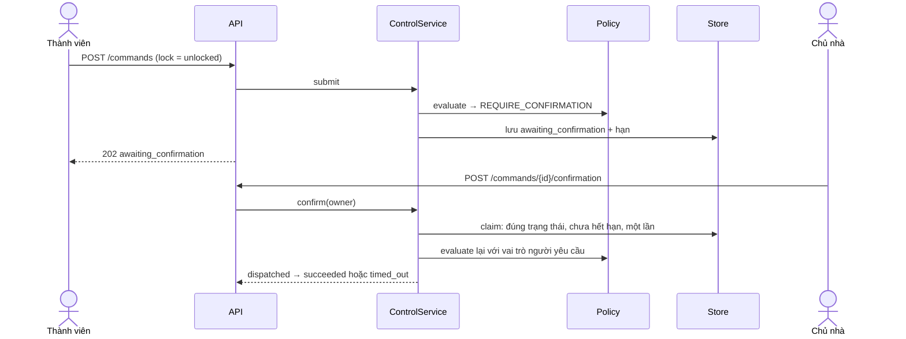

# Security and Safety

> **Tóm tắt.** Policy xác định, **fail-closed** cho thiết bị nguy hiểm; mở khóa và bật bình nóng lạnh cần chủ nhà xác nhận phía
> server, một lần, có hạn. Đăng nhập thật, phiên phía server, CSRF, RBAC theo nhà đã có (Sprint 1). Rủi ro lớn nhất hiện nay:
> chưa kiểm Argon2id trên máy đích, chưa có TLS và triển khai thật (P0-17).

Cập nhật 2026-11-23. Mỗi mục ghi **Đã có** (có test) hoặc mã task kế hoạch.

## 1. Danh tính và phân quyền

| Mục | Thiết kế | Trạng thái |
|---|---|---|
| Danh tính tạm | `X-Dev-User`, chỉ khi `SMARTHOME_DEV_IDENTITY_ENABLED=true` **và** `environment ∈ {local, test}`; ngoài đó app từ chối khởi động ([LLD P0-07 D-07-9](lld/P0-07_AUTH_RBAC.md#3-quyết-định-thiết-kế)) | ✅ `core/config.py`, `test_environment_gate.py`, `test_a_header_identity_is_never_trusted_without_the_dev_flag` |
| Đăng nhập thật | Mật khẩu Argon2id (trong thread pool), cookie phiên `HttpOnly; Secure; SameSite=Strict`, CSRF token + `Origin` cho request ghi, giới hạn thử sai 5/email và 30/IP trong 15 phút, hết hạn nhàn rỗi 7 / tuyệt đối 30 ngày. Mô hình mối đe dọa: [ADR 0005 §4](adr/0005-session-auth-csrf.md#4-mô-hình-mối-đe-dọa) | ✅ `auth/`, `api/security.py`, `test_auth_service.py`, `test_auth_api.py`, `test_login_rate_limit_concurrency.py` (giới hạn đúng khi 20–40 request đồng thời trên nhiều kết nối). Giới hạn: M-07-1 chờ máy đích |
| RBAC theo nhà | Membership `(user, home, role)`; vai trò owner/member/guest; `min_role` theo capability. Membership tra DB mỗi request và mỗi lần duyệt lệnh (`MembershipSource`); owner cuối không bị gỡ/hạ | ✅ `test_role_matrix_and_isolation_for_every_home_route`, `test_demoted_owner_cannot_approve_a_pending_command`, `test_two_owners_demoting_each_other_at_once_leave_one_owner` |
| Tách dữ liệu giữa nhà | Mọi truy vấn lọc theo `home_id` của danh tính; người ngoài nhận 404 cho cả nhà và thiết bị; khóa ngoại tổng hợp theo `home_id` ở DB | ✅ test tham số hóa trên **mọi** route theo nhà (AC-07-10) và `test_composite_foreign_keys_block_cross_home_rows` |
| WebSocket | Cùng cookie phiên khi bắt tay (không token trong URL), kiểm `Origin`, kiểm membership, một chiều server → client, đóng kết nối ≤ 60 giây sau khi phiên/membership bị thu hồi ([ADR 0005 §5](adr/0005-session-auth-csrf.md#5-websocket-ràng-buộc-cho-adr-0007)) | 📐 DESIGNED (P0-08, chưa có LLD) |

## 2. Ma trận hành động (nhà mẫu)

| Hành động | Guest | Member | Owner | Agent (thay mặt người) | Automation |
|---|---|---|---|---|---|
| Xem trạng thái | ✓ | ✓ | ✓ | ✓ (đọc) | — |
| Đèn, rèm, điều hòa, TV | ✗ | ✓ | ✓ | Kế hoạch, người bấm Chạy | ✓ |
| Khóa cửa | ✗ | ✓ | ✓ | ✓ | ✓ |
| Mở khóa | ✗ | Chờ owner xác nhận | Chờ xác nhận | Chờ owner xác nhận | ✗ |
| Bật bình nóng lạnh | ✗ | Chờ owner xác nhận | Chờ xác nhận | Chờ owner xác nhận | ✗ |
| Tắt camera an ninh (P1) | ✗ | Chờ owner xác nhận | Chờ xác nhận | Chờ owner xác nhận | ✗ |
| Xem audit | ✗ | ✗ | ✓ | ✗ | — |

Cấu hình bằng thuộc tính capability (`min_role`, `safety`, `safe_values`), không hardcode theo loại thiết bị.
Với `safety` là `high_power` hoặc `security`, **mọi** giá trị cần xác nhận trừ giá trị khai báo trong `safe_values`
(fail-closed): quên khai báo thì hệ thống hỏi xác nhận, không bao giờ bỏ qua. `confirm_values` chỉ áp dụng cho
capability `normal` và không làm yếu được capability nguy hiểm.

## 3. Human-in-the-loop (Đã có)

- Lệnh cần xác nhận (theo quy tắc fail-closed ở §2) → `AWAITING_CONFIRMATION`, không gửi gì tới gateway.
- **Authorization khác approval:** approval không nâng quyền; khi duyệt, policy chạy lại với vai trò của **người yêu
  cầu** và trạng thái thiết bị hiện tại.
- Approval gắn với đúng một bản ghi lệnh (người yêu cầu, nhà, thiết bị, capability, giá trị, `command_id`). Duyệt là
  một **claim có điều kiện** `awaiting_confirmation → requested` trong store: chỉ thành công một lần, chỉ trước hạn;
  duyệt lặp lại, đồng thời, hay từ tiến trình khác đều nhận `409 NOT_AWAITING`.
- Chỉ **owner của đúng nhà** xác nhận được, qua `POST /commands/{id}/confirmation`. Đây là kiểm tra phía server; hộp
  thoại frontend chỉ là giao diện.
- Xác nhận hết hạn sau `SMARTHOME_CONFIRMATION_TTL_S` (mặc định 120 s), dùng một lần.
- Khi duyệt, policy chạy lại với trạng thái hiện tại (thiết bị vừa offline → từ chối).
- Test: `test_unlock_waits_for_owner_confirmation`, `test_confirmation_expires`, `test_confirmation_rechecks_policy`,
  `test_unlock_needs_server_side_owner_confirmation`.

*Hình 1. Human-in-the-loop phía server (đã có). Duyệt lặp lại, đồng thời hoặc từ tiến trình khác nhận `409 NOT_AWAITING`.*

## 4. An toàn vật lý

- Policy là hàm xác định, không phụ thuộc LLM.
- Thiết bị offline → từ chối, không gửi mù.
- Dữ liệu cảm biến cũ → `stale`; automation không dùng dữ liệu `stale` làm điều kiện (P1-01).
- Thiết bị công suất lớn không được automation bật (đã có cho giá trị cần xác nhận).
- Chống bật/tắt liên tục: cooldown, `min_hold`, giới hạn tần suất (P1-02).
- **Không kiểm thử tự động trên thiết bị thật nguy hiểm.** Test tự động chỉ dùng simulator; kiểm thử phần cứng chỉ với
  đèn/ổ cắm không tải, do người thực hiện.

## 5. Dữ liệu và secrets

| Mục | Quy tắc |
|---|---|
| Secrets | Chỉ qua biến môi trường hoặc secret store (`SMARTHOME_LLM_API_KEY`, `SMARTHOME_HA_TOKEN`); `SecretStr`; không commit `.env` (đã có trong `.gitignore`) |
| Log | Chỉ metadata; không ghi nội dung tin nhắn, token, mật khẩu (**Đã có**, `test_invoke_does_not_log_message`) |
| Truyền | HTTPS/WSS khi ra ngoài LAN; trong LAN khuyến nghị TLS qua reverse proxy |
| Lưu | Mật khẩu băm Argon2id; memory cá nhân và token HA mã hóa khi lưu nếu phải lưu (P0-06/P1-04) |
| Audit | Chỉ ghi thêm: trigger Postgres từ chối UPDATE và DELETE, trừ lệnh `purge` (đặt `smarthome.allow_audit_purge` trong transaction). Chưa tách role DB riêng |
| Gửi LLM | Chỉ ngữ cảnh tối thiểu của nhà đang hỏi; không gửi audit, memory của người khác, secrets |

## 6. Prompt injection

Xem [AI_AGENT_DESIGN.md §6](AI_AGENT_DESIGN.md#6-chống-prompt-injection). Điểm cốt lõi: agent không có tool thực thi và
mọi kế hoạch qua validate + policy, nên văn bản bị chèn không tạo được quyền mới.

## 7. Rủi ro còn mở

| Mức | Bảo mật | Dữ liệu | Thiết bị / IoT | Vận hành |
|---|---|---|---|---|
| ⛔ **Critical** | Không còn mục Critical mở sau Sprint 1; **không** nối thiết bị thật hay triển khai ra ngoài máy dev trước P0-17 | | | |
| 🔴 **High** | Argon2id chưa đo trên máy đích (M-07-1); chưa có TLS (cần reverse proxy, P0-17) | Cấu hình ghi lúc chạy chưa có (chỉ khi app dừng, P0-13) | Chưa có adapter Home Assistant, chưa kiểm thiết bị thật (P0-09) | |
| 🟠 **Medium** | Rate limit chỉ có cho đăng nhập (chưa cho API khác); chưa tách role DB cho audit | Audit có thể thiếu khi DB gián đoạn (chỉ log) | `state_match` phụ thuộc đồng hồ gateway; HA `assumed_state` | |
| 🟡 **Low** | | | | Lệnh chờ xác nhận hết hạn nằm trong bộ nhớ tới khi được truy cập |

*Hình 2. Ma trận rủi ro theo mức độ và khu vực (đánh giá định tính, không phải số đo). Chi tiết từng rủi ro ở bảng dưới.*

| Rủi ro | Mức | Xử lý |
|---|---|---|
| Đăng nhập thật đã có nhưng chưa chạy trên máy đích, chưa có TLS | Cao | Compose dev chỉ bind `127.0.0.1`; không triển khai trước P0-17; đo Argon2id (M-07-1) |
| Không đặt `SMARTHOME_DATABASE_URL` thì lệnh và audit ở bộ nhớ | Trung bình | Production từ chối khởi động khi thiếu DB |
| Ghi audit thất bại (DB lỗi) chỉ được log, không chặn điều khiển: có thể thiếu dòng audit trong lúc DB gián đoạn | Trung bình | Cảnh báo/giám sát ở P0-16 |
| Xác minh `state_match` (không correlation) dựa vào đồng hồ gateway trong ngưỡng 1 s | Trung bình | Ưu tiên correlation (HA `context.id`) ở P0-09 |
| Rate limit chỉ cho đăng nhập (5/email, 30/IP, nguyên tử dưới tải đồng thời: F2) | Trung bình | API khác: P0-16 |
| Nhiều đăng nhập khác email/IP cùng lúc làm cạn RAM/CPU (Argon2id ~64 MiB mỗi phép) | Trung bình → Thấp | **Đã giới hạn** (R3): tối đa 2 phép cùng lúc, hàng đợi 16, chờ 5 s, vượt thì `503 AUTH_BUSY`; cấu hình qua `SMARTHOME_ARGON2_*`. Dưới tấn công cực lớn người dùng thật có thể phải thử lại. Capacity theo worker thread nên hủy request không nhả chỗ sớm (R4); request đăng nhập bị hủy vẫn tính là một lần sai và được ghi `login_cancelled` |
| HA `assumed_state` có thể làm xác minh sai | Trung bình | Thiết kế ở IOT_INTEGRATION §6, kiểm ở P0-09 |
