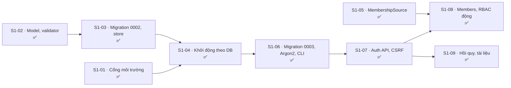

# Sprint 1: kết quả nghiệm thu

> **Tóm tắt (2026-11-24).** P0-06b (cấu hình nhà trong PostgreSQL) và P0-07 (đăng nhập, RBAC) đã có code. 13 tiêu chí AC-06 và
> 20 tiêu chí AC-07 đều có test chạy trên PostgreSQL thật; DR-H03 và DR-H08 đóng bằng test. Đợt nghiệm thu bổ sung sửa F1
> (Dockerfile), F2 (throttle đăng nhập dưới tải đồng thời), kiểm Docker (F3) trong CI và trên máy dev, và vòng review
> PR #2 sửa R1 (tài liệu), R2 (dọn dẹp smoke test), R3 (giới hạn Argon2id đồng thời). **Còn mở:** Argon2id trên máy đích
> (M-07-1, PENDING TARGET HARDWARE), Home Assistant, thiết bị thật, topology production (P0-17). Nguồn thiết kế: [LLD P0-06](lld/P0-06_PERSISTENCE.md),
> [LLD P0-07](lld/P0-07_AUTH_RBAC.md).


*Hình 1. Chín task Sprint 1 và trạng thái. ✅ nghĩa là có code và test đạt trên máy phát triển với PostgreSQL 18; kết quả CI nằm
ở Pull Request.*

## Cách chạy lại bằng chứng

```powershell
$env:SMARTHOME_TEST_DATABASE_URL = "postgresql://postgres@127.0.0.1:5432/postgres"
$env:SMARTHOME_REQUIRE_POSTGRES = "1"   # thiếu Postgres thì test lỗi, không bị bỏ qua
python -m pytest -rs
```

## AC-06: Persistence

| AC | Bằng chứng (test) | Kết quả |
|---|---|---|
| AC-06-1 | `test_config_store.py::test_migration_0002_round_trip_keeps_0001_data` | ✅ |
| AC-06-2 | `test_round_trip_is_exact_including_capabilities` (bộ nhớ và Postgres) | ✅ |
| AC-06-3 | `test_composite_foreign_keys_block_cross_home_rows` (phòng↔tầng, thiết bị↔phòng, thiết bị↔gateway của nhà khác) | ✅ |
| AC-06-4 | `test_placement_must_match_the_devices_room`, `test_placement_update_and_moving_rooms` | ✅ |
| AC-06-5 | `test_external_ref_uniqueness_and_id_reuse`, `test_two_homes_may_share_room_ids_and_external_refs`, `test_removed_device_id_can_never_come_back` | ✅ |
| AC-06-6 | `test_delete_rules_use_restrict` (`RestrictViolation` trên PG 18, `ForeignKeyViolation` trên PG 16; cascade placement), `test_room_that_ever_held_a_device_cannot_be_dropped` | ✅ |
| AC-06-7 | `tests/unit/test_home_config_validation.py` (đủ ca hợp lệ, không hợp lệ, biên và dung sai 0,05 m) | ✅ |
| AC-06-8 | `test_version_increments_by_one_and_stale_version_writes_nothing`, `test_concurrent_replace_with_same_version_has_exactly_one_winner`, `test_failed_write_rolls_back_every_table`, `test_load_all_is_one_consistent_snapshot` | ✅ |
| AC-06-9 | `test_startup.py`: `test_empty_database_refuses_to_start_instead_of_using_the_demo_home`, `test_corrupt_capability_json_refuses_startup_and_names_the_device`, `test_placement_outside_the_room_refuses_startup` | ✅ |
| AC-06-10 | `test_seed_demo_is_refused_outside_local_and_test`, `test_seed_is_refused_while_the_application_runs`, `test_seed_is_idempotent`, `test_cli_seed_demo_*` | ✅ |
| AC-06-11 | `test_restart_keeps_the_configuration`, `test_restart_interrupts_unfinished_commands_and_never_resends_them`, `test_unfinished_command_of_a_removed_device_is_reconciled_as_unknown` | ✅ |
| AC-06-12 | Toàn bộ test cũ vẫn đạt; `test_check_constraints_match_the_python_enums`; `tests/unit/test_migrations_frozen.py` (băm `0001`); chạy không DB vẫn dùng nhà mẫu | ✅ |
| AC-06-13 | `test_simulated_flag_matches_gateway_kind`, `test_real_home_cannot_keep_simulator_devices` | ✅ |

## AC-07: Authentication and RBAC

| AC | Bằng chứng (test) | Kết quả |
|---|---|---|
| AC-07-1 | `test_auth_api.py::test_login_sets_a_hardened_cookie_and_returns_csrf_and_homes`, `test_login_stores_only_the_hash_of_the_token` | ✅ |
| AC-07-2 | `test_all_login_failures_look_identical` (HTTP), `test_every_failure_looks_the_same_and_always_hashes` (băm luôn chạy) | ✅ |
| AC-07-3 | `test_passwords.py`, `test_login_stores_only_the_hash_of_the_token`, `test_every_security_event_is_recorded_without_secrets`, `test_no_password_or_token_reaches_the_application_log` | ✅ |
| AC-07-4 | `test_sixth_failure_in_the_window_is_throttled_even_for_unknown_emails`, `test_throttle_survives_restart_and_expires_with_the_sliding_window`, `test_failures_slide_out_one_by_one`, `test_per_ip_limit_applies_across_different_emails`, `test_login_is_throttled_with_retry_after` | ✅ |
| AC-07-5 | `test_forwarded_for_is_ignored_unless_the_peer_is_a_trusted_proxy` | ✅ |
| AC-07-6 | `test_state_changing_requests_need_origin_and_csrf`, `test_login_itself_needs_a_good_origin`, `test_logout_with_a_session_still_needs_csrf` | ✅ |
| AC-07-7 | `test_session_dies_on_idle_time_but_activity_keeps_it_alive`, `test_session_dies_at_the_absolute_limit_despite_activity`, `test_revoked_session_and_disabled_user_are_refused_immediately`, `test_last_seen_is_written_at_most_once_per_five_minutes`, `test_each_login_gets_a_new_token_and_revokes_the_one_presented`, `test_logout_revokes_the_session_and_is_idempotent` | ✅ |
| AC-07-8 | `test_change_password_rules`, `test_wrong_current_password_is_throttled`, `test_change_password_over_http` | ✅ |
| AC-07-9 | `test_every_route_is_denied_without_a_session` (đi qua toàn bộ route trong schema), `test_public_routes_are_exactly_health_login_and_logout` | ✅ |
| AC-07-10 | `test_role_matrix_and_isolation_for_every_home_route` (10 route × ẩn danh, người ngoài, nhà khác, 3 vai trò), `test_confirmation_route_roles`, `test_commands_of_one_home_are_invisible_from_another` | ✅ |
| AC-07-11 | `test_demoted_owner_cannot_approve_a_pending_command`, `test_removed_owner_cannot_approve_and_removed_requester_is_rejected`, `test_requester_demoted_to_guest_is_rejected_on_approval`; mức đơn vị: `test_membership_source.py` | ✅ |
| AC-07-12 | `test_two_owners_demoting_each_other_at_once_leave_one_owner` (hai kết nối), `test_the_last_owner_cannot_leave_or_be_demoted` | ✅ |
| AC-07-13 | `test_owner_manages_members` | ✅ |
| AC-07-14 | `tests/unit/test_environment_gate.py`, `test_strict_environment_serves_no_docs_and_no_simulator_route`, `test_local_environment_keeps_docs_for_developers` | ✅ |
| AC-07-15 | `test_cli_rejects_password_on_the_command_line`, `test_cli_create_owner_*`, `test_cli_set_password_revokes_all_sessions_and_unlock_clears_throttle`, `test_cli_disable_user_*`, `test_cli_prompt_mismatch_and_weak_passwords_are_refused` | ✅ |
| AC-07-16 | `test_every_security_event_is_recorded_without_secrets`, `test_changing_a_password_is_logged_without_the_password`, `test_auth_events_are_append_only` | ✅ |
| AC-07-17 | `test_password_verification_does_not_block_the_event_loop` (5 phép xác minh đồng thời, độ trễ vòng lặp < 50 ms) | ✅ |
| AC-07-18 | Test cũ chạy ở `environment=test` với danh tính dev; test mới dùng `https://home.example` cho cookie `Secure` | ✅ |
| AC-07-19 | `test_migration_0003_keeps_older_data_on_downgrade` | ✅ |
| AC-07-20 | `test_static_source_matches_the_old_member_dict`, `test_membership_source_reads_the_database_every_time`, `test_membership_source_hides_disabled_users` | ✅ |

## Nghiệm thu bổ sung (2026-11-24): F1, F2, F3

| Finding | Mức | Trước | Nguyên nhân gốc | Sửa | Bằng chứng | Sau |
|---|---|---|---|---|---|---|
| F1 Dockerfile | High | ❌ `docker build` hỏng | Lần sửa trước chèn chuỗi `\n` theo nghĩa đen vào lệnh `ENV` nhiều dòng (công cụ sửa file thay vì xuống dòng thật) | Sửa thành dòng nối `\` đúng; gộp hai `RUN` (hadolint DL3059) | `tests/unit/test_dockerfile.py` (5 test: đạt trên file đã sửa, **3 lỗi trên file cũ**); `docker build` và kiểm biến trong container ở [CI run 45352819175](https://github.com/nguyenquangtiep/smart-home-future/actions/runs/45352819175) | ✅ |
| F2 Throttle đăng nhập | High | ❌ 20 lần thử đồng thời đều được kiểm mật khẩu (giới hạn 5); 40 lần từ một IP đều được kiểm (giới hạn 30) | "Đọc số lần sai → xác minh Argon2id (~90 ms) → ghi" là ba bước rời nhau: mọi request đồng thời đọc cùng một số đếm thấp | `reserve_attempt`: **một** transaction ngắn lấy advisory lock theo email rồi IP (luôn theo thứ tự này, không deadlock), đếm, rồi chèn lần thử như **thất bại** trước khi xác minh; khóa nhả lúc commit nên không giữ khóa khi Argon2id chạy. Thành công thì `finish_attempt` đổi thành `succeeded`. Áp dụng cả đổi mật khẩu | `tests/integration/test_login_rate_limit_concurrency.py` (5 test, mỗi lần thử một kết nối PostgreSQL riêng): **4 lỗi trước khi sửa**, đạt sau khi sửa | ✅ |
| F3 Docker runtime | High | ⛔ chưa kiểm (Docker Desktop trên máy dev không chạy) | Máy dev: Docker Desktop crash khi khởi động (socket `dockerInference` cũ không xóa được) | Thêm `scripts/docker_smoke.sh` và job `docker` trong CI (hadolint + smoke test) | [CI run 45352819175](https://github.com/nguyenquangtiep/smart-home-future/actions/runs/45352819175), commit `06a2c6d`: 30 kiểm tra đạt (bảng dưới) | ✅ trong CI · ✅ máy dev (sau khi Docker Desktop chạy lại) |

Smoke test Docker (job `docker`, runner Linux, chỉ publish cổng `127.0.0.1`):

| Nhóm | Kiểm tra đạt |
|---|---|
| Image | build; `SMARTHOME_ENVIRONMENT=production`; uid 10001 (non-root); Python 3.12; không có `.env` hay biến dạng secret |
| Fail-closed | image `production` từ chối khởi động khi thiếu PostgreSQL, và khi thiếu `SMARTHOME_ALLOWED_ORIGINS` |
| PostgreSQL 16 | migration 0001–0003; `status` = 3; `seed-demo`; `create-owner --password-stdin` |
| App (production, đăng nhập thật) | `/health`; `/docs` = 404; API không phiên = 401; `X-Dev-User` bị bỏ qua; login từ Origin lạ = 403; login = 200 với cookie `HttpOnly; Secure; SameSite=Strict`; đọc 10 thiết bị; ghi thiếu CSRF = 403; ghi đủ = 202 và lệnh được xác minh |
| Restart | phiên, lịch sử lệnh và cấu hình nhà còn nguyên; `HEALTHCHECK` = healthy |
| Compose dev | `docker compose config`; app trả `/health`; chỉ publish `127.0.0.1:8000` |

Compose dev hiện tại chỉ có app, nhà mẫu trong bộ nhớ. **Topology production (proxy TLS, PostgreSQL, backup, migrate) là P0-17, chưa kiểm chứng.**

### Vòng review PR #2 (R1, R2, R3) và bảng trạng thái

| Finding | Nguyên nhân / bằng chứng trước | Sửa | Bằng chứng sau | Trạng thái |
|---|---|---|---|---|
| F1 Dockerfile | `\n` theo nghĩa đen trong `ENV` | xem trên | `test_dockerfile.py`; hadolint và build trong CI; build trên máy dev | **FIXED + CI PASS** |
| F2 Rate limiter race | 20 lần đồng thời đều được kiểm mật khẩu | xem trên | `test_login_rate_limit_concurrency.py` (PostgreSQL thật, mỗi lần một kết nối) | **FIXED + CONCURRENCY TEST PASS** |
| F3 Docker runtime | chưa kiểm | `scripts/docker_smoke.sh` | 30 kiểm tra đạt trong CI **và** trên máy dev (Docker Desktop 29.6.1 chạy lại được, 2026-11-24) | **VERIFIED IN CI + LOCAL** |
| R1 Tài liệu Deployment | `DEPLOYMENT.md` còn ghi Compose dùng `docker`, cổng môi trường fail-open, "sau S1-01 sẽ…", `create-owner` chưa có code, cần `--proxy-headers` | Viết lại §1 Hiện trạng, §4 Cấu hình, §6; tách rõ hiện tại và mục tiêu P0-17; ADR 0005 §1 và ADR 0008 đánh dấu phần lịch sử | test tài liệu (link, anchor) đạt | **FIXED** |
| R2 Dọn dẹp smoke test | Script cũ dùng `docker rm -f` (bỏ lại volume ẩn danh của postgres: **đo được 1 volume sót mỗi lần chạy**) và để file headers/cookie trong thư mục làm việc nếu lỗi giữa chừng | `docker rm -fv`; thư mục tạm `mktemp -d` cho headers, cookie, CSRF, xóa trong `cleanup` ở mọi lối thoát (kể cả Ctrl-C), giữ mã thoát; `compose down --volumes --remove-orphans`; `SMOKE_FAIL_AT` để ép lỗi | `scripts/docker_smoke_cleanup_check.sh`: ép lỗi ở `db`, `app`, `restart` → thư mục tạm bị xóa, không sót container/network `shf-smoke-*`, tập volume không đổi, log không chứa mật khẩu/cookie/CSRF (máy dev); bước CI kiểm cả đường thành công và lỗi | **FIXED + VERIFIED** |
| R3 Argon2id đồng thời | Giới hạn theo email/IP không chặn tổng: 24 lần đăng nhập khác email/IP chạy **16 phép Argon2id cùng lúc (~1 GiB)**, chỉ bị chặn bởi thread pool, hàng đợi vô hạn | `passwords.py`: tối đa `SMARTHOME_ARGON2_MAX_CONCURRENT` (2) phép cùng lúc, tối đa `SMARTHOME_ARGON2_MAX_PENDING` (16) đang chạy hoặc chờ, chờ tối đa `SMARTHOME_ARGON2_WAIT_S` (5 s); vượt thì `503 AUTH_BUSY` + `Retry-After: 1`, cùng thân cho mọi email; lần thử đã giữ chỗ được trả lại (không tính là sai) và ghi `login_busy` | `test_argon2_concurrency.py` (5 test, PostgreSQL thật): đỉnh ≤ giới hạn, quá tải bị từ chối ngay, timeout, đăng nhập bình thường không đổi, HTTP 503. Đo lại: **đỉnh 2 phép (~128 MiB)** | **FIXED** |
| R4 Hủy task giữa chừng (cancellation) | `_run()` giảm bộ đếm `_pending` trong `finally` của coroutine. Hủy coroutine **không** dừng worker thread đang chờ slot hay đang băm, nên capacity được nhả sớm: test T1, T2 **lỗi trên code cũ** (sau khi hủy, `_pending` = 1 trong khi còn 2 worker; caller thứ ba lọt vào hàng đợi đã đầy) | Capacity theo **worker**, không theo coroutine: job gửi vào thread pool riêng (cỡ `max_pending`), `_pending` chỉ giảm trong callback của `concurrent.futures.Future` (chạy đúng một lần: khi worker xong, hoặc khi job bị hủy trước khi có worker nhận). Caller bị hủy đánh dấu `abandoned` để worker còn chờ slot bỏ qua phép băm. Đăng nhập: hủy ở bất kỳ bước nào sau khi giữ chỗ thì lần thử **vẫn tính là thất bại**, ghi `login_cancelled` kèm bước (ghi được che bằng `asyncio.shield`), không tạo phiên | `tests/unit/test_hasher_cancellation.py` (T1–T4, T6, chạy lặp 15 lần ổn định); `tests/integration/test_login_cancellation.py` (T5, T6, PostgreSQL thật: hủy khi giữ chỗ, khi chờ hasher, khi băm, sau khi xác minh, khi tạo phiên; 5 lần hủy vẫn hết ngân sách 5 lần sai) | **FIXED** |
| M-07-1 Benchmark máy đích | — | `scripts/bench_argon2.py` | số tham khảo máy dev | **PENDING TARGET HARDWARE** |

Lựa chọn cho R3: một semaphore trong tiến trình (không cần đa tiến trình vì triển khai là một worker, một instance: ADR 0001)
cộng một bộ đếm hàng đợi có trần, thay vì worker pool riêng hay giới hạn trong PostgreSQL: đơn giản nhất, không chặn event loop
(chờ diễn ra trong thread), không hàng đợi vô hạn. Đánh đổi: dưới tải cực lớn người dùng thật có thể nhận `503` và phải thử lại;
giới hạn theo tiến trình sẽ phải xem lại nếu có nhiều instance (ADR 0001 thay đổi).

Vì sao cách sửa R4 an toàn khi hủy: bộ đếm chỉ đổi ở hai chỗ, tăng khi gửi job (dưới khóa, kiểm trần trước) và giảm trong callback hoàn tất của job, mà `concurrent.futures` gọi đúng một lần cho mỗi job, kể cả khi job bị hủy trước khi chạy. Không chỗ nào giảm theo vòng đời coroutine, nên không thể âm, không thể nhả hai lần, và không rò rỉ khi worker kết thúc bằng ngoại lệ hay timeout. `asyncio.shield` chỉ dùng cho việc ghi sự kiện bảo mật, không dùng để giữ capacity.
Giới hạn: việc ngắt kết nối HTTP có hủy handler hay không phụ thuộc server ASGI và middleware; các test hủy trực tiếp `asyncio.Task`, không khẳng định hành vi ngắt kết nối. Hủy đúng lúc đang giữ chỗ có thể để lại một lần thử được tính là thất bại mà không có id trong sự kiện (sự kiện vẫn được ghi với bước `reserving`); phiên đã ghi vào DB nhưng chưa trả token (hủy ngay sau `create_session`) không dùng được vì token không bao giờ rời tiến trình.


## M-07-1: Argon2id

| Thông số | Giá trị |
|---|---|
| Tham số | `time_cost=3`, `memory_cost=64 MiB`, `parallelism=2` (đúng LLD) |
| Trạng thái | **PENDING TARGET HARDWARE**: chưa có máy triển khai cuối; phải đo trước Deployment/Pilot (P0-17, P0-18). Người phụ trách: chủ dự án (cung cấp máy) |
| Công cụ | `python scripts/bench_argon2.py --runs 30 --warmup 3 --json` (không in mật khẩu hay hash) |
| Máy đo (tham khảo) | máy phát triển Windows 11, Intel Core thế hệ 11 (Family 6 Model 141), 12 luồng, 15,8 GiB RAM, Python 3.12.6. **Không phải máy đích** |
| Băm | p50 **79,9 ms**, p95 124,2 ms (min 70,1, max 144,7; 30 lần sau 3 lần khởi động) |
| Xác minh | p50 **84,5 ms**, p95 118,2 ms (min 70,2, max 126,1) |
| Event loop | trễ tối đa 6,6 ms khi 5 phép xác minh chạy đồng thời (chạy trong thread pool) |
| Đánh giá | Dưới dải 100 ms–1 s của LLD trên máy dev nhanh. **Không chỉnh tham số** dựa trên máy dev hay CI; quyết định sau khi đo trên máy đích. Tiêu chí đóng: p50 xác minh trên máy đích trong 100 ms–1 s, hoặc tham số được chỉnh và đo lại |

## Quyết định khi triển khai (khác hoặc bổ sung LLD)

| # | Quyết định | Lý do |
|---|---|---|
| 1 | Cột số thực của `0002` là `double precision`, không phải `real` | `real` trả `2.8` thành `2.7999999523`, làm vòng ghi–đọc không bằng nhau (AC-06-2) |
| 2 | `POST /auth/logout` thuộc allowlist default-deny, không có phiên vẫn `204` | LLD API ghi `204` khi không có phiên; ma trận quyền ghi `401`. Chọn `204` (idempotent); có phiên thì vẫn cần `Origin` và CSRF |
| 3 | Gateway của nhà mẫu giữ ID `simulator` | Đó là ID instance hợp lệ (toàn cục, thuộc `home-demo`); đổi sẽ phá nhiều test mà không thêm an toàn. Route simulator tra gateway theo `device.gateway`, không theo tên |
| 4 | `seed-demo` tạo thêm 3 người dùng demo (`user-owner`, `user-member`, `user-guest`, mật khẩu NULL) và membership | Danh tính dev cần membership trong DB khi có Postgres; mật khẩu NULL nên không đăng nhập thật được |
| 5 | Gateway `home_assistant` làm app từ chối khởi động ("chưa triển khai") | Chưa có adapter (P0-09); không âm thầm bỏ qua thiết bị |
| 6 | FastAPI bọc router lười: test duyệt route qua `app.openapi()["paths"]`, không qua `app.routes` | `app.routes` chỉ chứa `_IncludedRouter`; duyệt `APIRoute` ra 0 route và test vô nghĩa |
| 7 | Test dùng chung event loop của lifespan (`client.portal`) | `TestClient` không dùng `with` chạy mỗi request trên loop riêng và hủy tác vụ nền (báo cáo của simulator) khi request kết thúc |

## Chưa kiểm hoặc ngoài phạm vi

| Mục | Trạng thái |
|---|---|
| Argon2id trên máy đích | PENDING TARGET HARDWARE (M-07-1) |
| `docker build`, `docker compose up` | ✅ trong CI và trên máy dev (30 kiểm tra của `scripts/docker_smoke.sh`) |
| Topology production (proxy TLS, PostgreSQL, backup) | Chưa có, P0-17 |
| Home Assistant, thiết bị thật, TLS, hiệu năng dưới tải | Chưa có (P0-09, P0-17) |
| WebSocket, UI đăng nhập | Ngoài Sprint 1 (P0-08, P0-11) |
| Ghi cấu hình lúc app chạy | Chưa có: cấu hình chỉ ghi khi app dừng (D-06-8); P0-13 |
