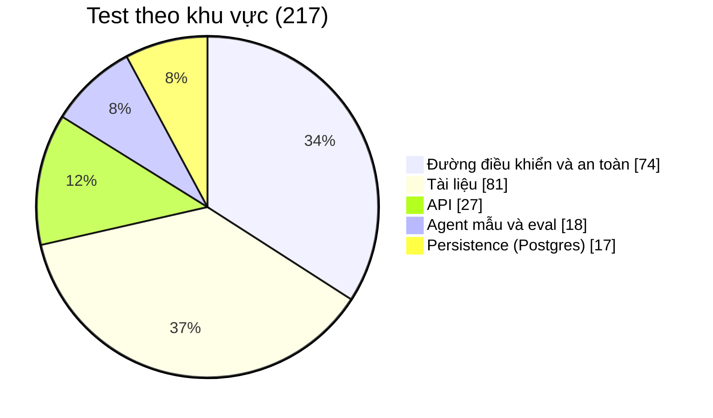

# Testing Strategy

> **Tóm tắt.** 217 test (165 unit, 44 integration, 8 eval); 13 test cần Postgres và **bắt buộc** chạy trong CI. Mọi
> sơ đồ Mermaid được render bằng renderer thật trong CI. Chỉ dùng simulator, không thử trên
> thiết bị thật.

Cập nhật 2026-11-23.

## 1. Hiện có

| Tầng | Framework | Vị trí | Số test |
|---|---|---|---|
| Unit | pytest | `tests/unit/` | capability/state, policy, execution, agent mẫu |
| Integration (API) | pytest + FastAPI `TestClient` | `tests/integration/` | agent API, control API |
| Eval | pytest + runner | `tests/eval/`, `eval/` | 7 ca agent mẫu |
| Persistence | pytest + Postgres thật | `tests/integration/test_persistence.py`, `tests/conftest.py` | contract chạy trên store bộ nhớ và Postgres; migration; restart; đồng thời hai tiến trình |
| Tài liệu (tĩnh) | pytest | `tests/unit/test_docs.py` | 81 ca (tự sinh theo số tài liệu): file và anchor của link nội bộ, Mermaid hợp lệ và không có `;`, SVG là XML hợp lệ, có `viewBox`, `title`, `desc`, `lang` |
| Tài liệu (render thật) | mermaid-cli 11.17.1 | `scripts/render_mermaid.py` | Render từng khối Mermaid ra SVG; lỗi cú pháp làm CI đỏ; SVG lưu thành artifact `mermaid-svg` |
| Tổng (2026-11-23) | | | **217 đạt, 0 lỗi, 0 bỏ qua** khi có Postgres; không có thì **204 đạt, 13 bỏ qua**. CI đặt `SMARTHOME_REQUIRE_POSTGRES=1` nên thiếu DB là **lỗi**, không bỏ qua |

Test async chạy bằng `asyncio.run` trong test đồng bộ, không cần plugin thêm. Test dùng simulator với độ trễ 20 ms và
timeout xác minh 0,2–0,3 s để nhanh.

Test Postgres cần `SMARTHOME_TEST_DATABASE_URL` trỏ tới server cho phép tạo database (mỗi test tạo và xóa một DB riêng).
CI chạy chúng với service container `postgres:16`.

Lệnh:

```powershell
python -m pytest
```

```powershell
ruff check .; ruff format --check .; python eval/scripts/run_eval.py
```

Render Mermaid giống CI (cần Node; `npm install -g @mermaid-js/mermaid-cli@11.17.1`):

```powershell
python scripts/render_mermaid.py --out mermaid-out
```


*Hình 1. Phân bố test. Nguồn: `python -m pytest --collect-only -q`, 2026-11-23 (sau Design Review, trên `a797bac` + tài liệu review). Đường điều khiển và an
toàn = `test_capabilities_and_state`, `test_policy`, `test_execution`, `test_hardening`, `test_hardening_round2`,
`test_issue_repro`; tài liệu = `test_docs`; API = `test_api`, `test_homes_api`; agent = `test_graph`, `test_tools`,
`tests/eval`.*

## 2. Kim tự tháp mục tiêu

| Tầng | Kiểm cái gì | Ghi chú |
|---|---|---|
| Unit | Policy, capability, máy trạng thái lệnh, ánh xạ HA → capability, conflict detection, mapping trạng thái → hiệu ứng 3D | Hàm thuần, không DB, không mạng |
| Integration | API + Postgres thật (**đã có**), WebSocket, auth, cô lập nhà | Postgres service container trong CI (**đã có**) |
| Simulation | Kịch bản lỗi bằng simulator: silent, error, offline, báo cáo đảo thứ tự, báo cáo trùng, lệnh đồng thời | Đã có một phần |
| Contract (HA) | Tin nhắn HA WebSocket ghi sẵn → `StateReport`; `call_service` đúng định dạng | P0-09 |
| HA dev instance | HA container với demo integration, chạy adapter thật | P0-09, chạy thủ công hoặc job CI riêng |
| E2E web | Playwright: dashboard, 3D bấm thiết bị, xác nhận | P0-11/12 |
| Eval agent | Dataset câu tiếng Việt → kế hoạch mong đợi; ca mơ hồ; ca injection; ca không có LLM | P0-15 |
| Hardware | Thiết bị thật **an toàn** (đèn, ổ cắm không tải), người thực hiện, theo checklist | P0-18 |
| Acceptance | Kịch bản pilot | §6 |

## 3. Bất biến bắt buộc có test

1. Không có `succeeded` khi chưa có báo cáo khớp. (**Đã có**)
2. Thiết bị im lặng → `timed_out`, giá trị hiển thị không đổi. (**Đã có**)
3. Người ngoài nhà không đọc/điều khiển được. (**Đã có**)
4. Hành động nhạy cảm không tới gateway khi chưa có owner xác nhận. (**Đã có**)
5. Automation không thực hiện hành động cần xác nhận. (**Đã có**)
6. Idempotency key không tạo lệnh thứ hai; khóa dùng lại với nội dung khác bị từ chối. (**Đã có**)
7. Khởi động lại không làm mất lệnh, lệnh đang chờ thành `interrupted`, không gửi lại. (**Đã có**)
8. Báo cáo cũ, sai thứ tự, hoặc mang correlation của lệnh khác không xác minh được lệnh. (**Đã có**)
9. Capability nguy hiểm thiếu cấu hình vẫn cần xác nhận (fail-closed). (**Đã có**)
10. Approval dùng một lần, có hạn, không dùng cho lệnh khác, kể cả giữa hai tiến trình. (**Đã có**)

## 4. Hiệu năng

Đo `created_at → dispatched_at → completed_at` của lệnh trong log (P0-16). Báo cáo p50/p95 theo loại thiết bị, điều kiện ghi
rõ (LAN, HA cục bộ, giao thức). Thêm phép đo "lệnh trực tiếp trong lúc agent đang gọi LLM" để kiểm NFR-02.

## 5. Không làm

- Không chạy test tự động trên thiết bị thật có rủi ro (khóa, bình nóng lạnh).
- Không mock để test "đạt" một chức năng chưa có.

## 6. Acceptance pilot (P0-18)

1. Đăng nhập owner và member trên hai máy.
2. Bấm đèn trên mô hình 3D: đèn thật bật, mô hình chuyển "đang chờ" → sáng sau xác nhận.
3. Rút điện một thiết bị: mô hình hiện mất kết nối trong ≤ 60 s, lệnh tới nó bị từ chối rõ ràng.
4. Member yêu cầu mở khóa qua agent: owner nhận yêu cầu xác nhận; không xác nhận thì không mở.
5. Ngắt Internet của router: điều khiển qua LAN vẫn chạy; agent báo AI không khả dụng, lệnh đơn giản vẫn chạy bằng luật.
6. Chạy scene "Đón khách" khi một thiết bị im lặng: kết quả từng bước đúng, các bước sau "chưa chạy".
7. Audit hiện đủ người, nguồn, kết quả cho mọi bước trên.
