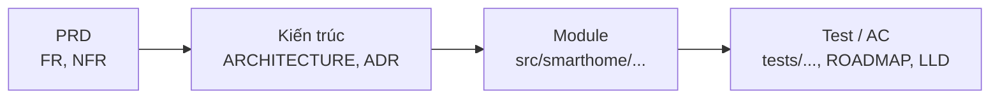
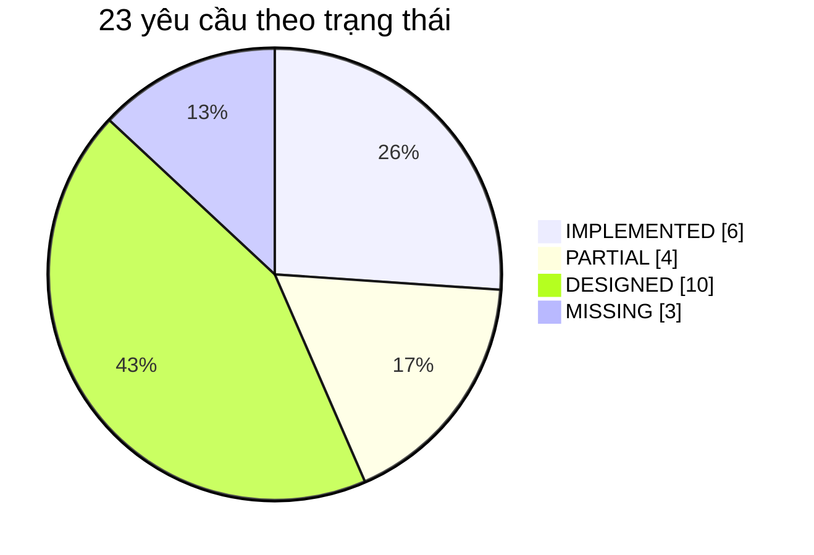

# Requirement Traceability Matrix

> **Tóm tắt (2026-11-23, trạng thái code `0461606`, thiết kế theo LLD v2).** 23 yêu cầu (16 chức năng, 7 phi chức năng): **6 IMPLEMENTED**,
> **4 PARTIAL**, **10 DESIGNED**, **3 MISSING** (chưa có thiết kế đủ để code). Mọi trạng thái đều có dẫn chứng file hoặc test.
> Cập nhật mỗi khi một task đổi trạng thái.

*Hình 1. Mỗi dòng dưới đây đi đủ bốn bước; ô trống nghĩa là chưa có.*

| Trạng thái | Nghĩa |
|---|---|
| ✅ IMPLEMENTED | Có code và test tự động chứng minh |
| ⚠️ PARTIAL | Có code một phần hoặc test chưa phủ hết |
| 📐 DESIGNED | Có thiết kế đủ để code (LLD, ADR hoặc AC trong ROADMAP), chưa có code |
| ❌ MISSING | Chưa có thiết kế đủ chi tiết |

## 1. Yêu cầu chức năng

| ID | Yêu cầu | Kiến trúc | Module | Test / AC | Trạng thái |
|---|---|---|---|---|---|
| FR-01 | Capability theo thiết bị, validate giá trị | ARCH §3, IOT §2 | `domain/capabilities.py`, `domain/models.py` | `test_validate_value`, `test_same_type_devices_may_differ_in_capabilities` | ✅ |
| FR-02 | Trạng thái theo bằng chứng (6 nhãn) | ARCH §4, ADR 0003 | `domain/state.py` | `test_view_*`, `test_pending_keeps_last_confirmed_value`, `test_offline_overrides_everything`, `test_sensor_report_goes_stale` | ✅ |
| FR-03 | Vòng đời lệnh: xác minh, timeout, idempotency | ARCH Hình 4, ADR 0003, HARDENING §2 | `control/execution.py`, `control/commands.py` | `test_success_only_after_matching_report`, `test_report_with_foreign_correlation_does_not_verify`, `test_gap_a_*`, `test_same_key_*`, `test_concurrent_requests_with_same_key_create_one_command` | ✅ |
| FR-04 | Xác nhận phía server, chỉ owner, có hạn, một lần | SECURITY §3 | `control/policy.py`, `ControlService.confirm`, `store.claim` | `test_unlock_waits_for_owner_confirmation`, `test_confirmation_expires`, `test_approval_cannot_be_replayed`, `test_two_processes_confirming_same_command_dispatch_once` | ✅ (giới hạn: kiểm tra lại người yêu cầu dùng thành viên **tĩnh**, phải đổi khi có P0-07, DR-H08) |
| FR-05 | Audit mọi lệnh, chỉ ghi thêm | SECURITY §5, ADR 0002 | `persistence/*`, migration `0001` | `test_audit_records_full_lifecycle`, `test_audit_is_append_only_except_explicit_purge` | ✅ |
| FR-06 | Lưu bền dữ liệu | ADR 0002, ADR 0006 | `persistence/*` | 06a: `test_restart_keeps_history_interrupts_in_flight_and_never_resends`, `test_command_history_survives_app_restart`. 06b: [LLD AC-06-1…13](lld/P0-06_PERSISTENCE.md#9-tiêu-chí-nghiệm-thu) | ⚠️ |
| FR-07 | Đăng nhập, RBAC theo nhà | ADR 0005 | hiện: `api/identity.py` (dev) | [LLD AC-07-1…20](lld/P0-07_AUTH_RBAC.md#9-tiêu-chí-nghiệm-thu); hiện có `test_auth_disabled_by_default`, `test_rejected_commands` (vai trò) | ⚠️ |
| FR-08 | Realtime | ADR 0007 | — | ROADMAP P0-08 (AC mức task) | 📐 |
| FR-09 | Home Assistant adapter | ADR 0004, IOT §6 | hợp đồng `gateway/base.py` | ROADMAP P0-09 | 📐 |
| FR-10 | Web dashboard | VISUAL_DESIGN_STANDARD §3 | — | ROADMAP P0-11 | 📐 |
| FR-11 | 3D view + liên kết thiết bị | DIGITAL_TWIN_3D, VISUAL §4 | dữ liệu: `Placement`, `Room.footprint` | ROADMAP P0-12, P0-13 | 📐 |
| FR-12 | Scene | AUTOMATION_ENGINE §1 | — | ROADMAP P0-14; **chưa có** API `plans/scenes`, bảng `scenes` | ❌ |
| FR-13 | AI Agent lập kế hoạch | AI_AGENT_DESIGN | hiện: `agent/` (mẫu, không nối control) | ROADMAP P0-15; **chưa có** hợp đồng tool/plan API | ❌ |
| FR-14 | Automation + conflict engine | AUTOMATION_ENGINE §2–4 | — | ROADMAP P1-01, P1-02 | 📐 |
| FR-15 | AI Memory | AI_AGENT_DESIGN §7 | — | ROADMAP P1-04 | 📐 |
| FR-16 | Energy, diagnostics | — | `CapabilityKind.POWER` có sẵn | ROADMAP P1-05, P1-06 | ❌ |

## 2. Yêu cầu phi chức năng

| ID | Yêu cầu | Kiến trúc | Module | Test / AC | Trạng thái |
|---|---|---|---|---|---|
| NFR-01 | p95 bấm → xác nhận < 2 s (LAN) | ADR 0001 | timestamp trên `CommandRecord` | ROADMAP P0-16; **chưa có** phép đo | 📐 |
| NFR-02 | LLM không chặn điều khiển | ADR 0001, AI_AGENT §8 | — | Chưa có test tải | 📐 |
| NFR-03 | Không báo thành công khi chưa có bằng chứng | ADR 0003 | `control/execution.py` | `test_issue01_*`, `test_gap_a_*`, `test_non_matching_report_keeps_waiting_then_times_out` | ✅ (simulator; **chưa** với thiết bị thật) |
| NFR-04 | Tách dữ liệu giữa các nhà | SECURITY §1 | `api/identity.py`, `device_in_home`, `get_command` | `test_non_member_and_unknown_home_get_404`, `test_unknown_device_is_404`, `test_owner_of_other_home_cannot_confirm`. Test HTTP chỉ phủ `/devices`; endpoint khác dùng chung dependency | ⚠️ (AC-07-10 tham số hóa mọi route; AC-06-3 cho khóa ngoại theo nhà) |
| NFR-05 | Mất Internet vẫn điều khiển LAN | ADR 0008 | — | ROADMAP P0-18 | 📐 |
| NFR-06 | 3D ≥ 50 fps | DIGITAL_TWIN §7 | — | ROADMAP P0-12 | 📐 |
| NFR-07 | Không log nội dung tin nhắn, token, mật khẩu | SECURITY §5, LLD P0-07 §8 | `core/logging.py`, access log chỉ path | `test_invoke_does_not_log_message`; mật khẩu/token: LLD AC-07-2 | ⚠️ |

## 3. Đếm

*Hình 2. Nguồn: hai bảng trên. IMPLEMENTED = FR-01…05, NFR-03 (giới hạn: chỉ với simulator). PARTIAL = FR-06, FR-07,
NFR-04, NFR-07. DESIGNED = FR-08, 09, 10, 11, 14, 15, NFR-01, 02, 05, 06. MISSING = FR-12, 13, 16.*

## 4. Từ yêu cầu tới task Sprint 1

| Yêu cầu | Task | Tiêu chí nghiệm thu | ADR |
|---|---|---|---|
| FR-06 (06b) | S1-02, S1-03, S1-04 | AC-06-1…13 | ADR 0006 ✅ Accepted |
| FR-07 | S1-01, S1-05…S1-09 | AC-07-1…20 | ADR 0005 ✅ Accepted |
| NFR-04 | S1-07, S1-08 | AC-07-10, AC-07-11, AC-06-3 | ADR 0005, 0006 ✅ Accepted |
| NFR-07 | S1-06, S1-07, S1-08 | AC-07-3, AC-07-16 | ADR 0005 ✅ Accepted |
| FR-04 (hồi quy) | S1-05, S1-08 | AC-07-11, AC-07-20 | ADR 0005 ✅ Accepted |

Dependency và tiêu chí thoát: [ROADMAP, Sprint 1](ROADMAP.md#sprint-1-p0-06b-và-p0-07-chốt-thiết-kế-2026-11-23).

