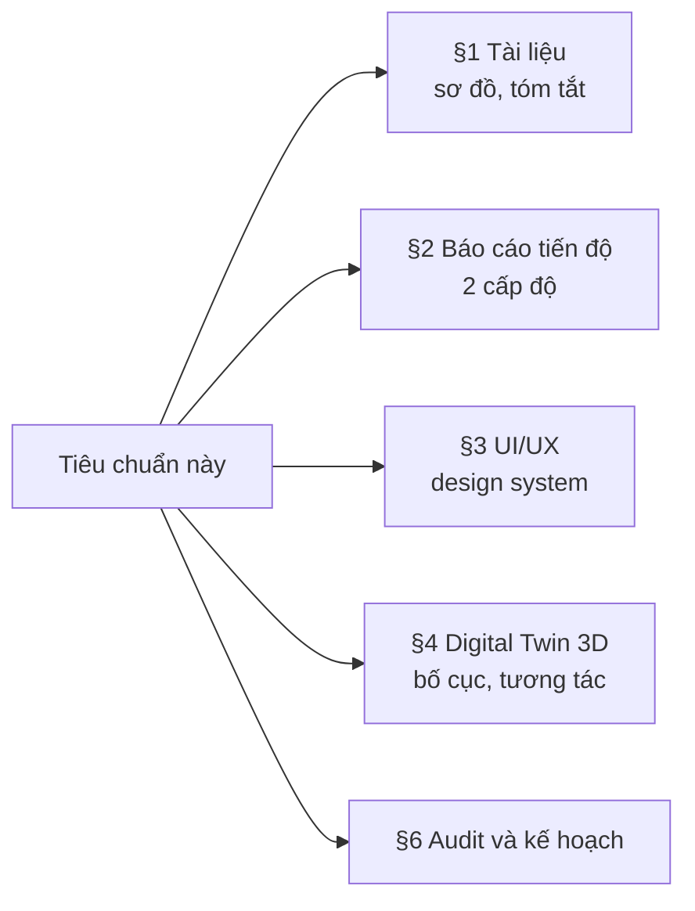
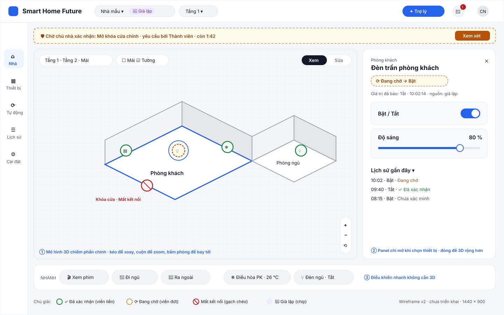
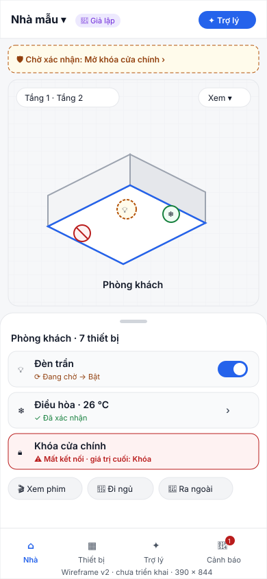
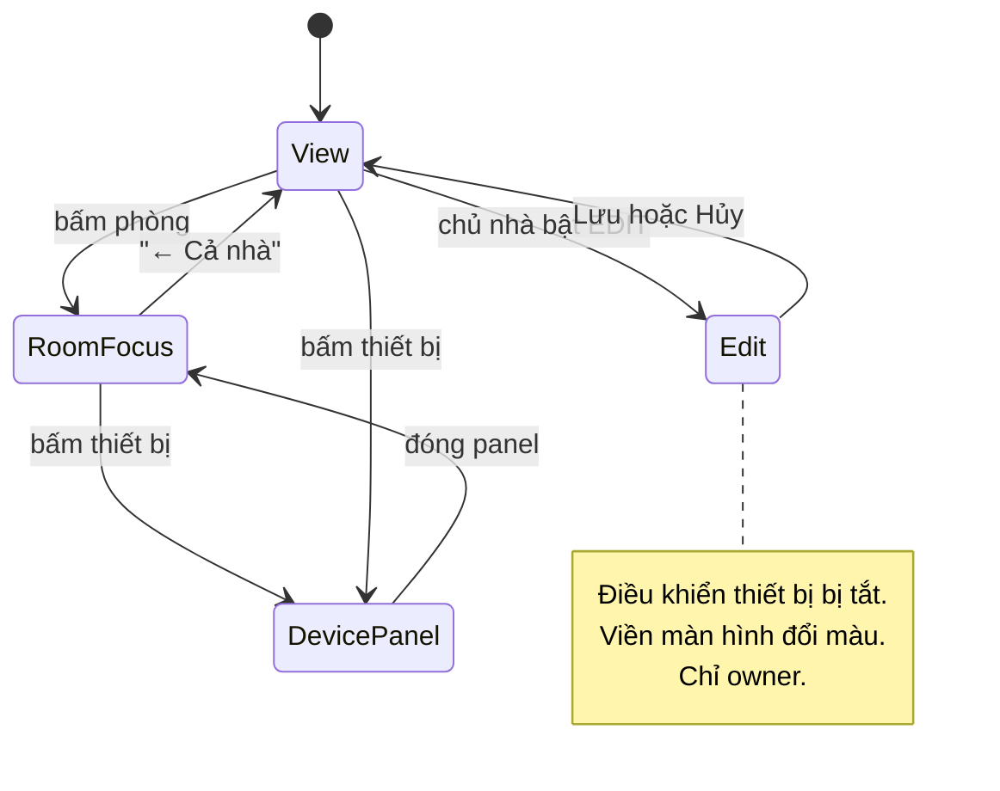
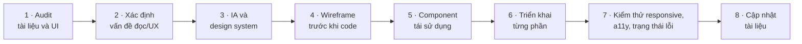

# Visual-first Design Standard

> **Tóm tắt.** Mọi tài liệu và màn hình của Smart Home Future đi theo nguyên tắc *hình trước, chữ sau*. Tài liệu mở đầu
> bằng tóm tắt, dùng sơ đồ Mermaid kiểm soát bằng Git. Giao diện ưu tiên mô hình 3D, thẻ số liệu, icon kèm nhãn, và
> chỉ mở chi tiết khi cần. **Ít chữ hơn không có nghĩa là ít thông tin hơn:** ràng buộc an toàn và tiêu chí nghiệm thu
> không bao giờ bị cắt bớt để làm gọn.

Cập nhật 2026-11-23. Trạng thái: **tiêu chuẩn đã áp dụng cho tài liệu**. Web UI và 3D **chưa triển khai** (P0-11, P0-12):
phần UI dưới đây là đặc tả và wireframe để dùng khi code.

*Hình 1. Cấu trúc tài liệu này.*

## 1. Tài liệu

### 1.1 Quy tắc

| # | Quy tắc | Kiểm tra bằng |
|---|---|---|
| D1 | Mở đầu bằng khối **Tóm tắt** 2–4 câu: điều quan trọng nhất và trạng thái thật (đã có / kế hoạch) | Đọc 5 giây đầu |
| D2 | Một hình, một thông điệp. Sơ đồ quá 15 nút thì tách theo chức năng | Đếm nút |
| D3 | Mỗi hình có chú thích ngắn ngay dưới: `*Hình N. …*` | Review |
| D4 | Không lặp lại giữa sơ đồ và đoạn văn: văn bản chỉ nói điều hình không nói được (lý do, ngoại lệ, ràng buộc) | Review |
| D5 | Thành phần chưa có code phải ghi **Kế hoạch** hoặc mã task trên chính nút sơ đồ | So với code |
| D6 | Biểu đồ số liệu chỉ dùng số có nguồn (lệnh, commit, file) ghi ngay dưới hình | Có dòng *Nguồn* |
| D7 | Không xóa giải thích kỹ thuật, ràng buộc an toàn, tiêu chí nghiệm thu để giảm chữ | Review diff |
| D8 | Ảnh nằm trong `docs/assets/<khu vực>/`, đường dẫn tương đối; SVG có `title`, `desc`, `lang` | `tests/unit/test_docs.py` |

### 1.2 Chọn loại hình

| Muốn truyền đạt | Dùng | Mermaid |
|---|---|---|
| Hệ thống gồm gì, nối với gì | Architecture / component diagram | `flowchart LR` |
| Ai gọi ai, theo thứ tự | Sequence diagram | `sequenceDiagram` |
| Một đối tượng đi qua những trạng thái nào | State diagram | `stateDiagram-v2` |
| Dữ liệu lưu thế nào | ERD | `erDiagram` |
| Quyết định nhiều nhánh | Flowchart | `flowchart TD` |
| Việc gì xong lúc nào | Timeline | `timeline` (chỉ mốc có ngày thật) |
| Tỷ lệ có số liệu thật | Donut/pie | `pie` |
| Rủi ro | Risk matrix | bảng mức độ × trạng thái, nhãn chữ + ký hiệu |
| So sánh phương án | Bảng | Markdown |

Không dùng Gantt khi chưa có lịch thật: Gantt có ngày giả là thông tin sai.

### 1.3 Quy ước Mermaid

- Nhãn tiếng Việt, ngắn. Xuống dòng bằng ` `.
- Luồng ngang `LR` cho kiến trúc, dọc `TD` cho quyết định.
- Trạng thái trên nhãn: `· Đã có`, `· Kế hoạch P0-xx`.
- Tên trong sơ đồ trùng tên trong code (`ControlService`, `CommandStatus.TIMED_OUT`) khi nói về code.
- Mọi khối Mermaid phải render được: CI render từng khối bằng mermaid-cli (xem §6.3).

## 2. Báo cáo tiến độ

Mỗi báo cáo trả lời năm câu: **đã xong gì · đang làm gì · còn bao nhiêu · blocker/rủi ro · bước tiếp theo**. Báo cáo
hiện hành: [PROGRESS.md](PROGRESS.md).

| Cấp | Nội dung | Hình thức |
|---|---|---|
| **Executive Summary** | 5 câu trả lời, thanh tiến độ, ma trận trạng thái, mốc, biểu đồ test, rủi ro | 1 màn hình, chủ yếu hình và bảng |
| **Technical Details** | Commit, file, lệnh, kết quả test, log | Liên kết tới IMPLEMENTATION_LOG, HARDENING |

**Phần trăm** chỉ dùng khi có phương pháp tính: hiện là *số task P0 đạt mọi tiêu chí nghiệm thu / tổng task P0*. Task đạt
một phần không cộng vào phần trăm, được ghi riêng.

## 3. Web UI/UX

### 3.1 Nguyên tắc

| Nguyên tắc | Cách làm |
|---|---|
| Quan trọng trước | Cảnh báo an toàn và lệnh chờ xác nhận luôn ở trên cùng; số liệu chính trên thẻ |
| Progressive disclosure | Thẻ hiện 1 giá trị + trạng thái; bấm để mở panel bên với chi tiết và lịch sử |
| Ít chữ | Icon + nhãn 1–3 từ; câu đầy đủ chỉ trong panel chi tiết và thông báo lỗi |
| Ít popup | Panel bên/bottom sheet thay modal. Modal **chỉ** cho xác nhận hành động nguy hiểm |
| Không chỉ dựa vào màu | Trạng thái = icon + nhãn chữ + mẫu viền + màu (§3.3) |
| Điều khiển nhanh không phụ thuộc 3D | Thanh điều khiển nhanh và danh sách thiết bị luôn có |
| Trung thực | Không bao giờ vẽ trạng thái mới từ lệnh vừa gửi; luôn hiện giá trị đã báo + "đang chờ" |
| Responsive | Desktop ≥ 1200 px, tablet 768–1199 px, mobile < 768 px (§4.3) |
| Accessible | WCAG 2.2 AA (§3.5) |

### 3.2 Design tokens

| Token | Light | Dark | Dùng cho |
|---|---|---|---|
| `bg` | `#F6F7F9` | `#0F1115` | Nền trang |
| `surface` | `#FFFFFF` | `#171A21` | Thẻ, panel |
| `text` | `#111827` | `#F3F4F6` | Chữ chính |
| `text-muted` | `#4B5563` | `#A1A7B3` | Chữ phụ |
| `border` | `#E5E7EB` | `#2A2F3A` | Viền |
| `primary` | `#2563EB` | `#60A5FA` | Hành động chính |
| Bo góc | 12 px thẻ · 8 px nút · 999 px chip | | |
| Khoảng cách | thang 4 px: 4, 8, 12, 16, 24, 32, 48 | | |
| Chữ | Inter (hoặc system-ui): 12 / 14 / 16 / 20 / 28 / 36 px; số liệu dùng `tabular-nums` | | |
| Chuyển động | 150–250 ms; tắt khi `prefers-reduced-motion` | | |

Các màu chữ trạng thái ở §3.3 đều đạt tương phản ≥ 4.5:1 trên `surface` light (giá trị nhóm 700 của Tailwind).

### 3.3 Ngôn ngữ trạng thái (nối thẳng với code)

Trạng thái hiển thị lấy từ `DisplayStatus` (`src/smarthome/domain/state.py`) và `CommandStatus`
(`src/smarthome/control/commands.py`). UI không được tự tạo trạng thái khác.

| `DisplayStatus` | Nhãn | Icon (Lucide) | Không dùng màu | Màu chữ |
|---|---|---|---|---|
| `confirmed` | Đã xác nhận | `check-circle` | viền liền | `#15803D` |
| `simulated` | Giả lập | `flask-conical` | chip "Giả lập" | `#6D28D9` |
| `pending` | Đang chờ → *giá trị mới* | `loader` (quay) | viền nét đứt | `#B45309` |
| `stale` | Cũ · *thời điểm* | `history` | mờ 60 % + thời điểm | `#4B5563` |
| `unknown` | Chưa rõ | `help-circle` | dấu "?" | `#4B5563` |
| `offline` | Mất kết nối | `wifi-off` | gạch chéo + banner | `#B91C1C` |

| `CommandStatus` cuối | Nhãn cho người dùng | Ghi chú |
|---|---|---|
| `succeeded` | Đã xong | Hiện "xác nhận qua thiết bị" nếu `verification=state_match` |
| `timed_out`, `interrupted` | **Chưa xác minh** | Không bao giờ viết "thất bại"; đưa nút Thử lại |
| `failed` | Không gửi được | Gateway từ chối hoặc không ghi được lệnh |
| `rejected` | Không được phép | Hiện lý do từ `reasons` |
| `awaiting_confirmation` | Chờ chủ nhà xác nhận | Luôn nổi trên banner an toàn |

### 3.4 Component tái sử dụng (đặc tả cho P0-11)

| Component | Nội dung tối thiểu | Mở rộng khi bấm |
|---|---|---|
| `StatusBadge` | icon + nhãn + mẫu viền theo §3.3 | Tooltip thời điểm, nguồn |
| `DeviceCard` | icon loại, tên ngắn, 1 giá trị chính, `StatusBadge`, 1 nút nhanh | Panel thiết bị |
| `DevicePanel` | Điều khiển sinh từ capability (switch, slider, chọn chế độ), trạng thái lệnh | Lịch sử lệnh |
| `SafetyBanner` | Cảnh báo không tắt được khi chưa xử lý: mất kết nối thiết bị an ninh, lệnh chờ xác nhận | Danh sách chi tiết |
| `ConfirmDangerSheet` | Thiết bị, hành động, giá trị, người yêu cầu, hạn xác nhận; 2 nút chữ rõ | — |
| `MetricCard` | 1 số liệu lớn + đơn vị + xu hướng (nếu có dữ liệu thật) | Biểu đồ |
| `QuickDock` | 4–6 cảnh/thiết bị yêu thích | — |

### 3.5 Accessibility

- Bàn phím: mọi thiết bị trên 3D có mục tương ứng trong danh sách có thể Tab tới; mũi tên xoay camera; `Esc` đóng panel.
- `aria-live="polite"` cho thay đổi trạng thái lệnh; `assertive` cho cảnh báo an toàn.
- Vùng bấm ≥ 44 × 44 px trên cảm ứng.
- Không có thông tin chỉ nằm trong 3D: danh sách thiết bị có đủ chức năng.

## 4. Digital Twin 3D

### 4.1 Bố cục

| Desktop | Mobile |
|---|---|
|  |  |

*Hình 2. Wireframe v2 (3D-first), **chưa triển khai**. Bốn wireframe v1 trong `docs/assets/ui/0*.svg` thuộc phạm vi 2D cũ.*

| Vùng | Desktop | Mobile |
|---|---|---|
| Mô hình 3D | ~70 % chiều rộng | ~55 % chiều cao |
| Chọn tầng, ẩn mái/tường | Góc trên trái canvas | Chip trên canvas |
| Panel thiết bị/phòng | Cột phải 360 px, đóng được | Bottom sheet kéo lên |
| Điều khiển nhanh | `QuickDock` dưới canvas | Hàng chip trên tab bar |
| Cảnh báo an toàn | `SafetyBanner` trên cùng | Trên cùng, dính |
| Thay thế không 3D | Tab "Thiết bị" (danh sách đủ chức năng) | Tab "Thiết bị" |

### 4.2 Chế độ VIEW và EDIT

*Hình 3. Chế độ của trang Nhà. EDIT tách hẳn khỏi VIEW để tránh kéo nhầm thiết bị.*

### 4.3 Khi không dùng được 3D

WebGL không có, máy yếu (dưới 30 fps sau 3 giây), hoặc người dùng chọn "Danh sách": tự chuyển sang danh sách thiết bị theo
phòng, đủ chức năng điều khiển và xác nhận.

## 5. Quy trình áp dụng

*Hình 4. Thứ tự bắt buộc. Bước 5–7 của UI chờ P0-07 (auth) và P0-08 (realtime) theo [ROADMAP.md](ROADMAP.md);
tiêu chuẩn này không đẩy UI lên trước hardening, persistence, auth và độ tin cậy IoT.*

## 6. Audit và kế hoạch cải thiện (2026-11-23)

### 6.1 Kết quả audit tài liệu

| Tài liệu | Trước | Vấn đề | Đã làm |
|---|---|---|---|
| README | 0 sơ đồ, mở đầu bằng scaffold | Không thấy ngay trạng thái dự án | Thêm tóm tắt trạng thái, sơ đồ tổng quan, link báo cáo |
| ARCHITECTURE | 4 sơ đồ; sơ đồ thành phần ~25 nút | Khó đọc; thiếu vòng đời lệnh | Thêm sơ đồ ngữ cảnh nhỏ, state diagram `CommandStatus` |
| HARDENING_2026-11 | 0 sơ đồ, 9 bảng | Logic xác minh và quy tắc ghi DB khó theo dõi bằng chữ | Thêm flowchart xác minh, sequence ghi trước/sau side effect |
| DATABASE_DESIGN | ERD toàn bộ (phần lớn là kế hoạch) | Không phân biệt bảng đã có | Thêm ERD bảng đã có (khớp migration `0001`) |
| SECURITY_AND_SAFETY | 0 sơ đồ | Luồng xác nhận chỉ bằng chữ; rủi ro rời rạc | Thêm sequence approval, ma trận rủi ro |
| TESTING_STRATEGY | 0 sơ đồ | Không thấy phân bố test | Thêm biểu đồ phân bố với số liệu thật |
| IOT_INTEGRATION | 0 sơ đồ | Hợp đồng gateway/correlation khó hình dung | Thêm sequence lệnh–báo cáo |
| ROADMAP | 1 sơ đồ dependency | Không thấy tiến độ tổng | Thêm biểu đồ trạng thái P0 |
| DIGITAL_TWIN_3D | 0 hình | Không có bố cục | Thêm wireframe v2, liên kết §4 |
| AUTOMATION_ENGINE | 0 sơ đồ | Phân xử xung đột chỉ bằng bảng | Thêm flowchart phân xử (thiết kế P1) |
| product/ui-desktop, scope | Wireframe v1 2D | Lệch hướng 3D hiện tại | Gắn nhãn "v1, phạm vi cũ" |
| Mọi tài liệu chính | Mở đầu bằng dòng trạng thái | Thiếu tóm tắt thông điệp | Thêm khối **Tóm tắt** |
| Đường dẫn ảnh/link | Không có kiểm tra | Dễ gãy khi đổi tên | Test tự động `tests/unit/test_docs.py` |

**UI hiện có:** không có frontend trong repo; chỉ có wireframe SVG. Không có gì để audit về responsive hay a11y ở mức code.

### 6.2 Kế hoạch

| ID | Việc | Phụ thuộc | Trạng thái |
|---|---|---|---|
| VD-01 | Tiêu chuẩn này | — | **Xong** |
| VD-02 | Sơ đồ và tóm tắt cho tài liệu chính (§6.1) | VD-01 | **Xong** |
| VD-03 | Báo cáo tiến độ 2 cấp [PROGRESS.md](PROGRESS.md) | VD-01 | **Xong** |
| VD-04 | Wireframe v2 3D-first desktop + mobile | VD-01 | **Xong** (wireframe, không phải UI) |
| VD-05 | Kiểm tra link, anchor, SVG và render Mermaid thật trong CI | — | **Xong** |
| VD-06 | Design tokens thành CSS variables + component §3.4 | P0-11 | Chưa làm |
| VD-07 | Test responsive (Playwright 3 kích thước) và a11y (axe) | VD-06 | Chưa làm |
| VD-08 | Wireframe panel xác nhận nguy hiểm, trang Cảnh báo | VD-04 | Chưa làm |

### 6.3 Kiểm chứng

- **Render thật trong CI:** `scripts/render_mermaid.py` chạy mermaid-cli 11.17.1 cho từng khối; lỗi cú pháp làm CI đỏ;
  SVG lưu thành artifact `mermaid-svg`. Đã thử với một khối hỏng: script báo `Parse error` và thoát mã 1.
- `tests/unit/test_docs.py` (số ca tự sinh theo số tài liệu): file và **anchor** của mọi link nội bộ tồn tại (theo quy tắc slug của GitHub); SVG là XML
  hợp lệ, có `viewBox`, `title`, `desc`, `lang`; khối Mermaid có loại hợp lệ, không chứa `;`. Repo không có link ngoài.
- **Responsive (mức kiểm chứng được):** 2 wireframe và 25 SVG render đặt trong khung 375 px với `max-width: 100%` trong
  trình duyệt: 27/27 tải được, 0 ảnh tràn ngang, khung không có thanh cuộn ngang. Chưa kiểm trên GitHub mobile thật.
