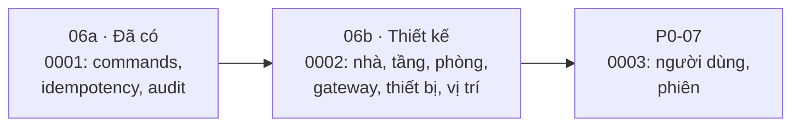
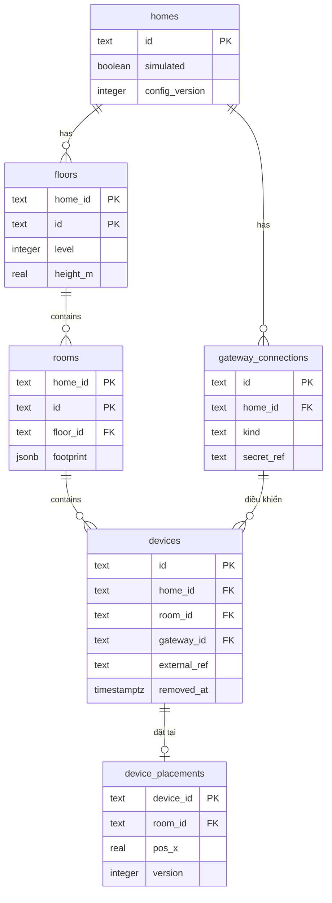
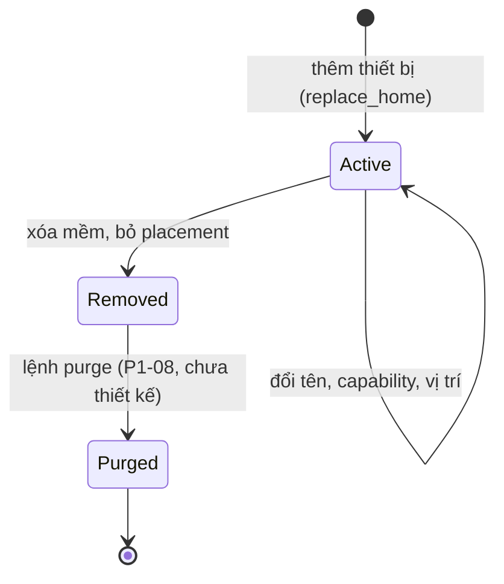
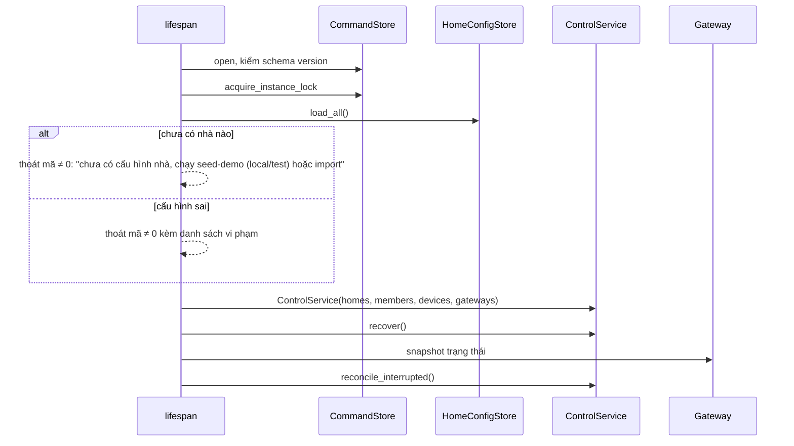

# LLD P0-06: Persistence

> **Tóm tắt (v2, 2026-11-23).** P0-06 gồm hai phần. **06a (đã có):** lệnh, idempotency, audit trên Postgres, recovery khi
> restart. **06b (thiết kế này):** lưu cấu hình nhà bằng migration `0002` và nạp vào `ControlService` thay cho nhà mẫu cứng
> trong code. v2 sửa các lỗi của v1: khóa định danh thiết bị và gateway, ràng buộc placement, quy tắc xóa, version, và ai
> được ghi cấu hình. Dựa trên [ADR 0006](../adr/0006-home-configuration-source-of-truth.md) và
> [ADR 0004](../adr/0004-home-assistant-integration-layer.md). **06b đã triển khai (2026-11-24) bằng migration `0002`; bằng chứng: [SPRINT1_ACCEPTANCE](../SPRINT1_ACCEPTANCE.md#ac-06-persistence). Khác thiết kế: cột số thực dùng `double precision` thay `real` để đọc lại đúng giá trị đã ghi.**


*Hình 1. Thứ tự migration. `0003` có khóa ngoại tới `homes` của `0002`.*

## 1. Hiện trạng đã xác minh (commit `0461606`)

| Thành phần | Trạng thái | Dẫn chứng |
|---|---|---|
| `commands`, `idempotency_keys`, `audit_events` | ✅ IMPLEMENTED | `migrations/0001_commands_audit.up.sql`, `persistence/postgres.py` |
| Recovery, đối soát, instance lock, tự kết nối lại | ✅ IMPLEMENTED | `ControlService.recover`, `reconcile_interrupted`, `acquire_instance_lock` |
| Cấu hình nhà | ❌ MISSING: luôn nạp seed trong code | `api/main.py` `build_control` gọi `build_demo_home()` |
| Trạng thái thiết bị | Cố ý **không** lưu (cache) | `domain/state.py` `StateStore` |
| `Device.id` toàn cục | Ràng buộc từ code | `ControlService.devices = {d.id: d}`, `device_in_home` (`execution.py`) |
| `commands.device_id` toàn cục | Ràng buộc từ schema | `commands_one_in_flight_idx ON (device_id, capability)` không có `home_id` |
| Seed hiện tại thỏa các bất biến dưới đây | ✅ đã kiểm bằng script | 10 thiết bị, 2 phòng, vị trí trong footprint, 1 gateway `simulator` |

## 2. Quyết định thiết kế

| ID | Quyết định | Lý do (dẫn chứng) |
|---|---|---|
| D-06-1 | **`devices.id` duy nhất toàn cục**; thiết bị thật dùng ID hệ thống tự sinh (`dev_` + 12 ký tự ngẫu nhiên); ID cố định (`dev-living-light`) chỉ có ở seed demo | `ControlService` khóa thiết bị theo `id` toàn cục; index lệnh đang gửi không có `home_id` (0001 đã áp dụng, không sửa) |
| D-06-2 | **`floors`, `rooms` khóa theo `(home_id, id)`**; hai nhà có thể cùng dùng `room-living` | Code không bao giờ tra tầng/phòng toàn cục; seed của nhiều nhà không đụng nhau |
| D-06-3 | **Gateway là một *instance* có ID riêng** (`gateway_connections.id`); `Device.gateway` mang ID instance, không phải tên adapter | `UNIQUE(gateway, external_ref)` với tên adapter `home_assistant` sẽ va chạm giữa hai nhà có entity cùng tên `light.living_room` và cấm hai HA trong một nhà |
| D-06-4 | **`device_placements.room_id` luôn bằng `devices.room_id`**, ép bằng khóa ngoại tổng hợp | Vị trí là tọa độ *trong phòng của thiết bị*; cho phép khác nhau sẽ tạo thiết bị "ở" hai phòng |
| D-06-5 | **Thiết bị chỉ xóa mềm** (`removed_at`); ID không bao giờ dùng lại | `commands.device_id`, `audit_events.device_id` tham chiếu lâu dài; ID dùng lại sẽ gắn lịch sử của thiết bị cũ vào thiết bị mới |
| D-06-6 | **Mọi khóa ngoại `ON DELETE RESTRICT`** (trừ placement: `CASCADE` vì là dữ liệu dẫn xuất) | Không xóa dây chuyền; xóa tầng/phòng/gateway còn thiết bị bị chặn |
| D-06-7 | **`homes.config_version`** tăng 1 mỗi lần đổi cấu hình; ghi có điều kiện `expected_version` | Hai người sửa cùng lúc (3D EDIT, import) không ghi đè nhau |
| D-06-8 | **Chỉ ghi cấu hình khi giữ instance lock** (app dừng) bằng CLI; ghi lúc chạy chỉ qua `ControlService` (P0-13) | Bộ nhớ `ControlService` nạp một lần lúc khởi động; ghi ngoài luồng sẽ làm bộ nhớ lệch DB (DR-M11) |
| D-06-9 | **Có DB mà chưa có nhà → từ chối khởi động**, không rơi về nhà mẫu | Rơi về seed trong môi trường thật là fail-open; trộn dữ liệu giả với thật |
| D-06-10 | **`seed-demo` chỉ ở `environment ∈ {local, test}`** | Nhà mẫu `simulated=true` không được lọt vào môi trường thật |

## 3. ERD


*Hình 2. Khóa ngoại đều là **tổng hợp theo `home_id`** (rooms → floors, devices → rooms và gateway_connections,
placement → devices theo `(device_id, room_id)`), nên một dòng không thể trỏ sang nhà khác. Bảng `commands` không có khóa
ngoại tới `devices` (lịch sử sống lâu hơn thiết bị).*

## 4. DDL đề xuất cho `0002_home_config`

```sql
CREATE TABLE homes (
    id             text        PRIMARY KEY CHECK (id <> ''),
    name           text        NOT NULL CHECK (name <> ''),
    simulated      boolean     NOT NULL DEFAULT false,
    config_version integer     NOT NULL DEFAULT 1 CHECK (config_version >= 1),
    created_at     timestamptz NOT NULL DEFAULT now(),
    updated_at     timestamptz NOT NULL DEFAULT now()
);

CREATE TABLE floors (
    home_id     text    NOT NULL REFERENCES homes (id) ON DELETE RESTRICT,
    id          text    NOT NULL CHECK (id <> ''),
    name        text    NOT NULL,
    level       integer NOT NULL,
    elevation_m real    NOT NULL DEFAULT 0,
    height_m    real    NOT NULL DEFAULT 3 CHECK (height_m > 0),
    PRIMARY KEY (home_id, id),
    UNIQUE (home_id, level)
);

CREATE TABLE rooms (
    home_id   text  NOT NULL,
    id        text  NOT NULL CHECK (id <> ''),
    floor_id  text  NOT NULL,
    name      text  NOT NULL,
    footprint jsonb NOT NULL CHECK (jsonb_typeof(footprint) = 'array' AND jsonb_array_length(footprint) = 4),
    PRIMARY KEY (home_id, id),
    FOREIGN KEY (home_id, floor_id) REFERENCES floors (home_id, id) ON DELETE RESTRICT
);

CREATE TABLE gateway_connections (
    id         text    PRIMARY KEY CHECK (id <> ''),
    home_id    text    NOT NULL REFERENCES homes (id) ON DELETE RESTRICT,
    kind       text    NOT NULL CHECK (kind IN ('simulator', 'home_assistant')),
    name       text    NOT NULL,
    url        text,
    secret_ref text,
    enabled    boolean NOT NULL DEFAULT true,
    UNIQUE (id, home_id),
    CHECK (kind <> 'home_assistant' OR (url IS NOT NULL AND secret_ref IS NOT NULL))
);

CREATE TABLE devices (
    id           text        PRIMARY KEY CHECK (id <> ''),
    home_id      text        NOT NULL,
    room_id      text        NOT NULL,
    gateway_id   text        NOT NULL,
    external_ref text        NOT NULL CHECK (external_ref <> ''),
    name         text        NOT NULL,
    type         text        NOT NULL CHECK (type IN (
                     'light', 'curtain', 'air_conditioner', 'tv', 'fan', 'plug', 'sensor',
                     'lock', 'camera', 'energy_meter', 'water_heater')),
    manufacturer text        NOT NULL,
    model        text        NOT NULL,
    capabilities jsonb       NOT NULL CHECK (jsonb_typeof(capabilities) = 'array' AND jsonb_array_length(capabilities) > 0),
    removed_at   timestamptz,
    created_at   timestamptz NOT NULL DEFAULT now(),
    UNIQUE (id, room_id),
    FOREIGN KEY (home_id, room_id)    REFERENCES rooms (home_id, id)               ON DELETE RESTRICT,
    FOREIGN KEY (gateway_id, home_id) REFERENCES gateway_connections (id, home_id) ON DELETE RESTRICT
);
CREATE UNIQUE INDEX devices_gateway_entity_uq ON devices (gateway_id, external_ref) WHERE removed_at IS NULL;
CREATE INDEX devices_home_active_idx ON devices (home_id) WHERE removed_at IS NULL;

CREATE TABLE device_placements (
    device_id      text    PRIMARY KEY,
    room_id        text    NOT NULL,
    pos_x          real    NOT NULL,
    pos_y          real    NOT NULL,
    pos_z          real    NOT NULL,
    rotation_y_deg real    NOT NULL DEFAULT 0,
    version        integer NOT NULL DEFAULT 1 CHECK (version >= 1),
    FOREIGN KEY (device_id, room_id) REFERENCES devices (id, room_id) ON DELETE CASCADE
);
```

`down`: `DROP TABLE` theo thứ tự ngược (`device_placements`, `devices`, `gateway_connections`, `rooms`, `floors`, `homes`);
không đụng bảng của `0001`.

## 5. Bất biến và nơi ép buộc

| # | Bất biến | Ép bằng | Test |
|---|---|---|---|
| I1 | Tầng thuộc đúng một nhà; mỗi nhà một tầng mỗi cấp | PK `(home_id, id)`, `UNIQUE (home_id, level)` | AC-06-3 |
| I2 | Phòng nằm ở tầng **cùng nhà** | FK tổng hợp `(home_id, floor_id)` | AC-06-3 |
| I3 | Thiết bị nằm ở phòng **cùng nhà** | FK tổng hợp `(home_id, room_id)` | AC-06-3 |
| I4 | Thiết bị dùng gateway **cùng nhà** | FK tổng hợp `(gateway_id, home_id)` | AC-06-3 |
| I5 | Placement cùng phòng với thiết bị | FK tổng hợp `(device_id, room_id)` | AC-06-4 |
| I6 | Một entity gateway gắn tối đa một thiết bị đang hoạt động | unique một phần `(gateway_id, external_ref) WHERE removed_at IS NULL` | AC-06-5 |
| I7 | Hai nhà không va chạm `external_ref` | `gateway_id` toàn cục thuộc đúng một nhà | AC-06-5 |
| I8 | `devices.id` không dùng lại | PK toàn cục + không có DELETE trong store | AC-06-5 |
| I9 | Loại thiết bị, loại gateway hợp lệ | `CHECK`; test đồng bộ với `DeviceType` | AC-06-12 |
| I10 | Vị trí nằm trong footprint của phòng (dung sai 0,05 m) và `0 ≤ y ≤ height_m` | **Validator** (footprint là JSON, không ép bằng SQL) | AC-06-7 |
| I11 | Home `simulated=true` chỉ có gateway `simulator`; home thật không có `simulator` | **Validator** (liên bảng) | AC-06-13 |
| I12 | `capabilities` đọc lại đúng kiểu và ràng buộc | Validator + `Capability` pydantic khi nạp | AC-06-2, AC-06-9 |
| I13 | Cấu hình ghi trong một transaction, có version | `HomeConfigStore.replace_home` | AC-06-8 |

Quy tắc xóa (D-06-5, D-06-6):

| Đối tượng | Quy tắc | Ghi chú |
|---|---|---|
| Thiết bị | Xóa mềm (`removed_at`), xóa luôn placement; ID giữ vĩnh viễn; nạp lúc khởi động chỉ lấy `removed_at IS NULL` | Có thể thêm lại cùng `external_ref` (unique một phần) |
| Phòng, tầng, gateway | `ON DELETE RESTRICT`: không xóa khi còn thiết bị **kể cả đã xóa mềm** | API xóa phòng/tầng là P1-08; khi đó cần lệnh purge thiết bị đã xóa |
| Nhà | `RESTRICT` | Không có thao tác xóa nhà trong P0 |
| Chuyển thiết bị sang phòng khác | Xóa placement rồi đổi `room_id` trong **một** transaction; FK chặn đổi khi placement còn | Vị trí cũ vô nghĩa ở phòng mới |


*Hình 3. Vòng đời cấu hình của một thiết bị. `Removed` không được nạp vào `ControlService`; lịch sử lệnh vẫn đọc được.*

## 6. Hợp đồng `HomeConfigStore`

```python
class GatewayConnection(BaseModel):  # domain mới, frozen
    id: str
    home_id: str
    kind: Literal["simulator", "home_assistant"]
    name: str
    url: str | None
    secret_ref: str | None
    enabled: bool = True


class HomeConfig(BaseModel):  # một nhà, một ảnh chụp nhất quán
    home: Home
    version: int
    gateways: tuple[GatewayConnection, ...]
    devices: tuple[Device, ...]  # chỉ thiết bị đang hoạt động, mang placement


class HomeConfigStore(Protocol):
    async def load_all(self) -> list[HomeConfig]: ...
    async def replace_home(self, config: HomeConfig, expected_version: int | None) -> int: ...
```

| Phương thức | Giao dịch | Hành vi |
|---|---|---|
| `load_all` | **Một** transaction `REPEATABLE READ` | Đọc mọi bảng cùng ảnh chụp; chạy `validate_home_config` trên từng nhà; lỗi → `ConfigInvalidError` kèm danh sách vi phạm (không nạp nửa chừng) |
| `replace_home(config, expected_version)` | Một transaction `READ COMMITTED` | `validate` trước; khóa dòng `homes` (`FOR UPDATE`); `expected_version=None` = tạo mới (lỗi nếu đã có); khác version hiện tại → `ConfigVersionConflict`, không ghi gì; ghi tầng, phòng, gateway, thiết bị, placement; thiết bị vắng mặt → xóa mềm; `config_version += 1`; commit |
| Bộ nhớ (`MemoryHomeConfigStore`) | — | Cùng hợp đồng, dùng cho dev/test; chứa nhà mẫu khi không có DB |

`validate_home_config(config)` là hàm thuần (`domain/`), kiểm I10, I11, trùng ID trong nhà, tham chiếu tầng/phòng/gateway tồn
tại, `(gateway_id, external_ref)` không trùng giữa thiết bị hoạt động, `placement.room_id == device.room_id`. Dùng lại ở
import YAML (P0-10).

`GatewayConnection.secret_ref` là **tên** biến môi trường hoặc secret, không phải giá trị (ADR 0004).

## 7. Khởi động và CLI


*Hình 4. Khởi động khi có `SMARTHOME_DATABASE_URL`. Không có DB (chỉ ở local/test): giữ hành vi hiện tại với nhà mẫu trong bộ nhớ.*

| Lệnh | Điều kiện | Hành vi |
|---|---|---|
| `python -m smarthome.persistence seed-demo` | `environment ∈ {local, test}` **và** lấy được instance lock | Tạo `home-demo` nếu chưa có; đã có thì không đổi, thoát 0 |
| `python -m smarthome.persistence import` (P0-10) | lấy được instance lock | `replace_home` từ YAML đã validate |

App đang chạy giữ instance lock nên CLI ghi cấu hình **từ chối** (D-06-8): không có hai bên ghi cùng lúc, và bộ nhớ
`ControlService` luôn khớp DB.

Thành viên (`members`) trong lúc chờ P0-07 vẫn lấy từ nhà mẫu; `0003` thay bằng bảng `memberships` và nguồn thành viên động
([LLD P0-07](P0-07_AUTH_RBAC.md#3-quyết-định-thiết-kế)).

## 8. Migration, backup, rollback

| Bước | Lệnh | Ghi chú |
|---|---|---|
| Backup | `pg_dump` trước khi nâng cấp | `0002` chỉ thêm bảng, nhưng vẫn backup |
| Nâng cấp | `python -m smarthome.persistence upgrade` | Từ chối khởi động app nếu thiếu (đã có) |
| Rollback code | Chạy lại bản cũ | Bản cũ không đọc bảng mới; dùng nhà mẫu trong bộ nhớ |
| Rollback schema | `downgrade --to 1 --confirm-data-loss` | **Xóa** toàn bộ cấu hình nhà; `0001` còn nguyên |

Nhà `home-demo` giữ nguyên ID để lệnh và audit cũ vẫn khớp.

## 9. Tiêu chí nghiệm thu

| ID | Tiêu chí | Test |
|---|---|---|
| AC-06-1 | `upgrade` trên DB mới đạt version 2; `downgrade --to 1` rồi `upgrade` lại không lỗi; dữ liệu `commands`, `audit_events` chèn trước đó còn nguyên | integration, migration |
| AC-06-2 | `load_all` sau `replace_home(seed)` trả cấu hình bằng seed: so sánh `Home`, `Device`, `Capability` (đúng kiểu bool/số/enum, ràng buộc giữ nguyên) | integration |
| AC-06-3 | **Khác nhà bị chặn:** tạo phòng với tầng của nhà khác; thiết bị với phòng của nhà khác; thiết bị với gateway của nhà khác → `ForeignKeyViolation` (3 ca) | integration |
| AC-06-4 | **Placement:** `room_id` khác phòng thiết bị → lỗi FK; placement cho thiết bị không tồn tại → lỗi; đổi phòng thiết bị khi còn placement → lỗi; xóa placement rồi đổi phòng trong một transaction → thành công | integration |
| AC-06-5 | **Định danh gateway:** cùng `external_ref` ở hai gateway instance (hai nhà) → OK; hai thiết bị hoạt động cùng `(gateway, external_ref)` → lỗi unique; sau xóa mềm thêm lại cùng ref → OK; thêm thiết bị với `id` đã từng tồn tại (kể cả đã xóa mềm) → lỗi PK | integration |
| AC-06-6 | **Quy tắc xóa:** xóa tầng còn phòng, phòng còn thiết bị (kể cả đã xóa mềm), gateway còn thiết bị, nhà còn dữ liệu → bị chặn. Lỗi là `RestrictViolation` (SQLSTATE 23001), **không** phải `ForeignKeyViolation` (23503) như ca INSERT; xóa thiết bị cứng cascade placement | integration |
| AC-06-7 | **Validator** (tham số hóa): từ chối trùng ID, tham chiếu thiếu, trùng `(gateway, external_ref)`, placement lệch phòng, vị trí ngoài footprint 6 cm, `y` > chiều cao tầng, capability rỗng; **chấp nhận** vị trí đúng biên và dung sai 0,05 m; seed demo đạt | unit |
| AC-06-8 | **Version:** `expected_version` sai → `ConfigVersionConflict`, không dòng nào đổi; thành công tăng đúng 1; hai `replace_home` đồng thời cùng version → đúng một thành công | integration, đồng thời |
| AC-06-9 | **Khởi động:** DB trống → thoát mã ≠ 0 với thông báo rõ, không rơi về nhà mẫu; DB có nhà → nạp; JSON capability bị sửa sai trong DB → từ chối, nêu `device_id` | integration (`create_app`) |
| AC-06-10 | **seed-demo:** từ chối khi `environment` ∉ `{local, test}`; từ chối khi app đang giữ instance lock; chạy hai lần không đổi dữ liệu | unit + integration |
| AC-06-11 | **Restart:** cấu hình sau restart bằng trước; lệnh dở dang của thiết bị đã xóa mềm được đối soát `STATE_UNKNOWN_AFTER_RESTART` | integration restart |
| AC-06-12 | **Hồi quy:** mọi test hiện có đạt; không đặt DB thì vẫn chạy bằng nhà mẫu; `0001` không bị sửa; test đồng bộ `CHECK` của `devices.type`, `gateway_connections.kind` với `DeviceType` và `Literal` | CI |
| AC-06-13 | **`simulated` nhất quán:** nhà `simulated=true` có gateway không phải `simulator` → từ chối; nhà `simulated=false` có gateway `simulator` → từ chối | unit |

## 10. Rủi ro và việc còn mở

| Rủi ro | Mức | Xử lý |
|---|---|---|
| Một thiết bị vật lý được ánh xạ qua hai gateway khác nhau (HA và Zigbee2MQTT) | Medium | DB không phát hiện được; importer cảnh báo khi trùng `manufacturer + model + tên` trong cùng phòng (P0-10) |
| Đổi schema `Capability` làm JSON cũ không nạp được | Medium | Nạp lỗi thì từ chối khởi động nêu thiết bị; thay đổi `Capability` phải đi kèm migration chuyển đổi |
| ID thiết bị toàn cục: import cùng YAML vào hai nhà sẽ đụng ID | Low | Thiết bị thật dùng ID tự sinh (D-06-1); chỉ seed demo dùng ID cố định |
| Ghi cấu hình lúc chạy (3D EDIT) chưa có luồng làm mới bộ nhớ | Medium | LLD P0-13 |
| Phòng có thiết bị đã xóa mềm không xóa được | Low | Lệnh purge ở P1-08 |
