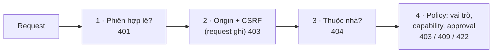
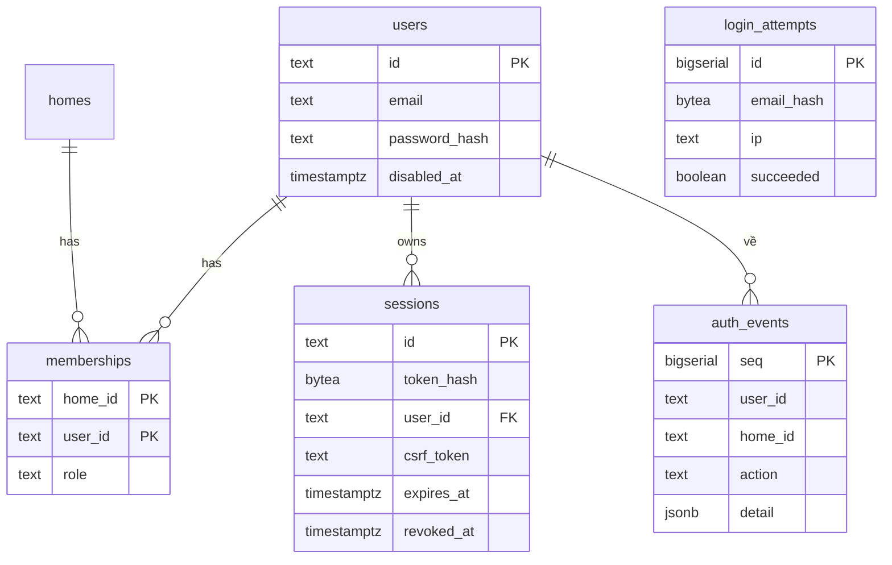
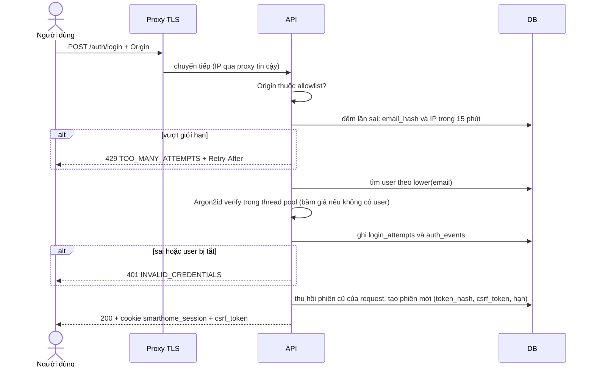
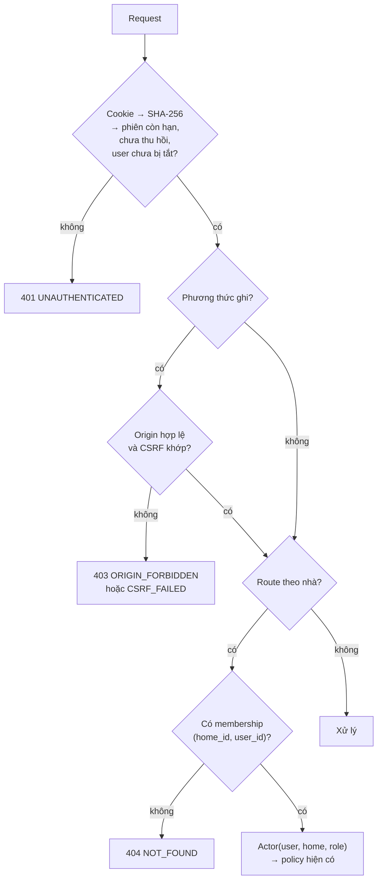
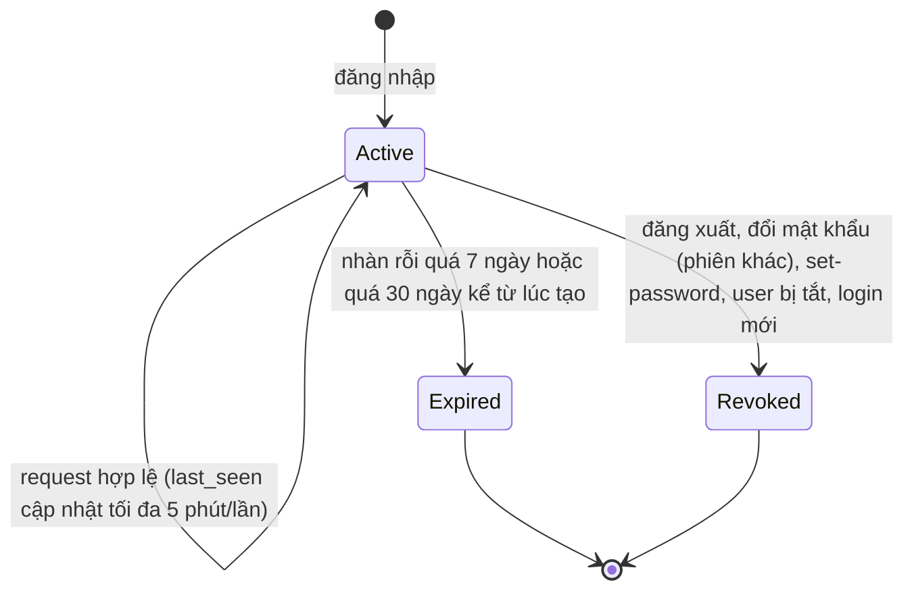
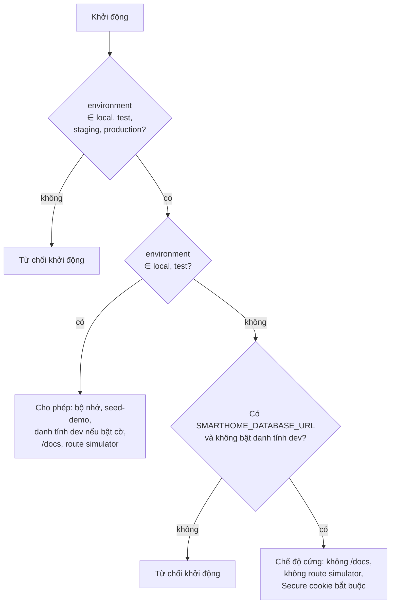
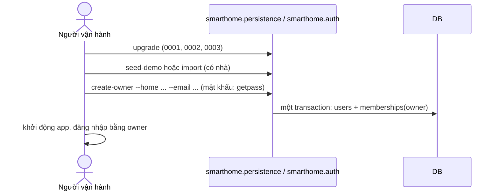

# LLD P0-07: Authentication và RBAC

> **Tóm tắt (v2, 2026-11-23).** Thay danh tính dev bằng đăng nhập thật: session phía server, cookie HttpOnly, CSRF, mật khẩu
> Argon2id, membership theo nhà, sự kiện bảo mật chỉ ghi thêm. v2 sửa 6 lỗi của v1 (mục 1). Theo
> [ADR 0005](../adr/0005-session-auth-csrf.md) (**Accepted** 2026-11-23, đã triển khai). Phụ thuộc
> [P0-06b](P0-06_PERSISTENCE.md) (khóa ngoại `memberships → homes`). **Đã triển khai (2026-11-24) bằng migration `0003`; bằng chứng:
> [SPRINT1_ACCEPTANCE](../SPRINT1_ACCEPTANCE.md#ac-07-authentication-and-rbac). Quyết định khi triển khai: `POST /auth/logout` nằm trong allowlist của default-deny (không có phiên vẫn trả `204`).**


*Hình 1. Chuỗi kiểm tra của mọi request. Bước 4 giữ nguyên code hiện có (`control/policy.py`).*

## 1. Hiện trạng đã xác minh và lỗi của v1

| Thành phần | Trạng thái | Dẫn chứng |
|---|---|---|
| Danh tính | ⚠️ PARTIAL: header `X-Dev-User`, mặc định tắt | `api/identity.py` `current_actor` |
| Cổng môi trường | ❌ Fail-open: chỉ chặn khi `environment == "production"` đúng chữ; `environment` là chuỗi tự do, mặc định `local` | `api/main.py` `create_app`, `core/config.py` |
| Vai trò và quyền theo capability | ✅ IMPLEMENTED | `control/policy.py` `role_at_least`, `may_confirm` |
| Người dùng, mật khẩu, phiên | ❌ MISSING | — |
| `/api/v1/agent/invoke` | ⚠️ **Không có xác thực** (chỉ `Depends(get_graph)`) | `api/routes/agent.py` |
| OpenAPI `/docs`, `/openapi.json` | ⚠️ Luôn mở (không đặt `docs_url`) | `api/main.py` `FastAPI(...)` |
| Thành viên trong `ControlService` | ❌ **Dict tĩnh nạp lúc khởi động**, `confirm()` dùng để kiểm tra lại người yêu cầu | `control/execution.py` `self.members`, `confirm()` |
| Sự kiện cấp người dùng | ❌ Không ghi được: `audit_events.home_id NOT NULL` | `migrations/0001` |

| # | Lỗi của LLD v1 | Hậu quả nếu code theo v1 | Sửa trong v2 |
|---|---|---|---|
| E1 | Chỉ lưu **hash** CSRF nhưng `GET /auth/session` phải trả token | Không trả lại được sau khi tải lại trang | Lưu `csrf_token` trong `sessions` (D-07-3) |
| E2 | Không nói gì về `ControlService.members` tĩnh | Người bị hạ quyền hoặc gỡ vẫn được dùng vai trò cũ khi duyệt lệnh | `MembershipSource` tra DB mỗi lần (D-07-6) |
| E3 | Giới hạn thử sai theo IP, nhưng sau reverse proxy mọi request cùng IP proxy | Một người sai 30 lần khóa cả nhà | Chỉ tin IP từ proxy tin cậy (D-07-8) |
| E4 | Argon2 chạy trong coroutine | ~100 ms CPU chặn event loop của worker duy nhất, chặn cả điều khiển thiết bị (ADR 0001) | Chạy trong thread pool (D-07-5) |
| E5 | `SameSite=Lax`, danh tính dev theo tên môi trường, route agent/docs mở | Lỏng hơn cần thiết; fail-open | `Strict`, allowlist môi trường, default-deny (D-07-2, 9, 10) |
| E6 | `users.id uuid` nhưng `commands.actor_id`, `confirmed_by` là `text` và seed dùng `user-owner` | Phải ép kiểu khắp nơi, seed không khớp | `users.id text` (D-07-4) |

## 2. Phạm vi Sprint 1

| Trong phạm vi | Ngoài phạm vi |
|---|---|
| Migration `0003`, đăng nhập/đăng xuất, phiên, CSRF, đổi mật khẩu | WebSocket (P0-08, [ADR 0007](../adr/0007-realtime-websocket-per-home.md)); ràng buộc xác thực đã chốt ở ADR 0005 §WebSocket |
| Quản lý thành viên của nhà, last-owner | Đăng nhập không mật khẩu, 2FA, quên mật khẩu qua email |
| CLI tạo owner, đặt lại mật khẩu, mở khóa | Luồng mời thành viên (P2); ép đổi mật khẩu tạm (P1) |
| Cổng môi trường, default-deny, `MembershipSource` | Web UI đăng nhập (P0-11) |

## 3. Quyết định thiết kế

| ID | Quyết định | Lý do |
|---|---|---|
| D-07-1 | Phiên **phía server** trong Postgres; token 256 bit ngẫu nhiên; DB chỉ lưu **SHA-256** của token | Thu hồi tức thì; lộ DB không lộ phiên |
| D-07-2 | Cookie `smarthome_session`: `HttpOnly; Secure; SameSite=Strict; Path=/`, không `Domain`. `Secure` bắt buộc, chỉ tắt được ở `local`/`test` qua `SMARTHOME_COOKIE_SECURE=false` | SPA cùng origin vẫn gửi cookie cho XHR/WebSocket; `Strict` chặn cả điều hướng chéo site. Test dùng `https://` base URL vì cookie `Secure` không gửi qua `http://` |
| D-07-3 | CSRF: token ngẫu nhiên **theo phiên**, lưu nguyên văn trong `sessions.csrf_token`, trả ở `login` và `GET /auth/session`. Request ghi cần header `X-CSRF-Token` khớp (so sánh hằng thời gian) **và** `Origin` thuộc allowlist. `login` chỉ cần `Origin` | Token CSRF không phải bí mật đủ để dùng nếu thiếu cookie HttpOnly; phải trả lại được sau tải lại trang |
| D-07-4 | **Mọi ID người dùng là `text`** (UUID4 dạng chuỗi cho người thật; ID cố định `user-*` chỉ ở seed demo) | Khớp `commands.actor_id`, `confirmed_by`, `audit_events.actor_id` (text, không FK) và `Member.user_id: str` |
| D-07-5 | Argon2id `time_cost=3, memory_cost=64 MiB, parallelism=2`; chuẩn hóa NFKC; độ dài 12–128; chặn danh sách 1 000 mật khẩu phổ biến và mật khẩu trùng email; băm giả cho email không tồn tại; **băm và xác minh chạy trong `asyncio.to_thread`** | Chống liệt kê tài khoản bằng thời gian; không chặn event loop (E4). Giới hạn 128 chống DoS bằng mật khẩu dài |
| D-07-6 | **`MembershipSource`** (async, tra DB mỗi lần) thay dict tĩnh trong `ControlService`; bản `StaticMembershipSource` cho dev/test giữ test hiện có chạy | Gỡ/hạ quyền có hiệu lực ngay, kể cả với lệnh đang chờ duyệt (E2) |
| D-07-7 | Giới hạn thử sai: cửa sổ trượt 15 phút, **5 lần sai/email**, **30 lần sai/IP**, theo `login_attempts`; lần bị từ chối **không** ghi thêm; áp dụng cả với email không tồn tại; đổi mật khẩu sai cũng tính | Bền qua restart; không lộ tài khoản có tồn tại; khóa tự hết hạn |
| D-07-8 | IP client chỉ lấy qua `ProxyHeadersMiddleware` của Uvicorn với `SMARTHOME_TRUSTED_PROXY_IPS`; **code không đọc `X-Forwarded-For` trực tiếp** | E3; header giả từ client không qua proxy bị bỏ qua |
| D-07-9 | **Cổng môi trường**: `environment: Literal["local","test","staging","production"]`; giá trị khác → từ chối khởi động. Chế độ dễ dãi = `{local, test}`. Ngoài tập đó: bắt buộc `SMARTHOME_DATABASE_URL`, cấm danh tính dev, cấm `seed-demo`, tắt `/docs`, `/openapi.json`, `/redoc`, không đăng ký route điều khiển simulator. Mặc định vẫn `local` (để `from smarthome.api.main import app` và CI chạy); `Dockerfile` đặt `ENV SMARTHOME_ENVIRONMENT=production` | Fail-closed theo allowlist thay vì so một chuỗi (E5). Mặc định `production` sẽ làm `app = create_app()` ném lỗi lúc import |
| D-07-10 | **Default-deny**: mọi route trừ `GET /health` và `POST /api/v1/auth/login` cần phiên hợp lệ, gồm `/api/v1/agent/invoke` | Route mới không thể vô tình để mở |
| D-07-11 | **CLI** `python -m smarthome.auth`: `create-owner`, `set-password`, `unlock`, `disable-user`. Mật khẩu chỉ qua `getpass` hoặc `--password-stdin`, không qua tham số | Tạo owner đầu tiên (chưa có ai để đăng nhập) và khôi phục khi quên mật khẩu |
| D-07-12 | **Last-owner**: đổi vai trò/gỡ thành viên chạy trong một transaction, `SELECT … FROM homes WHERE id=… FOR UPDATE`, đếm owner còn lại, từ chối `409 LAST_OWNER` | Hai owner tự hạ quyền cùng lúc không để nhà mất owner |
| D-07-13 | Phiên theo **người dùng**, không gắn nhà; quyền vào nhà tính **mỗi request** qua membership | Gỡ khỏi nhà có hiệu lực ngay; một người nhiều nhà |
| D-07-14 | Thêm thành viên **chỉ tạo tài khoản mới**; email đã tồn tại → `409 EMAIL_IN_USE`. Mật khẩu tạm không ép đổi (chấp nhận rủi ro, P1) | Đơn giản cho một nhà; đánh đổi lộ sự tồn tại email cho owner. Đa tenant (P2) cần luồng mời |
| D-07-15 | `last_seen_at` chỉ cập nhật khi cũ hơn 5 phút | Tránh một lần ghi DB mỗi request |

## 4. Schema `0003_auth`


*Hình 2. Bảng của `0003`. `memberships.home_id → homes.id` thuộc `0002`. `login_attempts` không có khóa ngoại: email có thể
không tồn tại.*

```sql
CREATE TABLE users (
    id                  text        PRIMARY KEY CHECK (id <> ''),
    email               text        NOT NULL CHECK (email <> '' AND email = btrim(email)),
    display_name        text        NOT NULL CHECK (display_name <> ''),
    password_hash       text,
    password_changed_at timestamptz,
    disabled_at         timestamptz,
    created_at          timestamptz NOT NULL DEFAULT now()
);
CREATE UNIQUE INDEX users_email_uq ON users (lower(email));

CREATE TABLE memberships (
    home_id    text        NOT NULL REFERENCES homes (id) ON DELETE RESTRICT,
    user_id    text        NOT NULL REFERENCES users (id) ON DELETE RESTRICT,
    role       text        NOT NULL CHECK (role IN ('owner', 'member', 'guest')),
    created_by text,
    created_at timestamptz NOT NULL DEFAULT now(),
    PRIMARY KEY (home_id, user_id)
);
CREATE INDEX memberships_user_idx ON memberships (user_id);

CREATE TABLE sessions (
    id           text        PRIMARY KEY CHECK (id <> ''),
    token_hash   bytea       NOT NULL UNIQUE CHECK (octet_length(token_hash) = 32),
    user_id      text        NOT NULL REFERENCES users (id) ON DELETE RESTRICT,
    csrf_token   text        NOT NULL CHECK (length(csrf_token) >= 32),
    created_at   timestamptz NOT NULL,
    last_seen_at timestamptz NOT NULL,
    expires_at   timestamptz NOT NULL,
    revoked_at   timestamptz,
    CHECK (expires_at > created_at)
);
CREATE INDEX sessions_user_active_idx ON sessions (user_id) WHERE revoked_at IS NULL;

CREATE TABLE login_attempts (
    id         bigserial   PRIMARY KEY,
    at         timestamptz NOT NULL,
    email_hash bytea       NOT NULL CHECK (octet_length(email_hash) = 32),
    ip         text,
    succeeded  boolean     NOT NULL
);
CREATE INDEX login_attempts_email_idx ON login_attempts (email_hash, at DESC) WHERE NOT succeeded;
CREATE INDEX login_attempts_ip_idx    ON login_attempts (ip, at DESC)         WHERE NOT succeeded;

CREATE TABLE auth_events (
    seq     bigserial   PRIMARY KEY,
    at      timestamptz NOT NULL,
    user_id text,
    home_id text,
    action  text        NOT NULL CHECK (action <> ''),
    detail  jsonb       NOT NULL DEFAULT '{}'::jsonb
);
CREATE INDEX auth_events_user_idx ON auth_events (user_id, seq DESC);
CREATE TRIGGER auth_events_append_only BEFORE UPDATE OR DELETE ON auth_events
    FOR EACH ROW EXECUTE FUNCTION smarthome_audit_guard();
```

`down`: xóa `auth_events`, `login_attempts`, `sessions`, `memberships`, `users` (theo thứ tự này); không đụng `0001`, `0002`.
Trigger dùng lại hàm `smarthome_audit_guard()` của `0001` (cùng cơ chế `purge`).

| Ràng buộc | Ý nghĩa |
|---|---|
| `users_email_uq` trên `lower(email)` | Email không phân biệt hoa thường, không cần extension `citext` |
| `password_hash` NULL | Tài khoản không đăng nhập được (người dùng seed demo, dùng danh tính dev) |
| `ON DELETE RESTRICT` ở mọi khóa ngoại | Không xóa người dùng; dùng `disabled_at`. Audit tham chiếu `actor_id` lâu dài |
| `sessions.token_hash UNIQUE`, 32 byte | Chỉ lưu SHA-256; sửa cột không tạo được phiên hợp lệ |
| Last-owner | Không ép bằng DB; ép bằng transaction khóa dòng `homes` (D-07-12) và test đồng thời |

## 5. Cấu hình

| Biến | Mặc định | Ghi chú |
|---|---|---|
| `SMARTHOME_ENVIRONMENT` | `local` | Chỉ nhận `local`, `test`, `staging`, `production` |
| `SMARTHOME_ALLOWED_ORIGINS` | origin của proxy | Danh sách; bắt buộc ngoài `local`/`test` |
| `SMARTHOME_TRUSTED_PROXY_IPS` | rỗng | Danh sách IP/CIDR của proxy; rỗng = không tin header chuyển tiếp |
| `SMARTHOME_COOKIE_SECURE` | `true` | Chỉ đặt `false` được ở `local`, `test` |
| `SMARTHOME_SESSION_IDLE_DAYS` / `SMARTHOME_SESSION_MAX_DAYS` | 7 / 30 | |
| `SMARTHOME_LOGIN_MAX_FAILURES_EMAIL` / `_IP` | 5 / 30 | Trong 15 phút |

## 6. API

Mã lỗi theo định dạng hiện có: `{"detail": {"code": "...", "message": "..."}}`.

| Phương thức | Đường dẫn | Yêu cầu | Thành công | Lỗi |
|---|---|---|---|---|
| POST | `/api/v1/auth/login` `{email, password}` | `Origin` hợp lệ | `200 {user, homes[{id, name, role}], csrf_token}` + `Set-Cookie`; thu hồi phiên cũ của request này | `401 INVALID_CREDENTIALS`, `429 TOO_MANY_ATTEMPTS` (+ `Retry-After`), `403 ORIGIN_FORBIDDEN`, `422` |
| GET | `/api/v1/auth/session` | phiên | `200` cùng thân với login | `401 UNAUTHENTICATED` |
| POST | `/api/v1/auth/logout` | `Origin` + CSRF nếu có phiên | `204`, thu hồi phiên, xóa cookie; **không có phiên cũng trả `204`** | `403` |
| POST | `/api/v1/auth/password` `{current_password, new_password}` | phiên, CSRF | `204`; thu hồi **mọi phiên khác** | `401 INVALID_CREDENTIALS` (tính vào giới hạn), `422 WEAK_PASSWORD`, `403` |
| GET | `/api/v1/homes/{id}/members` | owner | `200 [{user_id, email, display_name, role, created_at}]` | `403`, `404` |
| POST | `/api/v1/homes/{id}/members` `{email, display_name, role, password}` | owner, CSRF | `201` | `409 EMAIL_IN_USE`, `422`, `403` |
| PATCH | `/api/v1/homes/{id}/members/{user_id}` `{role}` | owner, CSRF | `200` | `409 LAST_OWNER`, `404`, `422` |
| DELETE | `/api/v1/homes/{id}/members/{user_id}` | owner, CSRF | `204` | `409 LAST_OWNER`, `404` |

| Mã | HTTP | Khi nào |
|---|---|---|
| `UNAUTHENTICATED` | 401 | Không có cookie, phiên hết hạn, bị thu hồi, người dùng bị tắt |
| `INVALID_CREDENTIALS` | 401 | Email không tồn tại, sai mật khẩu, tài khoản bị tắt, `password_hash` NULL, sai mật khẩu hiện tại: **cùng thân, cùng thông điệp** |
| `TOO_MANY_ATTEMPTS` | 429 | Vượt giới hạn; kèm `Retry-After` (giây); cùng phản hồi dù email có tồn tại hay không |
| `ORIGIN_FORBIDDEN` | 403 | `Origin` thiếu hoặc không thuộc allowlist (request ghi, kể cả login) |
| `CSRF_FAILED` | 403 | Thiếu hoặc sai `X-CSRF-Token` |
| `FORBIDDEN_ROLE` | 403 | Vai trò không đủ (đã có) |
| `NOT_FOUND` | 404 | Không thuộc nhà, hoặc không có tài nguyên (đã có) |
| `LAST_OWNER` | 409 | Thao tác sẽ làm nhà không còn owner |
| `EMAIL_IN_USE` | 409 | Email đã có tài khoản |
| `WEAK_PASSWORD` | 422 | Độ dài, danh sách phổ biến, trùng email |

### Ma trận quyền

| Route | Ẩn danh | Không thuộc nhà | Guest | Member | Owner |
|---|---|---|---|---|---|
| `GET /health` | ✅ | ✅ | ✅ | ✅ | ✅ |
| `POST /auth/login` | ✅ (Origin) | ✅ | ✅ | ✅ | ✅ |
| `/auth/session`, `/auth/logout`, `/auth/password`, `/api/v1/agent/invoke` | 401 | ✅ | ✅ | ✅ | ✅ |
| `GET /homes/{id}`, `/devices`, `/devices/{id}`, `/commands/{id}` | 401 | 404 | ✅ | ✅ | ✅ |
| `POST /homes/{id}/commands` | 401 | 404 | 403 (policy) | ✅ theo capability | ✅ |
| `POST …/commands/{id}/confirmation` | 401 | 404 | 403 | 403 | ✅ |
| `GET /homes/{id}/audit` | 401 | 404 | 403 | 403 | ✅ |
| `…/members` (4 route) | 401 | 404 | 403 | 403 | ✅ |
| `PUT …/simulator/devices/{id}/behavior` | 401 | 404 | 403 | 403 | ✅ (chỉ khi `environment` ∈ `{local, test}`, nhà `simulated`) |
| `/docs`, `/openapi.json`, `/redoc` | ✅ chỉ ở `local`/`test` | | | | |

## 7. Luồng


*Hình 3. Đăng nhập. Phiên mới luôn có token mới (chống session fixation); client không chọn được ID phiên.*


*Hình 4. Pipeline mỗi request. CSRF kiểm trước membership để mã 403 không tiết lộ nhà có tồn tại.*


*Hình 5. Vòng đời phiên. Phiên `Expired` hoặc `Revoked` luôn trả `401`. Gỡ khỏi một nhà không thu hồi phiên: quyền vào nhà
tính mỗi request.*


*Hình 6. Cổng môi trường (D-07-9). Mọi giá trị không nằm trong allowlist đều đi theo nhánh nghiêm ngặt.*


*Hình 7. Khởi tạo lần đầu. Không có API tạo owner đầu tiên. Quên mật khẩu: `set-password` (thu hồi mọi phiên); bị khóa:
`unlock`.*

## 8. Sự kiện bảo mật

| Sự kiện (`auth_events.action`) | Lưu trong `detail` | Không bao giờ lưu |
|---|---|---|
| `login_succeeded`, `login_failed`, `login_throttled` | `email_hash`, `ip`, lý do nội bộ (`bad_password`, `unknown_user`, `disabled`) | Mật khẩu, email nguyên văn, token |
| `logout`, `sessions_revoked`, `password_changed` | `session_id`, số phiên bị thu hồi | Mật khẩu cũ/mới |
| `owner_created`, `password_set_by_cli`, `login_unlocked`, `user_disabled` | `home_id`, người thực hiện (`cli`) | Mật khẩu |
| `member_added`, `member_role_changed`, `member_removed` | `home_id`, `target_user_id`, vai trò cũ/mới | Mật khẩu tạm |

Thay đổi thành viên ghi **cả** `auth_events` và `audit_events` của nhà đó. Lý do nội bộ của `login_failed` không bao giờ
trả cho client. `login_attempts` giữ 24 giờ; `auth_events` giữ theo `SMARTHOME_AUDIT_RETENTION_DAYS`; IP là dữ liệu cá nhân
(Medium, xem mục 10).

## 9. Tiêu chí nghiệm thu

| ID | Tiêu chí | Loại |
|---|---|---|
| AC-07-1 | Đăng nhập đúng → cookie `HttpOnly; Secure; SameSite=Strict; Path=/`, không `Domain`; thân có `csrf_token`; DB chỉ có `token_hash`, không có token | integration |
| AC-07-2 | Email lạ, sai mật khẩu, user bị tắt, `password_hash` NULL → **cùng** status, thân, thông điệp; hàm băm vẫn được gọi (băm giả) | integration |
| AC-07-3 | Mật khẩu lưu dạng `$argon2id$…`; không xuất hiện bản rõ trong DB, log, `audit_events`, `auth_events` (quét `caplog` và bảng) | unit + integration |
| AC-07-4 | Lần sai thứ 6 trong 15 phút → `429` + `Retry-After`, cả với email không tồn tại; lần bị từ chối không ghi thêm; giới hạn còn sau restart; giới hạn IP; cửa sổ trượt (đồng hồ giả) | integration |
| AC-07-5 | `X-Forwarded-For` từ peer **không** tin cậy bị bỏ qua; từ proxy tin cậy được dùng | integration |
| AC-07-6 | Request ghi có cookie nhưng thiếu/sai `X-CSRF-Token` → `403 CSRF_FAILED`; `Origin` lạ hoặc thiếu → `403 ORIGIN_FORBIDDEN`; login với `Origin` lạ → `403`; GET không cần cả hai | security |
| AC-07-7 | Phiên hết hạn nhàn rỗi, hết hạn tuyệt đối, bị thu hồi, user bị tắt → `401` ngay (đồng hồ giả); login mới thu hồi phiên cũ của request; logout không có phiên → `204`; `last_seen_at` không ghi quá 1 lần/5 phút | integration |
| AC-07-8 | Đổi mật khẩu: sai mật khẩu hiện tại → `401` và tính vào giới hạn; yếu (<12, >128, danh sách phổ biến, trùng email) → `422 WEAK_PASSWORD`; thành công thu hồi mọi phiên khác, giữ phiên hiện tại | integration |
| AC-07-9 | **Default-deny:** duyệt `app.routes`, mọi route ngoài allowlist (`GET /health`, `POST /auth/login`) trả `401` khi không có phiên, gồm `/api/v1/agent/invoke` | security |
| AC-07-10 | **Cô lập nhà:** tham số hóa trên **mọi** route `/api/v1/homes/{id}/*`: ẩn danh `401`; người ngoài `404`; người nhà A gọi nhà B `404`; vai trò đúng ma trận mục 6 | security |
| AC-07-11 | **Thành viên động:** hạ quyền hoặc gỡ người yêu cầu sau khi gửi lệnh nguy hiểm, trước khi owner duyệt → duyệt bị từ chối (`REQUESTER_REMOVED`) hoặc policy chạy lại với vai trò mới; thiết bị không nhận lệnh | integration (DB thật) |
| AC-07-12 | **Last-owner:** hạ/gỡ owner cuối → `409 LAST_OWNER`; hai owner hạ quyền nhau đồng thời (hai kết nối) → đúng một thành công, nhà còn ≥ 1 owner | integration, đồng thời |
| AC-07-13 | Members: owner tạo (`201`), email trùng `409 EMAIL_IN_USE`, vai trò sai `422`, không phải owner `403`; người bị gỡ nhận `404` ở request kế tiếp | integration |
| AC-07-14 | **Cổng môi trường:** `environment` ngoài danh sách → từ chối khởi động; `staging`/`production` + cờ danh tính dev → từ chối; ngoài `local`/`test` thiếu `SMARTHOME_DATABASE_URL` → từ chối; `/docs`, `/openapi.json`, route simulator trả `404` khi không dễ dãi; giá trị `docker` của Compose hiện tại bị từ chối cho tới khi Compose được sửa | unit + integration |
| AC-07-15 | **CLI:** `--password` trên dòng lệnh bị từ chối; `create-owner` lỗi khi nhà không tồn tại và tạo user + owner trong **một** transaction; `set-password` thu hồi mọi phiên; `unlock` xóa lần sai; đầu ra không chứa mật khẩu | unit + integration |
| AC-07-16 | Mỗi sự kiện ở mục 8 được ghi, không chứa bí mật; `auth_events` từ chối UPDATE/DELETE trừ `purge` | integration |
| AC-07-17 | **Argon2 không chặn điều khiển:** trong lúc 5 phép xác minh mật khẩu chạy đồng thời, độ trễ vòng lặp sự kiện tối đa < 50 ms (sonde định kỳ) | integration |
| AC-07-18 | **Hồi quy:** mọi test hiện có đạt (ở `environment=test` với danh tính dev); test mới dùng `https://` base URL cho cookie `Secure` | CI |
| AC-07-19 | Migration `0003`: `upgrade` trên nền `0002`; `downgrade --to 2` giữ nguyên dữ liệu `0001`, `0002` | integration |
| AC-07-20 | **MembershipSource:** `StaticMembershipSource` cho kết quả như dict cũ (hồi quy `ControlService`); bản Postgres phản ánh thay đổi ngay không cần restart | unit + integration |

Kiểm tra thủ công (không tự động hóa): **M-07-1** đo thời gian Argon2id trên máy đích, kỳ vọng 100 ms–1 s; ghi kết quả, chỉnh
`memory_cost` nếu ngoài khoảng.

## 10. Rủi ro và việc còn mở

| Rủi ro | Mức | Xử lý |
|---|---|---|
| Khóa tài khoản bằng cách cố ý nhập sai (DoS) | Medium | Chấp nhận cho một nhà trong LAN; owner dùng CLI `unlock` |
| IP lưu trong `login_attempts`, `auth_events` là dữ liệu cá nhân | Medium | Giữ 24 giờ / theo retention audit; không lưu email nguyên văn |
| Owner phát hiện email đã đăng ký (`EMAIL_IN_USE`) | Low | Chấp nhận cho P0; đa tenant cần luồng mời (P2) |
| Mật khẩu tạm không bị ép đổi | Medium | P1 |
| XSS chạy lệnh trong trang đã đăng nhập (HttpOnly không chặn được) | Medium | CSP chặt và không `unsafe-inline` ở P0-11; ADR 0005 mục mối đe dọa |
| Đổi `ControlService.member` thành async ảnh hưởng người gọi | Low | Người gọi duy nhất là `confirm()` và `identity.py` (sẽ thay) |
| Thông số Argon2 chưa đo trên máy đích | Medium | M-07-1 |
