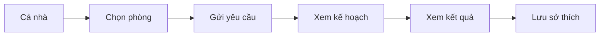
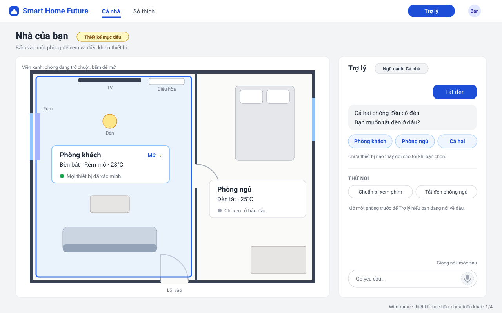
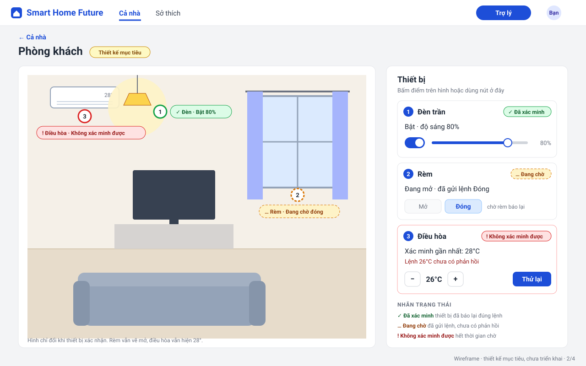
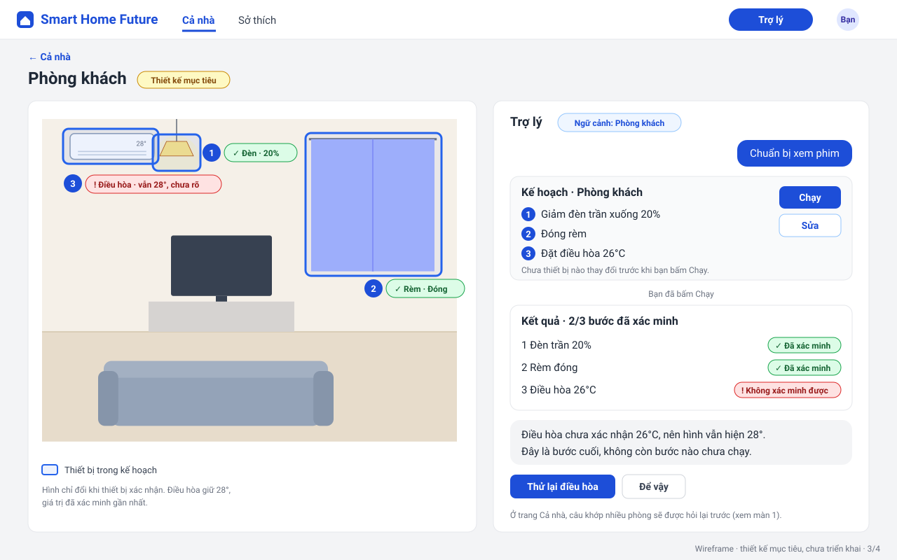
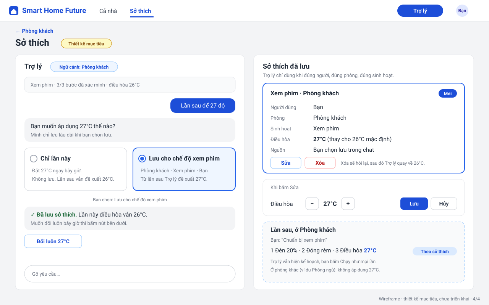

# Smart Home Future: giao diện web desktop

> **Wireframe v1 (phạm vi 2D cũ).** Hướng hiện tại là 3D-first: xem wireframe v2 và tiêu chuẩn giao diện ở
> [VISUAL_DESIGN_STANDARD.md](../VISUAL_DESIGN_STANDARD.md). Hành vi Trợ lý (kế hoạch, Chạy, nhãn trạng thái) vẫn áp dụng.

**Trả lời câu hỏi:** người dùng thấy gì và bấm gì ở bốn màn của bản web đầu tiên. Hành vi phía sau mỗi màn ở
[Phạm vi và hành vi](scope.md).

Bốn wireframe khổ 1280 × 800, cùng thanh trên, kiểu chữ và nhãn trạng thái. Đây là **thiết kế mục tiêu**, chưa phải giao
diện đã triển khai. Mặt bằng và hình phòng do dự án tự vẽ.

## Nhãn trạng thái dùng chung

| Nhãn | Nghĩa | Hình trên ảnh phòng |
|---|---|---|
| **✓ Đã xác minh** | Thiết bị đã báo lại đúng lệnh | Viền xanh lá, hình đã đổi |
| **… Đang chờ** | Đã gửi lệnh, chưa có phản hồi | Viền cam nét đứt, hình chưa đổi |
| **! Không xác minh được** | Hết thời gian chờ | Viền đỏ, hình giữ giá trị xác minh gần nhất |
| **Chưa chạy** | Bước sau một bước lỗi | Chỉ có trong danh sách kết quả |

Nhãn luôn có chữ và ký hiệu, không chỉ dựa vào màu.

## 1. Cả căn nhà

[Mở SVG](../assets/ui/01-ca-nha.svg)

- Hai phòng bấm được; viền xanh khi trỏ chuột. Thẻ mỗi phòng chỉ có tên, tóm tắt trạng thái và một chấm tín hiệu, đủ để biết
  có cần mở xem không.
- Bảng Trợ lý luôn có ở bên phải, ngữ cảnh "Cả nhà". Câu "Tắt đèn" khớp cả hai phòng nên Trợ lý hỏi lại bằng nút; chưa thiết
  bị nào đổi.
- Micro hiện mờ, nhãn "Giọng nói: mốc sau".

## 2. Phòng khách

[Mở SVG](../assets/ui/02-phong-khach.svg)

- Mỗi thiết bị có **điểm bấm đánh số trên hình** và **thẻ cùng số ở bảng bên phải**; hai cách điều khiển cho cùng kết quả.
- Hình minh họa đủ ba trạng thái: đèn đã xác minh, rèm đang chờ lệnh Đóng (hình vẫn vẽ rèm mở), điều hòa không xác minh được
  (hình vẫn hiện 28°, thẻ ghi "Lệnh 26°C chưa có phản hồi" và nút Thử lại).
- "← Cả nhà" quay lại sơ đồ.

## 3. Trợ lý theo phòng

[Mở SVG](../assets/ui/03-tro-ly-theo-phong.svg)

- Ngữ cảnh "Phòng khách" lấy từ phòng đang mở và hiện trên đầu khung chat.
- Kế hoạch hiện trước, chưa thiết bị nào đổi cho tới khi bấm **Chạy**. Ba thiết bị bị tác động được viền xanh và đánh số trên
  hình, trùng số với các bước.
- Kết quả từng bước: đèn và rèm đã xác minh, hình đổi theo; điều hòa không phản hồi nên giữ 28°. Trợ lý nói rõ đây là bước
  cuối, không còn bước nào chưa chạy, và đưa **Thử lại điều hòa** hoặc **Để vậy**.
- Khi đang ở trang Cả nhà và câu khớp nhiều phòng, Trợ lý hỏi lại trước (màn 1).

## 4. Sở thích

[Mở SVG](../assets/ui/04-so-thich.svg)

- "Lần sau để 27 độ" mở câu hỏi với hai lựa chọn: **Chỉ lần này** (đặt 27°C ngay, không lưu) và **Lưu cho chế độ xem phim**.
- Sau khi lưu, lần này điều hòa vẫn 26°C; nút "Đổi luôn 27°C" để người dùng tự quyết.
- Thẻ sở thích ghi rõ **người dùng, phòng, sinh hoạt**, giá trị và nguồn. Có **Sửa** (tăng/giảm, Lưu/Hủy) và **Xóa** (hỏi lại).
- Ô "Lần sau, ở Phòng khách" cho thấy giá trị lưu được dùng ở đâu: kế hoạch xem phim đề xuất 27°C với nhãn "Theo sở thích",
  người dùng vẫn bấm Chạy.

## Kiểm tra đã làm

- Render cả bốn SVG bằng Chrome headless ở 1280 × 800: chữ tiếng Việt hiển thị đủ dấu, không chữ nào bị cắt hay đè lên nhau.
- Mỗi SVG có `title`, `desc` và `lang="vi"` cho trình đọc màn hình.
