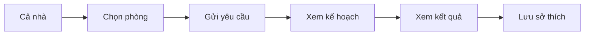
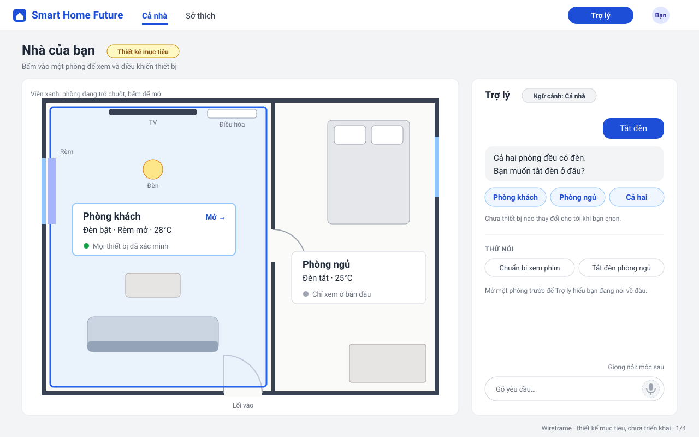
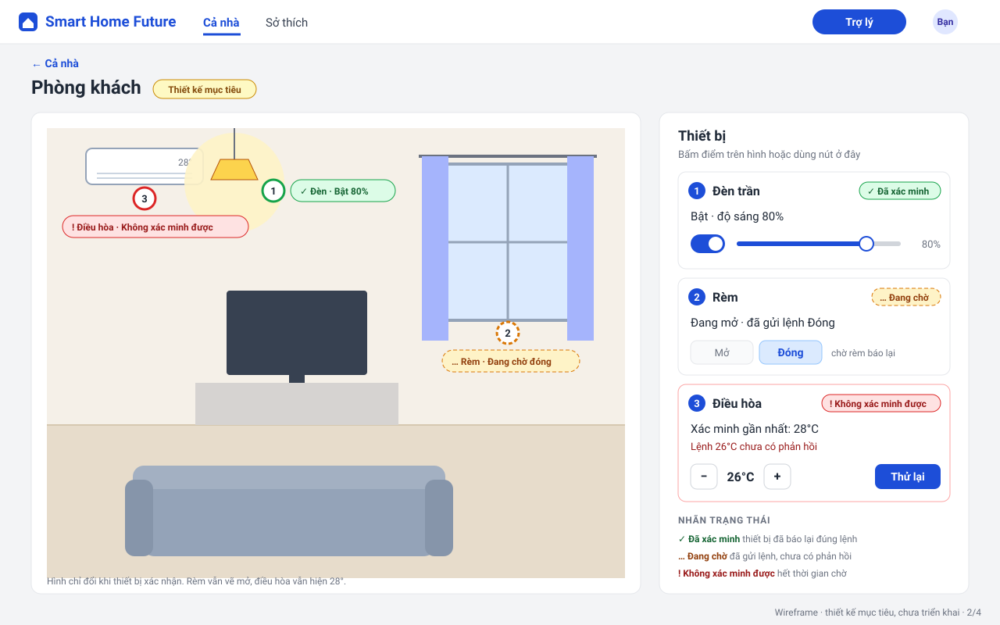
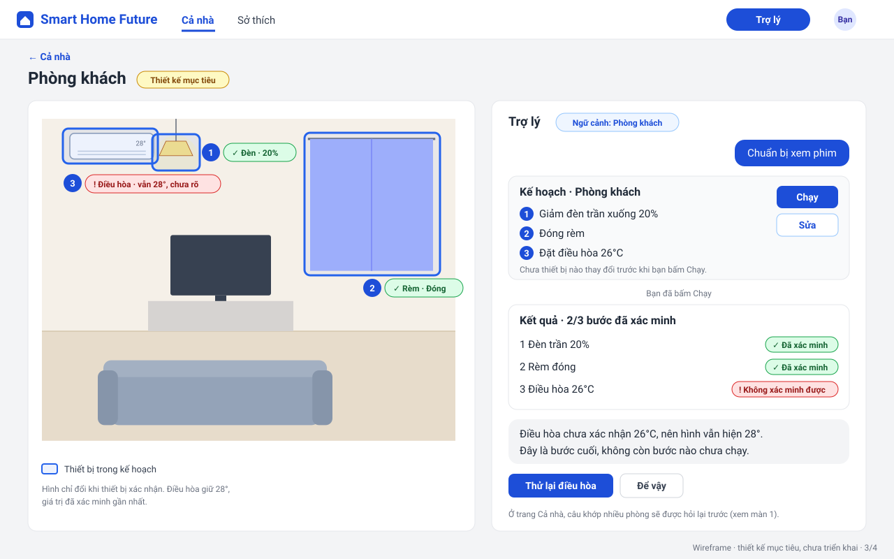
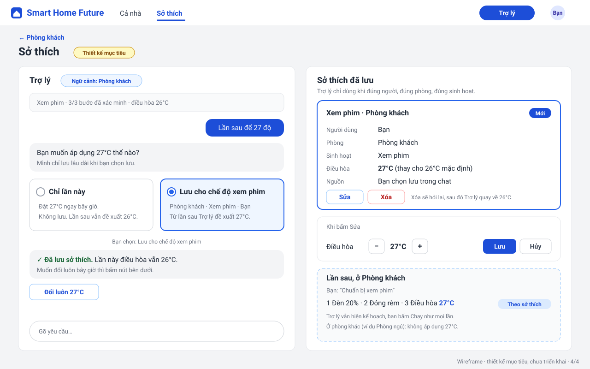

# Smart Home Future: tổng quan sản phẩm

**Smart Home Future** là quản gia số cho ngôi nhà. Người dùng nói hoặc gõ yêu cầu, xem Trợ lý định làm gì với từng thiết bị,
rồi lưu sở thích cho những sinh hoạt lặp lại. Về sau, Trợ lý có thể chủ động gợi ý dựa trên các sở thích đã lưu.

> **Cập nhật 23/11/2026:** hướng sản phẩm đã mở rộng (Digital Twin 3D, nhiều vai trò, thiết bị thật qua Home Assistant ở P0). Phạm vi hiện hành ở [Tầm nhìn](PRODUCT_VISION.md) §5 và [PRD](PRD.md); trang này giữ ví dụ xuyên suốt và wireframe.

**Trạng thái (23/11/2026):** mới qua lượt thiết kế sản phẩm đầu tiên, chưa triển khai tính năng. Mọi hình dưới đây là
**thiết kế mục tiêu**. Repo GitHub đích: `smart-home-future`, hiện **chưa đổi tên** (xem [Repo và nguồn gốc nội dung](product/repo-migration.md)).

## Vấn đề

Muốn chuẩn bị nhà cho một sinh hoạt quen thuộc như xem phim, người dùng phải chỉnh từng thiết bị: đèn, rèm, điều hòa. Lần
nào cũng phải làm lại và nói lại sở thích của mình.

## Người dùng đầu tiên

Một người có vài thiết bị thông minh và muốn chuẩn bị một phòng cho các sinh hoạt lặp lại, ví dụ xem phim ở phòng khách.

## Giá trị cần chứng minh

Sau khi lưu một sở thích, **lần sau người dùng nói ít hơn**, mà vẫn thấy rõ hệ thống **định làm gì**, **đã làm gì** và
**bước nào chưa xác minh**.

## Ví dụ xuyên suốt

> **Bạn** (đang mở Phòng khách): Chuẩn bị phòng khách để xem phim.
>
> **Trợ lý:** Kế hoạch: giảm đèn xuống 20%, đóng rèm, đặt điều hòa 26°C. → bạn bấm **Chạy** → đèn và rèm đã xác minh,
> điều hòa chưa phản hồi nên hình vẫn hiện 28°C.
>
> **Bạn:** Lần sau để 27 độ.
>
> **Trợ lý:** Bạn muốn **Chỉ lần này** hay **Lưu cho chế độ xem phim**? → bạn chọn lưu → lần sau, ở Phòng khách, kế hoạch
> xem phim đề xuất 27°C, gắn nhãn "Theo sở thích".

Trợ lý chỉ ghi sở thích dài hạn khi người dùng đồng ý.

## Tuyến sử dụng chính

| 1 · Cả căn nhà | 2 · Phòng khách |
|---|---|
|  |  |
| [Mở SVG](assets/ui/01-ca-nha.svg) | [Mở SVG](assets/ui/02-phong-khach.svg) |
| **3 · Trợ lý theo phòng** | **4 · Sở thích** |
|  |  |
| [Mở SVG](assets/ui/03-tro-ly-theo-phong.svg) | [Mở SVG](assets/ui/04-so-thich.svg) |

Giải thích từng màn ở [Giao diện web desktop](product/ui-desktop.md).

## Phạm vi theo mốc

| Mốc | Gồm | Chưa gồm |
|---|---|---|
| **1. Bản web đầu tiên** | Sơ đồ nhà hai phòng; ba thiết bị tương tác ở phòng khách (đèn, rèm, điều hòa); chat chữ; kế hoạch theo từng bước; phản hồi thiết bị mô phỏng; một sở thích xem, sửa, xóa được | Giọng nói, gợi ý chủ động, thiết bị thật |
| **2. Giọng nói** | Giọng nói đi vào cùng luồng với chat; hiện câu đã nhận dạng để người dùng kiểm tra khi cần | Gợi ý chủ động |
| **3. Mở rộng** | Gợi ý theo ngữ cảnh, ví dụ bật TV thì đề xuất chế độ xem phim đã lưu; bỏ qua hoặc tắt từng loại gợi ý; quyền tự chạy cấu hình riêng | |

**Thiết bị:** bản web đầu tiên dùng thiết bị và dữ liệu mô phỏng do dự án tự tạo. Hướng tích hợp thiết bị thật là
**Home Assistant**, đi sau bản web đầu tiên.

Chi tiết phạm vi, hành vi và ca nghiệm thu: [Phạm vi và hành vi](product/scope.md).

## Quyết định cần chủ dự án xác nhận

| Quyết định | Đề xuất hiện tại |
|---|---|
| Tách repo `smart-home-future` với baseline sạch | Có; xem [Repo và nguồn gốc](product/repo-migration.md) |
| Lệnh một thiết bị qua chat có chạy ngay không | Không; mọi kế hoạch của Trợ lý cần một chạm **Chạy** |
| Một bước không xác minh được thì có chạy tiếp các bước sau không | Dừng; các bước sau hiện "Chưa chạy" |
| "Lưu cho chế độ xem phim" có đổi luôn nhiệt độ lần này không | Không; có nút "Đổi luôn" riêng |
| Thời gian chờ xác minh của thiết bị mô phỏng | 5 giây |

## Đọc tiếp

| Tài liệu | Trả lời câu hỏi |
|---|---|
| [Phạm vi và hành vi](product/scope.md) | Mỗi mốc gồm gì, Trợ lý hiểu câu nói thế nào, ca nghiệm thu |
| [Giao diện web desktop](product/ui-desktop.md) | Bốn màn hình, nhãn trạng thái, điều người dùng thấy và bấm |
| [Repo và nguồn gốc nội dung](product/repo-migration.md) | Vì sao chưa đổi tên repo, phần nào giữ lại, tên kỹ thuật cần đổi |
